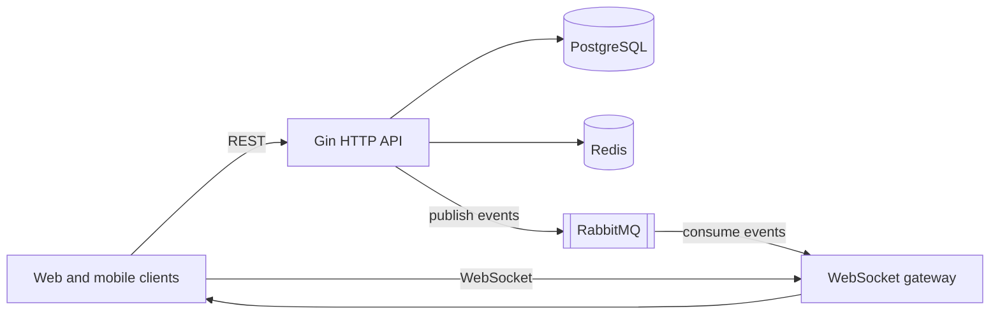

# Crypto Exchange

A backend for a cryptocurrency exchange, written in Go. It provides OTP-based sign-in, JWT sessions, administrative currency management with a Redis cache, RabbitMQ events, and a WebSocket gateway. A domain model and database schema for assets, markets, orders, trades, balances, accounts, KYC/AML, and custody are also included and will back the roadmap features.

> [!WARNING]
> **Pre-alpha: not production-ready.** Known defects that affect core flows are tracked in the [M0 stabilization epic](https://github.com/mdastpak/Crypto-Exchange/issues/83). Do not deploy this code with real funds or real personal data.

## Contents

- [Project status](#project-status)
- [Architecture](#architecture)
- [Technology stack](#technology-stack)
- [Getting started](#getting-started)
- [Configuration](#configuration)
- [API overview](#api-overview)
- [Testing](#testing)
- [Project layout](#project-layout)
- [Roadmap](#roadmap)
- [Contributing](#contributing)
- [Security](#security)
- [License](#license)

## Project status

| Capability | Status | Notes |
| --- | --- | --- |
| OTP sign-in (email, mobile, username) | Implemented, with known defects | Codes are not delivered yet ([#14](https://github.com/mdastpak/Crypto-Exchange/issues/14)), and verification needs hardening ([#15](https://github.com/mdastpak/Crypto-Exchange/issues/15)). |
| JWT access and refresh tokens, logout blacklist | Implemented, hardening pending | See [#10](https://github.com/mdastpak/Crypto-Exchange/issues/10) and [#17](https://github.com/mdastpak/Crypto-Exchange/issues/17). |
| Admin currency management (CRUD, Redis cache, RabbitMQ events) | Implemented | There is no admin sign-in flow yet ([#18](https://github.com/mdastpak/Crypto-Exchange/issues/18)). |
| Public currency listing | Implemented | Served from the Redis cache. |
| WebSocket gateway | Partial | Ping and pong only. Event broadcast is not wired yet ([#19](https://github.com/mdastpak/Crypto-Exchange/issues/19)). |
| Rate limiting (Redis) | Implemented, with known defects | See [#11](https://github.com/mdastpak/Crypto-Exchange/issues/11), [#26](https://github.com/mdastpak/Crypto-Exchange/issues/26), and [#34](https://github.com/mdastpak/Crypto-Exchange/issues/34). |
| Health check | Implemented | Always returns HTTP 200 ([#33](https://github.com/mdastpak/Crypto-Exchange/issues/33)). |
| Exchange domain model and schema | Models and migrations only | No services use them yet. |
| Price engine, OTC trading, ledger, custody, KYC/AML services | Planned | [Phase 1 epic](https://github.com/mdastpak/Crypto-Exchange/issues/85) |
| Spot trading, derivatives | Planned | [Phase 2](https://github.com/mdastpak/Crypto-Exchange/issues/86) and [Phase 3](https://github.com/mdastpak/Crypto-Exchange/issues/87) epics |

## Architecture

The service is a modular monolith with a single HTTP and WebSocket entry point.



- **PostgreSQL** stores currencies, users, and the exchange schema. Migrations run automatically at startup.
- **Redis** holds the currency cache, OTP sessions and attempt counters, the JWT blacklist, and the rate-limit buckets.
- **RabbitMQ** carries domain events. Currency changes are published to a fan-out exchange and are intended to be broadcast to WebSocket clients.

See [docs/architecture.md](docs/architecture.md) for package responsibilities, data stores, and the target architecture.

## Technology stack

| Area | Technology |
| --- | --- |
| Language | Go 1.26 |
| HTTP | [Gin](https://github.com/gin-gonic/gin), [gorilla/websocket](https://github.com/gorilla/websocket) |
| Database | PostgreSQL 16 (TimescaleDB image), [pgx v5](https://github.com/jackc/pgx) through `database/sql`, [golang-migrate](https://github.com/golang-migrate/migrate) |
| Cache | Redis 7 ([go-redis v8](https://github.com/redis/go-redis)) |
| Messaging | RabbitMQ 3.13 ([streadway/amqp](https://github.com/streadway/amqp)) |
| Authentication | RS256 JWT ([golang-jwt v5](https://github.com/golang-jwt/jwt)) |
| Money | [shopspring/decimal](https://github.com/shopspring/decimal) |
| API documentation | [swaggo](https://github.com/swaggo/swag) |

## Getting started

### Prerequisites

- Go 1.26 or later
- Docker with Docker Compose, for PostgreSQL, Redis, and RabbitMQ
- OpenSSL, to generate the JWT signing keys

### 1. Clone the repository

```bash
git clone https://github.com/mdastpak/Crypto-Exchange.git
cd Crypto-Exchange
```

### 2. Start the dependencies

```bash
docker compose up -d postgres redis rabbitmq
```

The `app` service in `docker-compose.yml` cannot be built yet ([#28](https://github.com/mdastpak/Crypto-Exchange/issues/28)), so run the server directly with Go.

### 3. Generate JWT signing keys

```bash
mkdir -p internal/ssl/user
openssl genpkey -algorithm RSA -out internal/ssl/user/private_key.pem -pkeyopt rsa_keygen_bits:2048
openssl rsa -pubout -in internal/ssl/user/private_key.pem -out internal/ssl/user/public_key.pem
```

PEM files under `internal/ssl/` are ignored by Git. Never commit key material.

### 4. Create a local configuration

```bash
cp config/config.example.yaml config/config.local.yaml
```

Edit `config/config.local.yaml` and set at least the JWT key paths. They are lists of path segments:

```yaml
jwt:
  ssl:
    user:
      private_key: ["internal", "ssl", "user", "private_key.pem"]
      public_key: ["internal", "ssl", "user", "public_key.pem"]
```

The example file contains `${...}` placeholders. These are **not** expanded inside YAML ([#29](https://github.com/mdastpak/Crypto-Exchange/issues/29)). Supply the credentials through environment variables instead. The following values match the Docker Compose defaults:

```bash
export POSTGRES_PASSWORD=postgres
export REDIS_PASSWORD=redis
export RABBITMQ_USER=guest
export RABBITMQ_PASSWORD=guest
```

### 5. Run the server

Run the server from the repository root, because the default migrations path is relative:

```bash
go run ./cmd/server -config config/config.local.yaml
```

| Flag | Default | Description |
| --- | --- | --- |
| `-config` | `config/config.yaml` | Path to the YAML configuration file |
| `-migrations` | `file://internal/db/migrations` | Migration source URL |

Set `GIN_MODE=release` to run Gin in release mode.

Once the server is running:

- API: `http://localhost:8080/`
- Swagger UI: `http://localhost:8080/swagger/index.html`
- Health check: `http://localhost:8080/system/healthcheck`

OTP codes are currently written to the server log instead of being delivered ([#13](https://github.com/mdastpak/Crypto-Exchange/issues/13), [#14](https://github.com/mdastpak/Crypto-Exchange/issues/14)).

## Configuration

Configuration is loaded from a YAML file, missing values are filled with defaults, and selected environment variables override the result. [docs/configuration.md](docs/configuration.md) describes every section, the defaults, and the supported environment variables.

## API overview

All JSON responses, except the system endpoints, use this envelope:

```json
{ "status": 200, "message": "Human-readable message", "info": {} }
```

| Method | Path | Authentication | Description |
| --- | --- | --- | --- |
| `GET` | `/system/healthcheck` | None | Dependency health |
| `GET` | `/system/ping` | None | Liveness ping |
| `GET` | `/public/currencies` | None | List cached currencies |
| `GET` | `/public/currencies/{hk}` | None | Get a currency by its UUID |
| `POST` | `/public/auth` | None | Request an OTP |
| `POST` | `/public/auth/{uuid}` | None | Verify an OTP and receive tokens |
| `POST` | `/public/auth/refresh` | Refresh token cookie | Issue a new access token |
| `POST` | `/public/auth/logout` | Access token | Revoke the access token |
| `POST` | `/admin/currencies` | Admin token | Create a currency |
| `PUT` | `/admin/currencies/{hk}` | Admin token | Update a currency |
| `DELETE` | `/admin/currencies/{hk}` | Admin token | Soft-delete a currency |
| `GET` | `/user/profile` | User token | Currently returns the currency list ([#27](https://github.com/mdastpak/Crypto-Exchange/issues/27)) |
| `POST` | `/user/update` | User token | Not implemented (returns 501) |
| `POST` | `/user/logout` | User token | Revoke the access token |
| `GET` | `/ws/` | None | WebSocket gateway |

Request and response details, the authentication flow, and the WebSocket protocol are described in [docs/api.md](docs/api.md).

## Testing

Run the unit tests, which need no infrastructure:

```bash
go test ./internal/domain/... ./internal/auth/... ./internal/middleware/... ./internal/helpers/... ./pkg/... ./config/...
```

Integration tests need a PostgreSQL instance and a Redis instance on the default ports:

```bash
docker run -d --name ce-test-postgres -e POSTGRES_PASSWORD=test -e POSTGRES_DB=testdb -p 5432:5432 postgres:16-alpine
docker run -d --name ce-test-redis -p 6379:6379 redis:7-alpine
go test -p 1 ./...
```

> [!CAUTION]
> The integration tests drop and recreate tables in `testdb` and `testdb_migrations`, and they flush Redis database 1. Never point them at an instance that holds real data. Stop the Docker Compose PostgreSQL service first, or change its port, because both use port 5432.

`-p 1` is currently required because packages share the same test databases. Hermetic, parallel-safe tests are tracked in [#37](https://github.com/mdastpak/Crypto-Exchange/issues/37).

The expected behavior of every tested flow is specified in the [test-scenario catalog](docs/testing/test-scenarios.md).

## Project layout

```text
cmd/server/            Application entry point, routing, and lifecycle
config/                Configuration loader, example and default YAML files
configs/               Asset registry and AML rule definitions (not loaded yet)
docs/                  Generated Swagger files and project documentation
internal/auth/         JWT issuing and verification, key rotation, blacklist, middleware
internal/db/           PostgreSQL and Redis clients, SQL migrations
internal/domain/       Exchange domain model: asset, market, order, trade, balance,
                       account, kyc, custody, shared types
internal/handlers/     HTTP and WebSocket handlers (admin, public, socket, system, user)
internal/helpers/      Response helpers
internal/middleware/   Security headers, CORS, rate limiting, validation, recovery
internal/models/       API models for currencies and users
internal/rabbitmq/     RabbitMQ connection, publishing with confirms, reconnect
pkg/utils/             Shared utilities
```

## Roadmap

Work is organized into milestones. Each milestone has a tracking epic with ordered sub-issues.

| Milestone | Focus | Epic |
| --- | --- | --- |
| [M0 - Stabilize current state](https://github.com/mdastpak/Crypto-Exchange/milestone/1) | Fix defects and security issues in existing features | [#83](https://github.com/mdastpak/Crypto-Exchange/issues/83) |
| [M1 - Foundation and hardening](https://github.com/mdastpak/Crypto-Exchange/milestone/2) | CI, hermetic tests, user model, configuration, observability | [#84](https://github.com/mdastpak/Crypto-Exchange/issues/84) |
| [M2 - Phase 1: OTC MVP](https://github.com/mdastpak/Crypto-Exchange/milestone/3) | Price engine, OTC quotes and execution, ledger, custody, KYC/AML | [#85](https://github.com/mdastpak/Crypto-Exchange/issues/85) |
| [M3 - Phase 2: Spot trading](https://github.com/mdastpak/Crypto-Exchange/milestone/4) | Order gateway, matching engine, order book data, margin | [#86](https://github.com/mdastpak/Crypto-Exchange/issues/86) |
| [M4 - Phase 3: Derivatives](https://github.com/mdastpak/Crypto-Exchange/milestone/5) | Perpetual futures and options | [#87](https://github.com/mdastpak/Crypto-Exchange/issues/87) |

Issues are labeled by `type:`, `priority:` (P0 to P3), and `feature:`. [CONTRIBUTING.md](CONTRIBUTING.md#labels-and-milestones) explains the labels.

## Contributing

Contributions are welcome. Read [CONTRIBUTING.md](CONTRIBUTING.md) and the [Code of Conduct](CODE_OF_CONDUCT.md) before opening a pull request. All code, comments, commit messages, issues, and documentation must be written in English.

## Security

Do not report vulnerabilities in public issues. Follow [SECURITY.md](SECURITY.md) to report them privately.

## License

This project is licensed under the [MIT License](LICENSE).
