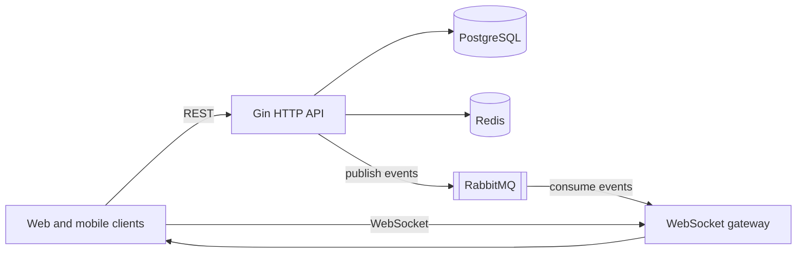

# Crypto Exchange

A backend for a cryptocurrency exchange, written in Go. It provides OTP-based sign-in, JWT sessions, administrative currency management with a Redis cache, RabbitMQ events, and a WebSocket gateway. A domain model and database schema for assets, markets, orders, trades, balances, accounts, KYC/AML, and custody are also included and will back the roadmap features.

> [!WARNING]
> **Pre-alpha: not production-ready.** Known defects that affect core flows are tracked in the [M0 stabilization epic](https://github.com/mdastpak/Crypto-Exchange/issues/83). Do not deploy this code with real funds or real personal data.

## Contents

- [Project status](#project-status)
- [Architecture](#architecture)
- [Technology stack](#technology-stack)
- [Getting started](#getting-started)
- [Configuration](#configuration)
- [API overview](#api-overview)
- [Testing](#testing)
- [Project layout](#project-layout)
- [Roadmap](#roadmap)
- [Contributing](#contributing)
- [Security](#security)
- [License](#license)

## Project status

| Capability | Status | Notes |
| --- | --- | --- |
| OTP sign-in (email, mobile) | Implemented | Codes are delivered by email (SMTP) and SMS (Kavenegar) through a RabbitMQ queue with retries. Codes are stored hashed, and attempts are limited per code and per contact. |
| JWT access and refresh tokens, sessions, logout | Implemented | Typed tokens with issuer, audience, and `kid` checks, separate signing keys for users and admins, key rotation, `Bearer` authentication, refresh token rotation with reuse detection, and session revocation on logout. Admins cannot sign in yet ([#18](https://github.com/mdastpak/Crypto-Exchange/issues/18)). |
| Admin currency management (CRUD, Redis cache, RabbitMQ events) | Implemented | Administrators are created with the `cmd/admin` command and sign in with an emailed code and an authenticator app (TOTP). |
| Public currency listing | Implemented | Served from the Redis cache. |
| WebSocket gateway | Partial | Ping and pong, and currency events broadcast to every client. The channel protocol is tracked in [#66](https://github.com/mdastpak/Crypto-Exchange/issues/66). |
| Rate limiting (Redis) | Implemented | Token buckets per client IP or per signed-in user, fixed windows for sign-in, and a configurable policy for Redis failures. |
| Health check | Implemented | Always returns HTTP 200 ([#33](https://github.com/mdastpak/Crypto-Exchange/issues/33)). |
| Exchange domain model and schema | Models and migrations only | No services use them yet. |
| Price engine, OTC trading, ledger, custody, KYC/AML services | Planned | [Phase 1 epic](https://github.com/mdastpak/Crypto-Exchange/issues/85) |
| Spot trading, derivatives | Planned | [Phase 2](https://github.com/mdastpak/Crypto-Exchange/issues/86) and [Phase 3](https://github.com/mdastpak/Crypto-Exchange/issues/87) epics |

## Architecture

The service is a modular monolith with a single HTTP and WebSocket entry point.



- **PostgreSQL** stores currencies, users, and the exchange schema. Migrations run automatically at startup.
- **Redis** holds the currency cache, OTP sessions and attempt counters, the JWT blacklist, and the rate-limit buckets.
- **RabbitMQ** carries domain events. Currency changes are published to a fan-out exchange and are intended to be broadcast to WebSocket clients.

See [docs/architecture.md](docs/architecture.md) for package responsibilities, data stores, and the target architecture.

## Technology stack

| Area | Technology |
| --- | --- |
| Language | Go 1.26 |
| HTTP | [Gin](https://github.com/gin-gonic/gin), [gorilla/websocket](https://github.com/gorilla/websocket) |
| Database | PostgreSQL 16 (TimescaleDB image), [pgx v5](https://github.com/jackc/pgx) through `database/sql`, [golang-migrate](https://github.com/golang-migrate/migrate) |
| Cache | Redis 7 ([go-redis v8](https://github.com/redis/go-redis)) |
| Messaging | RabbitMQ 3.13 ([streadway/amqp](https://github.com/streadway/amqp)) |
| Authentication | RS256 JWT ([golang-jwt v5](https://github.com/golang-jwt/jwt)) |
| Money | [shopspring/decimal](https://github.com/shopspring/decimal) |
| API documentation | [swaggo](https://github.com/swaggo/swag) |

## Getting started

### Prerequisites

- Go 1.26 or later
- Docker with Docker Compose, for PostgreSQL, Redis, and RabbitMQ
- OpenSSL, to generate the JWT signing keys

### 1. Clone the repository

```bash
git clone https://github.com/mdastpak/Crypto-Exchange.git
cd Crypto-Exchange
```

### 2. Start the dependencies

```bash
docker compose up -d postgres redis rabbitmq
```

This starts only the dependencies, for running the server with Go in the next steps. To run the server in Docker as well, see [Run everything with Docker Compose](#run-everything-with-docker-compose).

### 3. Generate JWT signing keys

```bash
mkdir -p internal/ssl/user
openssl genpkey -algorithm RSA -out internal/ssl/user/private_key.pem -pkeyopt rsa_keygen_bits:2048
openssl rsa -pubout -in internal/ssl/user/private_key.pem -out internal/ssl/user/public_key.pem
```

PEM files under `internal/ssl/` are ignored by Git. Never commit key material.

### 4. Create a local configuration

```bash
cp config/config.example.yaml config/config.local.yaml
```

The example works as it is for a local setup: it reads the user keys from step 3. Keep credentials out of the file and supply them through environment variables instead. The following values match the Docker Compose defaults:

```bash
export POSTGRES_PASSWORD=postgres
export REDIS_PASSWORD=redis
export RABBITMQ_USER=guest
export RABBITMQ_PASSWORD=guest
```

### 5. Run the server

Run the server from the repository root, because the default migrations path is relative:

```bash
go run ./cmd/server -config config/config.local.yaml
```

| Flag | Default | Description |
| --- | --- | --- |
| `-config` | `config/config.yaml` | Path to the YAML configuration file |
| `-migrations` | `file://internal/db/migrations` | Migration source URL |

Without `-config`, the server reads `config/config.yaml`, or an embedded copy of the example when that file does not exist. Most settings can also be set with an environment variable, such as `SERVER_PORT` or `SERVER_MODE=release`; [docs/configuration.md](docs/configuration.md#environment-variables) lists them all. When a required setting is missing, the server stops and names it, together with its variable.

Once the server is running:

- API: `http://localhost:8080/`
- Swagger UI: `http://localhost:8080/swagger/index.html`, outside release mode or when `server.swagger.enabled` is `true`
- Readiness: `http://localhost:8080/system/ready`, which answers `503` while a dependency is unavailable

Sign-in codes are delivered by email and SMS once `notifications` is configured (see [docs/configuration.md](docs/configuration.md#notifications)). To try sign-in locally without a provider, set `otp.auth.dev_log_codes: true` in `config/config.local.yaml`; the codes then appear in the server log. Never enable it outside development: the server refuses to start with it in release mode.

### 6. Create an administrator (optional)

Admin sign-in needs its own signing key pair, a key that encrypts authenticator secrets, and email delivery (or `dev_log_codes` locally):

```bash
mkdir -p internal/ssl/admin
openssl genpkey -algorithm RSA -out internal/ssl/admin/private_key.pem -pkeyopt rsa_keygen_bits:2048
openssl rsa -pubout -in internal/ssl/admin/private_key.pem -out internal/ssl/admin/public_key.pem
export ADMIN_TOTP_KEY="$(openssl rand -base64 32)"
```

Add the admin key paths under `jwt.ssl.admin` in `config/config.local.yaml`, as for the user keys. Then create the administrator. The command prints an `otpauth://` URI and a key for the authenticator app, once:

```bash
go run ./cmd/admin -config config/config.local.yaml create -email admin@example.com
```

The server and the command must use the same `ADMIN_TOTP_KEY`. `reset-totp` replaces a lost authenticator, and `disable` stops an administrator from signing in. [docs/api.md](docs/api.md#admin-sign-in) describes the sign-in.

### Run everything with Docker Compose

The `app` service builds the server image and runs it with [`config/config.compose.yaml`](config/config.compose.yaml), which holds no secrets. Passwords come from environment variables, and the user keys from step 3 are mounted as Compose secrets. To change settings, copy [`.env.example`](.env.example) to `.env`: Compose uses it for the dependencies and passes all of it to the server.

```bash
cp .env.example .env
docker compose up -d --build
curl http://localhost:8080/system/ready
```

- Sign-in codes appear in the log of the `app` service (`docker compose logs app`), because the Compose configuration enables `dev_log_codes`.
- On Linux, run the server as your own user so that it can read the key files without widening their permissions: `APP_UID=$(id -u) APP_GID=$(id -g) docker compose up -d --build`.
- `JWT_USER_PRIVATE_KEY_FILE` and `JWT_USER_PUBLIC_KEY_FILE` select other key files.
- To create an administrator in the stack, set `ADMIN_TOTP_KEY` and run the `admin` command from the image: `docker compose run --rm --no-deps --entrypoint /app/admin app -config config/config.compose.yaml create -email admin@example.com`. Admin sign-in additionally needs the admin keys, which this file does not mount.

The image contains only the `server` and `admin` binaries and the migrations, and runs as an unprivileged user. Configuration and keys are mounted at runtime and never built into it. Hardening for staging and production is tracked in [#103](https://github.com/mdastpak/Crypto-Exchange/issues/103).

## Configuration

Configuration is loaded from a YAML file, missing values are filled with defaults, and selected environment variables override the result. [docs/configuration.md](docs/configuration.md) describes every section, the defaults, and the supported environment variables.

## API overview

All JSON responses, except the system endpoints, use this envelope:

```json
{ "status": 200, "message": "Human-readable message", "info": {} }
```

| Method | Path | Authentication | Description |
| --- | --- | --- | --- |
| `GET` | `/system/live` | None | Liveness: the process serves requests |
| `GET` | `/system/ready` | None | Readiness: `503` while PostgreSQL, Redis, or RabbitMQ is unavailable |
| `GET` | `/system/healthcheck` | None | Earlier name of `/system/ready` |
| `GET` | `/system/ping` | None | Ping |
| `GET` | `/public/currencies` | None | List cached currencies |
| `GET` | `/public/currencies/{hk}` | None | Get a currency by its UUID |
| `POST` | `/public/auth` | None | Request an OTP |
| `POST` | `/public/auth/{uuid}` | None | Verify an OTP and receive tokens |
| `POST` | `/public/auth/refresh` | Refresh token cookie | Issue a new access token |
| `POST` | `/public/auth/logout` | Access token | Revoke the access token |
| `POST` | `/admin/auth` | None | Request an admin sign-in code |
| `POST` | `/admin/auth/{uuid}` | None | Verify the emailed code and the authenticator code, and receive an admin token |
| `POST` | `/admin/logout` | Admin token | Revoke the admin token |
| `POST` | `/admin/currencies` | Admin token | Create a currency |
| `PUT` | `/admin/currencies/{hk}` | Admin token | Update a currency |
| `DELETE` | `/admin/currencies/{hk}` | Admin token | Soft-delete a currency |
| `GET` | `/user/profile` | User token | Get the signed-in user's profile |
| `PATCH` | `/user/profile` | User token | Change the names in the signed-in user's profile |
| `POST` | `/user/logout` | User token | Revoke the access token |
| `GET` | `/ws/` | None | WebSocket gateway |

Request and response details, the authentication flow, and the WebSocket protocol are described in [docs/api.md](docs/api.md).

## Testing

Run the unit tests, which need no infrastructure:

```bash
go test ./internal/domain/... ./internal/auth/... ./internal/middleware/... ./internal/helpers/... ./pkg/... ./config/...
```

Integration tests need a PostgreSQL instance and a Redis instance on the default ports:

```bash
docker run -d --name ce-test-postgres -e POSTGRES_PASSWORD=test -e POSTGRES_DB=testdb -p 5432:5432 postgres:16-alpine
docker run -d --name ce-test-redis -p 6379:6379 redis:7-alpine
docker run -d --name ce-test-rabbitmq -p 5672:5672 rabbitmq:3.13
go test -p 1 ./...
```

> [!CAUTION]
> The integration tests create databases whose names start with `testdb_`, empty them and build their schemas with the migrations, and they flush Redis databases 1 to 5. Never point them at an instance that holds real data. The shared test helper (`internal/testutil/pgtest`) refuses to empty any other database. Stop the Docker Compose PostgreSQL and Redis services first (`docker compose stop postgres redis`): the test containers use the same ports (5432 and 6379), and the tests expect Redis without a password.

`-p 1` is currently required because packages share the same test databases. Hermetic, parallel-safe tests are tracked in [#37](https://github.com/mdastpak/Crypto-Exchange/issues/37).

The RabbitMQ tests (`internal/rabbitmq`) are skipped when no broker is reachable on port 5672. On some Docker Desktop and WSL 2 setups, RabbitMQ fails at startup with `Error when reading /var/lib/rabbitmq/.erlang.cookie: eacces`. Passing the Erlang cookie on the command line avoids reading that file:

```bash
docker run -d --name ce-test-rabbitmq -p 5672:5672 \
  -e RABBITMQ_SERVER_ADDITIONAL_ERL_ARGS="-setcookie local-test-cookie" \
  -e RABBITMQ_CTL_ERL_ARGS="-setcookie local-test-cookie" \
  rabbitmq:3.13
```

The expected behavior of every tested flow is specified in the [test-scenario catalog](docs/testing/test-scenarios.md).

## Project layout

```text
cmd/admin/             Command for managing administrators
cmd/server/            Application entry point, routing, and lifecycle
config/                Configuration loader, example and default YAML files
configs/               Asset registry and AML rule definitions (not loaded yet)
docs/                  Generated Swagger files and project documentation
internal/adminauth/    Administrator accounts and authenticator (TOTP) enrollment
internal/auth/         JWT issuing and verification, key rotation, blacklist, middleware
internal/db/           PostgreSQL and Redis clients, SQL migrations
internal/domain/       Exchange domain model: asset, market, order, trade, balance,
                       account, kyc, custody, shared types
internal/handlers/     HTTP and WebSocket handlers (admin, public, socket, system, user)
internal/helpers/      Response helpers
internal/middleware/   Security headers, CORS, rate limiting, validation, recovery
internal/models/       API models for currencies and users
internal/notify/       Delivery of sign-in codes by email and SMS through RabbitMQ
internal/otp/          Sign-in codes: generation, hashed storage in Redis, attempt limits
internal/rabbitmq/     RabbitMQ connection, publishing with confirms, reconnect
internal/totp/         Time-based one-time passwords (RFC 6238)
pkg/utils/             Shared utilities
```

## Roadmap

Work is organized into milestones. Each milestone has a tracking epic with ordered sub-issues.

| Milestone | Focus | Epic |
| --- | --- | --- |
| [M0 - Stabilize current state](https://github.com/mdastpak/Crypto-Exchange/milestone/1) | Fix defects and security issues in existing features | [#83](https://github.com/mdastpak/Crypto-Exchange/issues/83) |
| [M1 - Foundation and hardening](https://github.com/mdastpak/Crypto-Exchange/milestone/2) | CI, hermetic tests, user model, configuration, observability | [#84](https://github.com/mdastpak/Crypto-Exchange/issues/84) |
| [M2 - Phase 1: OTC MVP](https://github.com/mdastpak/Crypto-Exchange/milestone/3) | Price engine, OTC quotes and execution, ledger, custody, KYC/AML | [#85](https://github.com/mdastpak/Crypto-Exchange/issues/85) |
| [M3 - Phase 2: Spot trading](https://github.com/mdastpak/Crypto-Exchange/milestone/4) | Order gateway, matching engine, order book data, margin | [#86](https://github.com/mdastpak/Crypto-Exchange/issues/86) |
| [M4 - Phase 3: Derivatives](https://github.com/mdastpak/Crypto-Exchange/milestone/5) | Perpetual futures and options | [#87](https://github.com/mdastpak/Crypto-Exchange/issues/87) |

Issues are labeled by `type:`, `priority:` (P0 to P3), and `feature:`. [CONTRIBUTING.md](CONTRIBUTING.md#labels-and-milestones) explains the labels.

## Contributing

Contributions are welcome. Read [CONTRIBUTING.md](CONTRIBUTING.md) and the [Code of Conduct](CODE_OF_CONDUCT.md) before opening a pull request. All code, comments, commit messages, issues, and documentation must be written in English.

## Security

Do not report vulnerabilities in public issues. Follow [SECURITY.md](SECURITY.md) to report them privately.

## License

This project is licensed under the [MIT License](LICENSE).
