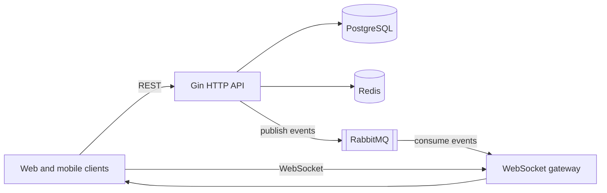

# Crypto Exchange

A backend for a cryptocurrency exchange, written in Go. It provides OTP-based sign-in, JWT sessions, administrative currency management with a Redis cache, RabbitMQ events, and a WebSocket gateway, and keeps balances in a double-entry ledger. A domain model and database schema for markets, orders, trades, accounts, KYC/AML, and custody are also included and will back the roadmap features.

> [!WARNING]
> **Pre-alpha: not production-ready.** The hardening work is tracked in the [M1 foundation and hardening epic](https://github.com/mdastpak/Crypto-Exchange/issues/84) and in the [open security issues](https://github.com/mdastpak/Crypto-Exchange/issues?q=is%3Aopen+label%3A%22type%3A+security%22). Do not deploy this code with real funds or real personal data.

## Contents

- [Project status](#project-status)
- [Architecture](#architecture)
- [Technology stack](#technology-stack)
- [Getting started](#getting-started)
- [Configuration](#configuration)
- [API overview](#api-overview)
- [Testing](#testing)
- [Project layout](#project-layout)
- [Roadmap](#roadmap)
- [Contributing](#contributing)
- [Security](#security)
- [License](#license)

## Project status

| Capability | Status | Notes |
| --- | --- | --- |
| OTP sign-in (email, mobile) | Implemented | Codes are delivered by email (SMTP) and SMS (Kavenegar and sms.ir, with failover and delivery reports) through a RabbitMQ queue with retries. Codes are stored hashed, and attempts are limited per code and per contact. |
| JWT access and refresh tokens, sessions, logout | Implemented | Typed tokens with issuer, audience, and `kid` checks, separate signing keys for users and admins, key rotation, `Bearer` authentication, refresh token rotation with reuse detection and a short grace period for concurrent refreshes, and session revocation on logout. Every user request checks that its session is active and its user can still sign in ([#120](https://github.com/mdastpak/Crypto-Exchange/issues/120)). Users list their sessions and end any of them ([#193](https://github.com/mdastpak/Crypto-Exchange/issues/193)). |
| User contacts | Implemented | A user holds one verified email address and one mobile number and signs in with either. Adding, replacing, or removing one needs a code to a verified contact of the account and to the new contact ([#199](https://github.com/mdastpak/Crypto-Exchange/issues/199)). |
| Admin currency management | Implemented | Create, list with filters and pages, read, update with optimistic versions, delete, and restore. Administrators are created with the `cmd/admin` command and sign in with an emailed code and an authenticator app (TOTP). |
| Public currency listing | Implemented | Served from the Redis cache, and from PostgreSQL while the cache is empty or unavailable ([#52](https://github.com/mdastpak/Crypto-Exchange/issues/52)). |
| Asset and market registry | Implemented | One registry of currencies ([#309](https://github.com/mdastpak/Crypto-Exchange/issues/309)), each with its networks (contract, decimals, custody, limits, and fees) and the markets of two currencies ([#57](https://github.com/mdastpak/Crypto-Exchange/issues/57)). `admin assets import` loads `config/assets.yaml`, and `assets.auto_sync` adds at startup what the database lacks, never changing what exists. Admin routes change one network or market at a time with the same checks, never the contract of a network that exists. Both tables are sealed, so a contract or a market changed in SQL is not acted on. The public currency list shows the networks, and `GET /public/markets` the markets. See [networks](docs/api.md#networks) and [markets](docs/api.md#markets). |
| Audit log | Implemented | Append-only `audit_events`, written in the transaction of each change, for sign-ins, sessions, currency changes, contact changes, and the `cmd/admin` commands. Administrators query it at `GET /admin/audit`. |
| Transactional outbox | Implemented | Events are written with their change and relayed to RabbitMQ by one instance at a time, with retries and dead letters that `cmd/admin outbox` lists, retries, or discards ([#89](https://github.com/mdastpak/Crypto-Exchange/issues/89), [#192](https://github.com/mdastpak/Crypto-Exchange/issues/192)). |
| Data-protection keys | Implemented | Keys for row seals and field encryption, wrapped by a key-encryption key in Vault or OpenBao Transit, with rotation ([#138](https://github.com/mdastpak/Crypto-Exchange/issues/138)). Row seals, a keyed MAC over each row, protect `users`, `user_contacts`, and `sessions` ([PR #300](https://github.com/mdastpak/Crypto-Exchange/pull/300)). A re-seal by administrators needs two of them, and the approval seals only the row state that the first one reviewed ([#411](https://github.com/mdastpak/Crypto-Exchange/issues/411)). The field key encrypts national IDs, administrators' authenticator secrets, and API key secrets, and sign-in codes are hashed with their own key ([#146](https://github.com/mdastpak/Crypto-Exchange/issues/146)). See [docs/data-protection.md](docs/data-protection.md). |
| Field encryption | Partial | With data keys, contacts and names are stored encrypted only, with the field key, and sign-in finds contacts by keyed blind indexes; a job encrypts the rows written before ([#140](https://github.com/mdastpak/Crypto-Exchange/issues/140)). Development without keys still stores plaintext, and the plaintext columns remain until [#355](https://github.com/mdastpak/Crypto-Exchange/issues/355). See [docs/data-protection.md](docs/data-protection.md#field-encryption). |
| WebSocket gateway | Partial | Ping and pong, token authentication with reauth, connections closed when their session ends, and currency events broadcast to every client. The channel protocol is tracked in [#66](https://github.com/mdastpak/Crypto-Exchange/issues/66). |
| Maintenance and lockdowns | Implemented | Administrators put the whole service under maintenance, or lock single features (sign-up, sign-in, deposits, withdrawals, trading, the WebSocket, or every change), now or on a schedule, through `/admin/platform` or `cmd/admin platform`. Every instance applies a change within a second, and money features fail closed when an instance cannot read the controls ([#235](https://github.com/mdastpak/Crypto-Exchange/issues/235)). |
| Backups and disaster recovery | Partial | The checks, the monthly restore drill, and the runbook are in the repository ([#236](https://github.com/mdastpak/Crypto-Exchange/issues/236)); WAL archiving and base backups are set up per environment with the backup tool, as [docs/disaster-recovery.md](docs/disaster-recovery.md) describes. |
| Global market data catalog | Implemented | `cmd/market-worker` collects an unverified catalog of assets from CoinGecko and CoinMarketCap, and tickers and candles from global and Iranian exchanges, in collection tiers, with live tickers, a public API, administration, and a feed for the blog ([#262](https://github.com/mdastpak/Crypto-Exchange/issues/262)). See [docs/market-data.md](docs/market-data.md). |
| Languages and text direction | Implemented | Supported locales with their direction (RTL or LTR), the locale of each request from its query, headers, cookie, or browser, and Persian translations of the messages users see ([#283](https://github.com/mdastpak/Crypto-Exchange/issues/283)). The country of each client from a trusted edge header or a GeoIP database ([#284](https://github.com/mdastpak/Crypto-Exchange/issues/284), [docs/geoip.md](docs/geoip.md)). A site per country with its own domain and locales, redirects that respect the visitor's choice, and the fallback to the global site in English ([#285](https://github.com/mdastpak/Crypto-Exchange/issues/285)). Each user's language and theme are saved in their profile and follow them across devices and domains ([#286](https://github.com/mdastpak/Crypto-Exchange/issues/286)). See [docs/i18n.md](docs/i18n.md). |
| Rate limiting (Redis) | Implemented | Token buckets per client IP or per signed-in user, fixed windows for sign-in, and a configurable policy for Redis failures. |
| Health checks | Implemented | `/system/live` for liveness, and `/system/ready`, which answers `503` while PostgreSQL or Redis is unavailable, and `200` with the status `degraded` while RabbitMQ is ([#33](https://github.com/mdastpak/Crypto-Exchange/issues/33), [#232](https://github.com/mdastpak/Crypto-Exchange/issues/232)). |
| Observability | Implemented | Structured `log/slog` records with secrets, tokens, and contacts redacted; Prometheus metrics of requests, the database pool, Redis, RabbitMQ, WebSocket connections, publishes, rate limits, and integrity findings, on a port of their own; OpenTelemetry traces across requests, PostgreSQL, Redis, and publishing, carried through the outbox ([PR #351](https://github.com/mdastpak/Crypto-Exchange/pull/351)). See [docs/observability.md](docs/observability.md). |
| Exchange domain model and schema | Partial | The ledger uses the balance model; the order, trade, custody, and KYC models have no service yet ([Phase 1 epic](https://github.com/mdastpak/Crypto-Exchange/issues/85)). |
| Ledger | Partial | Balances in double entry ([#360](https://github.com/mdastpak/Crypto-Exchange/pull/360), [#361](https://github.com/mdastpak/Crypto-Exchange/pull/361)): deposits, locks, transfers, OTC trade settlement, and withdrawals, each one entry with an idempotency key, its balances locked in a fixed order, and postings to the exchange's custody, fees, inventory, and pending-deposit accounts that PostgreSQL checks sum to zero and have the shape of their kind ([#404](https://github.com/mdastpak/Crypto-Exchange/issues/404)). Locked funds are held per reservation: a release, a withdrawal, a trade's debit and fee, a transfer, and a conversion take from the hold of their own reference, and no more than it has left ([#407](https://github.com/mdastpak/Crypto-Exchange/issues/407)). The changes are append-only, the balances are row-sealed, and an hourly audit snapshots the balances and reconciles the books, replaying every balance from its changes, with metrics and `admin ledger reconcile`. A sub-account is checked to be of its user. What custody holds is not yet compared with the books: that needs the settlement service ([#67](https://github.com/mdastpak/Crypto-Exchange/issues/67)). No public write API. Users read their own balances, per account, and the history of their changes, through `GET /user/balances` and `GET /user/transactions`, with keyset pages, row-seal checks, and indexes for every filter ([#365](https://github.com/mdastpak/Crypto-Exchange/issues/365)). See [docs/architecture.md](docs/architecture.md#the-ledger) and [balances and history](docs/api.md#balances-and-history). |
| Verification levels | Partial | What each level of a user may do, and the withdrawal limits per currency and level, as settings ([#157](https://github.com/mdastpak/Crypto-Exchange/issues/157)): `internal/verification` answers the deposit, trading, and withdrawal paths, with `403 verification_required` and `403 withdrawal_limit_exceeded`, and checks a withdrawal's daily limit in the transaction that locks its funds. `GET /user/verification` shows the level, what it allows, and what remains of the limits. Level 1 is granted by the identity checks of [#158](https://github.com/mdastpak/Crypto-Exchange/issues/158): a national ID and its date of birth verified through `POST /user/identity`, one account per national ID, with a card or an IBAN whose owner matched them. Level 2 waits for the KYC review of [#72](https://github.com/mdastpak/Crypto-Exchange/issues/72); until then, an operator grants it with the audited `admin verification grant`, for the testnet run and manual review ([#440](https://github.com/mdastpak/Crypto-Exchange/issues/440)). Release mode refuses withdrawals at level 0. The limits and the review thresholds follow a currency through a rename, and fail closed: a currency without a limit at a level that limits others is refused (`403 withdrawal_limit_unconfigured`), and one without a review threshold is held for review ([#406](https://github.com/mdastpak/Crypto-Exchange/issues/406)). See [verification levels](docs/api.md#verification-levels). |
| Withdrawal destinations | Implemented | A user's list of their own cards, IBANs (Sheba), and bank accounts, which a provider checks against the verified national ID, and crypto addresses valid for their network (Bitcoin, Ethereum, TRON) ([#160](https://github.com/mdastpak/Crypto-Exchange/issues/160)). Stored encrypted only, found by blind indexes, and sealed; adding or removing one needs a fresh second factor, the verification level of its withdrawals, and no security hold, and a new address waits 24 hours. The owner is checked with the national ID and date of birth through Jibit, or a stub ([#158](https://github.com/mdastpak/Crypto-Exchange/issues/158)); a card or an IBAN that the provider cannot check yet is added pending, unusable, and checked again in the background; withdrawals that use the destinations are [#70](https://github.com/mdastpak/Crypto-Exchange/issues/70). See [withdrawal destinations](docs/api.md#withdrawal-destinations). |
| Withdrawal confirmations | Implemented | Every withdrawal is confirmed with a code of the user's second factor: a passkey ([#373](https://github.com/mdastpak/Crypto-Exchange/issues/373)), the authenticator app, SMS, or email, as the user chooses (`GET`/`PUT /user/confirmation-method`) ([#161](https://github.com/mdastpak/Crypto-Exchange/issues/161)). A confirmation is bound to its withdrawal by a digest of the amount, currency, network, destination, and network fee (a fee that changed since the user confirmed makes the confirmation refused, [#408](https://github.com/mdastpak/Crypto-Exchange/issues/408)), confirmed once (`POST /user/confirmations/{id}`) within five attempts, consumed once in the withdrawal's transaction, and sealed. Codes have a namespace of their own and a message of their own, which says what they confirm. The withdrawals ([#70](https://github.com/mdastpak/Crypto-Exchange/issues/70)) start and consume them. See [withdrawal confirmations](docs/api.md#withdrawal-confirmations). |
| "This was not me" link | Implemented | Every message of a withdrawal confirmation code carries a link that can only stop, never approve ([#374](https://github.com/mdastpak/Crypto-Exchange/issues/374)). The link is a short token on the exchange's own domain (`security.deny_links.base_url`), stored only as its SHA-256, used once, and expiring. Opening it changes nothing; the page's `POST /public/deny/{token}` denies the confirmation, cancels the user's withdrawals that are not being paid yet with their funds released, ends every session, starts the security hold, and emails a notice. See ["this was not me" links](docs/api.md#this-was-not-me-links). |
| Withdrawals | Implemented | A withdrawal is requested in two steps under one idempotency key: a confirmation of the second factor bound to the request (#161), then one transaction that checks the restrictions, the network, the destination, and the limits of the level, consumes the confirmation, and locks the amount and the fee in the ledger. Amounts from `withdrawals.review_above` wait for an administrator. It is paid by payouts planned before anything is sent: one on chain, or rials split across the bank rails within their limits and the destination's daily limits, over several days when needed. Each payout has its own idempotency key and is never sent twice; a paid one leaves the ledger, a failed one goes to the next rail or is released alone. Until the banks' APIs are added, an administrator pays each payout and records it ([#70](https://github.com/mdastpak/Crypto-Exchange/issues/70)). Withdrawals and payouts are sealed. See [withdrawals](docs/api.md#withdrawals). |
| Anti-phishing code | Implemented | A phrase of the user's own that every email to their verified contacts shows, never an address that a change is adding, nor SMS (`GET`/`PUT`/`DELETE /user/anti-phishing-code`) ([#375](https://github.com/mdastpak/Crypto-Exchange/issues/375)). Stored encrypted and sealed; the API shows only its start. HTML templates must show it. Once it is old or many emails have shown it, the exchange suggests a new one, with reminders by email and SMS (`anti_phishing.rotation`). See [anti-phishing code](docs/api.md#anti-phishing-code). |
| SMS providers | Implemented | Kavenegar and sms.ir in a configured order, with failover when a provider fails and delivery reports that send a message that did not reach the phone again through the next one ([#371](https://github.com/mdastpak/Crypto-Exchange/issues/371)). Administrators see the health of each provider and switch between the automatic mode and a manual order (`GET`/`PUT /admin/notifications/sms`). See [SMS providers](docs/configuration.md#sms-providers). |
| Price engine | Implemented | `cmd/price-aggregator` follows Binance, Coinbase, and Kraken by their streams, with their REST APIs while a stream is down, and OKX and the Iranian venues by REST, and computes a reference price per market every 100 ms: the best bid and ask, the median mid, VWAP and TWAP over windows, outliers rejected by MAD, and a quorum below which the price is stale ([#58](https://github.com/mdastpak/Crypto-Exchange/issues/58)). Every replica caches the live prices in Redis, one at a time publishes the updates to a Redis stream and RabbitMQ, which the WebSocket forwards, and administrators can set a price for a time ([#59](https://github.com/mdastpak/Crypto-Exchange/issues/59)). See [docs/price-engine.md](docs/price-engine.md). |
| OTC quotes | Implemented | `POST /user/otc/quote` gives a firm price for 5 to 10 seconds: the reference price raised for a buy, and lowered for a sell, by half the spread, the hedge cost, a margin with a minimum, a risk premium, and a slippage of the square root of the size, rounded against the user, with the fee apart. It refuses a stale price, a paused market, and a user whose level, restrictions, currencies, or balance do not allow the trade. The quote is bound to the user and sub-account and signed in Redis, so that only they can take it, once ([#61](https://github.com/mdastpak/Crypto-Exchange/issues/61)). See [docs/api.md](docs/api.md#otc-quotes). |
| OTC execution | Implemented | `POST /user/otc/execute` takes a quote once and settles it in one transaction: the controls are checked again under its locks, the ledger settles the trade against the exchange's inventory, the trade is recorded sealed with the parts of its price, the inventory is bounded per currency by `otc.inventory_limits`, and `TradeExecuted` and `BalanceChanged` go through the outbox. A retry of the idempotency key returns the first trade ([#62](https://github.com/mdastpak/Crypto-Exchange/issues/62)). See [docs/api.md](docs/api.md#post-userotcexecute). |
| Venue state | Implemented | A job of `cmd/market-worker` per enabled venue snapshots its markets, networks, and balances into PostgreSQL, under a lease; a stale snapshot, a suspended network, or a halted market is not routable. Each venue has house accounts in the ledger, a reconciliation with the books that posts the fees a venue reports and holds a currency on a difference until an operator clears it, and reservations of its balances under row locks, so two nodes never plan the same funds ([#385](https://github.com/mdastpak/Crypto-Exchange/issues/385)). See [docs/venues.md](docs/venues.md#state). |
| OTC routing rules | Implemented | Versioned, audited rules pick the inventory, one venue, or a weighted split across venues for each OTC trade, by market, side, network, notional, region, and verification level, within each venue's balance share, reserve, daily limit, and a cost ceiling. A quote is priced with the cost of its route and refused when there is none; the execution routes again against fresh state. Every instance applies a new version within its cache window ([#386](https://github.com/mdastpak/Crypto-Exchange/issues/386)). Each venue leg becomes a limit order at its venue within a slippage guard, placed once by its own client id, followed to its fill in the ledger, and past its deadline cancelled and its remainder routed again ([#387](https://github.com/mdastpak/Crypto-Exchange/issues/387)). See [docs/otc-routing.md](docs/otc-routing.md). |
| AML rules and sanctions screening | Implemented | `config/aml_rules.yaml` is synced into sealed rules with a version per change, which evaluate each withdrawal in its transaction: velocity, structuring, high-risk and cross-border countries, unusual withdrawals, and dormant accounts, with amounts in USDT at the price engine's price, held for review without one. Withdrawal destinations are screened against the OFAC list, downloaded on a schedule and stored sealed, and users' names by similarity, held for review. A rule holds a withdrawal for review, refuses it, or refuses it and freezes the account; a batch at an interval catches the patterns that no single operation completed, and administrators work the alerts (`/admin/aml/*`). Deposits and trades call the same evaluation once their paths wire it; Chainalysis and TRM implement the same screening interface ([#73](https://github.com/mdastpak/Crypto-Exchange/issues/73)). See [docs/aml.md](docs/aml.md). |
| KYC applications | Partial | A user at level 1 applies for level 2 with a form and documents (`/user/kyc`), which administrators review (`/admin/kyc`): an approval raises the user to level 2 in the same transaction. The form is sealed with the field key, and each document is encrypted by the server before it is stored in S3-compatible storage, with its digest under the row's seal; administrators open a document through a link signed for them for a minute, and every reading is audited. KYC providers with verified webhooks are still to come ([#72](https://github.com/mdastpak/Crypto-Exchange/issues/72)). See [KYC applications](docs/api.md#kyc-applications). |
| Custody, KYC/AML services | Planned | [Phase 1 epic](https://github.com/mdastpak/Crypto-Exchange/issues/85) |
| Spot trading, derivatives | Planned | [Phase 2](https://github.com/mdastpak/Crypto-Exchange/issues/86) and [Phase 3](https://github.com/mdastpak/Crypto-Exchange/issues/87) epics |

## Architecture

The service is a modular monolith with a single HTTP and WebSocket entry point.



- **PostgreSQL** stores currencies, users, market data, and the exchange schema. In release mode, migrations are a release step (`cmd/admin migrate`, with a role of their own), never run at startup; running them at startup is for development ([#180](https://github.com/mdastpak/Crypto-Exchange/issues/180), [docs/configuration.md](docs/configuration.md)).
- **Redis** holds the currency cache, OTP sessions and attempt counters, the JWT blacklist, the rate-limit buckets, the WebSocket connection counts across instances ([#234](https://github.com/mdastpak/Crypto-Exchange/issues/234)), and the market-data API cache ([#269](https://github.com/mdastpak/Crypto-Exchange/issues/269)). It must never evict keys ([docs/redis-high-availability.md](docs/redis-high-availability.md)).
- **RabbitMQ** carries domain events. Events are written to a transactional outbox with their change and relayed to RabbitMQ; currency changes reach every WebSocket client through a fan-out exchange.

See [docs/architecture.md](docs/architecture.md) for package responsibilities, data stores, and the target architecture.

## Technology stack

| Area | Technology |
| --- | --- |
| Language | Go 1.26 |
| HTTP | [Gin](https://github.com/gin-gonic/gin), [gorilla/websocket](https://github.com/gorilla/websocket) |
| Database | PostgreSQL 16 (TimescaleDB image), [pgx v5](https://github.com/jackc/pgx) through `database/sql`, [golang-migrate](https://github.com/golang-migrate/migrate) with its pgx driver |
| Cache | Redis 7 ([go-redis v9](https://github.com/redis/go-redis)) |
| Messaging | RabbitMQ 3.13 ([amqp091-go](https://github.com/rabbitmq/amqp091-go)) |
| Authentication | RS256 JWT ([golang-jwt v5](https://github.com/golang-jwt/jwt)) |
| Money | [shopspring/decimal](https://github.com/shopspring/decimal) |
| API documentation | [swaggo](https://github.com/swaggo/swag) |

## Getting started

### Prerequisites

- Go 1.26 or later
- Docker with Docker Compose, for PostgreSQL, Redis, and RabbitMQ
- OpenSSL, to generate the JWT signing keys

### 1. Clone the repository

```bash
git clone https://github.com/mdastpak/Crypto-Exchange.git
cd Crypto-Exchange
```

### 2. Start the dependencies

```bash
docker compose up -d postgres redis rabbitmq
```

This starts only the dependencies, for running the server with Go in the next steps. To run the server in Docker as well, see [Run everything with Docker Compose](#run-everything-with-docker-compose).

### 3. Generate JWT signing keys

```bash
mkdir -p internal/ssl/user
openssl genpkey -algorithm RSA -out internal/ssl/user/private_key.pem -pkeyopt rsa_keygen_bits:2048
openssl rsa -pubout -in internal/ssl/user/private_key.pem -out internal/ssl/user/public_key.pem
```

PEM files under `internal/ssl/` are ignored by Git. Never commit key material.

### 4. Create a local configuration

```bash
cp config/config.example.yaml config/config.local.yaml
```

The example works as it is for a local setup: it reads the user keys from step 3. Keep credentials out of the file and supply them through environment variables instead. The following values match the Docker Compose defaults:

```bash
export POSTGRES_PASSWORD=postgres
export REDIS_PASSWORD=redis
export RABBITMQ_USER=guest
export RABBITMQ_PASSWORD=guest
```

### 5. Run the server

Run the server from the repository root, because the default migrations path is relative:

```bash
go run ./cmd/server -config config/config.local.yaml
```

| Flag | Default | Description |
| --- | --- | --- |
| `-config` | `config/config.yaml` | Path to the YAML configuration file |
| `-migrations` | `file://internal/db/migrations` | Migration source URL |

Without `-config`, the server reads `config/config.yaml`, or, in development only (`SERVER_MODE=debug`), an embedded copy of the example when that file does not exist. An instance that names no mode runs in release mode, and so does the container image ([#306](https://github.com/mdastpak/Crypto-Exchange/issues/306)). Most settings can also be set with an environment variable, such as `SERVER_PORT` or `SERVER_MODE=release`; [docs/configuration.md](docs/configuration.md#environment-variables) lists them all. When a required setting is missing or a value is invalid, the server stops and lists every problem, each with its variable. In release mode it also refuses insecure settings, such as no TLS or default passwords ([release mode](docs/configuration.md#release-mode)).

Once the server is running:

- API: `http://localhost:8080/`
- Swagger UI: `http://localhost:8080/swagger/index.html`, outside release mode or when `server.swagger.enabled` is `true`. It serves the OpenAPI document in `docs/`, which covers every route.
- Readiness: `http://localhost:8080/system/ready`, which answers `503` while a dependency is unavailable

Sign-in codes are delivered by email and SMS once `notifications` is configured (see [docs/configuration.md](docs/configuration.md#notifications)). To try sign-in locally without a provider, set `otp.auth.dev_log_codes: true` in `config/config.local.yaml`; the codes then appear in the server log. Never enable it outside development: the server refuses to start with it in release mode.

### 6. Create an administrator (optional)

Admin sign-in needs its own signing key pair, the [data-protection keys](docs/data-protection.md), which seal the authenticator secrets, and email delivery (or `dev_log_codes` locally):

```bash
mkdir -p internal/ssl/admin
openssl genpkey -algorithm RSA -out internal/ssl/admin/private_key.pem -pkeyopt rsa_keygen_bits:2048
openssl rsa -pubout -in internal/ssl/admin/private_key.pem -out internal/ssl/admin/public_key.pem
export KEYS_PROVIDER=local   # development only; production uses transit
export KEYS_LOCAL_KEK="$(openssl rand -base64 32)"
```

Add the admin key paths under `jwt.ssl.admin` in `config/config.local.yaml`, as for the user keys. Then create the administrator. The command prints an `otpauth://` URI and a key for the authenticator app, once:

```bash
go run ./cmd/admin -config config/config.local.yaml create -email admin@example.com
```

The server and the command must use the same `keys` settings: keep `KEYS_LOCAL_KEK`, since a new one cannot open the data keys that the first one wrapped. `reset-totp` replaces a lost authenticator, `disable` stops an administrator from signing in, and `end-sessions` signs one out everywhere. Each command records an audit event; pass `-operator <name>` before the command to name yourself in it. [docs/api.md](docs/api.md#admin-sign-in) describes the sign-in.

### Run everything with Docker Compose

The `app` service builds the server image and runs it with [`config/config.compose.yaml`](config/config.compose.yaml), which holds no secrets. Passwords come from environment variables, and the user keys from step 3 are mounted as Compose secrets. To change settings, copy [`.env.example`](.env.example) to `.env`: Compose uses it for the dependencies and passes all of it to the server.

```bash
cp .env.example .env
docker compose up -d --build
curl http://localhost:8080/system/ready
```

- The `migrate` service applies the migrations with the migration role (`POSTGRES_MIGRATIONS_USER`) and exits, and the `app` service then starts with the runtime role (`POSTGRES_USER`), which cannot change the schema ([Database roles](docs/configuration.md#database-roles)). Both roles are created when the PostgreSQL volume is created; a volume from before them keeps its single role until `docker compose down -v` removes it.
- Sign-in codes appear in the log of the `app` service (`docker compose logs app`), because the Compose configuration enables `dev_log_codes`.
- On Linux, run the server as your own user so that it can read the key files without widening their permissions: `APP_UID=$(id -u) APP_GID=$(id -g) docker compose up -d --build`.
- `JWT_USER_PRIVATE_KEY_FILE` and `JWT_USER_PUBLIC_KEY_FILE` select other key files.
- To create an administrator in the stack, set `KEYS_PROVIDER=local` and `KEYS_LOCAL_KEK` in `.env` and run the `admin` command from the image: `docker compose run --rm --no-deps --entrypoint /app/admin app -config config/config.compose.yaml create -email admin@example.com`. Admin sign-in additionally needs the admin keys, which this file does not mount.

The image contains only the `server` and `admin` binaries and the migrations, and runs as an unprivileged user. Configuration and keys are mounted at runtime and never built into it. Hardening for staging and production is tracked in [#103](https://github.com/mdastpak/Crypto-Exchange/issues/103).

## Configuration

Configuration is loaded from a YAML file, missing values are filled with defaults, and selected environment variables override the result. [docs/configuration.md](docs/configuration.md) describes every section, the defaults, and the supported environment variables.

The data-protection keys, which the row seals and the field encryption build on, are wrapped by a key-encryption key in HashiCorp Vault or OpenBao (Transit). [docs/data-protection.md](docs/data-protection.md) describes the key hierarchy, the setup, and how to rotate the keys.

Redis runs as one node, behind Sentinel, or as a cluster; [docs/redis-high-availability.md](docs/redis-high-availability.md) describes the deployment and what a failover may lose. RabbitMQ runs as a cluster of three nodes with quorum queues, and the server keeps working without it, except for sending sign-in codes; see [docs/rabbitmq-high-availability.md](docs/rabbitmq-high-availability.md).

Each process writes structured logs, with secrets and contacts redacted; the server serves Prometheus metrics on a port of their own and sends OpenTelemetry traces. [docs/observability.md](docs/observability.md) lists the metrics, the spans, and the alerts to set.

The connectors of the external exchanges that cover the OTC trades, Binance and Nobitex, read their keys from OpenBao and look every order up by our own id after a crash; [docs/venues.md](docs/venues.md) describes them. The [routing rules](docs/otc-routing.md) decide which of them, or the exchange's own inventory, fills each trade, and the routed orders place and follow the venue legs.

Backups, point-in-time recovery, the restore drill, and the disaster-recovery runbook are in [docs/disaster-recovery.md](docs/disaster-recovery.md). `admin backup status` alerts when WAL archiving falls behind the RPO, and `admin restore verify` checks a restored database before it is put in service.

## API overview

The API is versioned under `/api/v1`: the paths of the API in the table below are relative to it, so `/public/currencies` is `/api/v1/public/currencies`. The health probes under `/system/` are not part of the API and have no version. No other path answers ([docs/api.md](docs/api.md#versions)).

All JSON responses, except the system endpoints, use this envelope:

```json
{ "status": 200, "message": "Human-readable message", "info": {} }
```

Error responses also carry a stable `code`, such as `validation_failed` or `rate_limited`, and the `request_id`; [docs/api.md](docs/api.md#errors) lists the codes.

| Method | Path | Authentication | Description |
| --- | --- | --- | --- |
| `GET` | `/system/live` | None | Liveness: the process serves requests |
| `GET` | `/system/ready` | None | Readiness: `503` while PostgreSQL or Redis is unavailable; `degraded` without RabbitMQ |
| `GET` | `/public/currencies` | None | List cached currencies |
| `GET` | `/public/currencies/{hk}` | None | Get a currency by its UUID |
| `POST` | `/public/auth` | None | Request an OTP |
| `POST` | `/public/auth/{uuid}` | None | Verify an OTP and receive tokens |
| `POST` | `/public/auth/refresh` | Refresh token cookie | Issue a new access token |
| `POST` | `/public/auth/logout` | Access token | End the session and clear the refresh token cookie |
| `POST` | `/admin/auth` | None | Request an admin sign-in code |
| `POST` | `/admin/auth/{uuid}` | None | Verify the emailed code and the authenticator code, and receive an admin token |
| `POST` | `/admin/logout` | Admin token | End the session of the admin token |
| `POST` | `/admin/step-up` | Admin token | Give a fresh authenticator code for the sensitive routes |
| `GET` | `/admin/sessions` | Admin token | List the administrator's active sessions |
| `DELETE` | `/admin/sessions/{id}` | Admin token | End one of the administrator's sessions |
| `POST` | `/admin/currencies` | Admin token | Create a currency |
| `GET` | `/admin/currencies` | Admin token | List currencies of every status, with filters and pages |
| `GET` | `/admin/currencies/{hk}` | Admin token | Get a currency, whatever its status, with its version |
| `PUT` | `/admin/currencies/{hk}` | Admin token | Update a currency |
| `DELETE` | `/admin/currencies/{hk}` | Admin token | Soft-delete a currency |
| `POST` | `/admin/currencies/{hk}/restore` | Admin token | Restore a deleted currency as pending |
| `GET` | `/admin/audit` | Admin token | Query the audit log |
| `GET` | `/user/profile` | User token | Get the signed-in user's profile |
| `PATCH` | `/user/profile` | User token | Change the names in the signed-in user's profile |
| `GET` | `/user/sessions` | User token | List the active sessions |
| `DELETE` | `/user/sessions/{id}` | User token | End one session |
| `DELETE` | `/user/sessions` | User token | End every other session |
| `GET` | `/user/contacts` | User token | List the verified contacts |
| `POST` | `/user/contacts/changes` | User token | Start adding, replacing, or removing a contact |
| `POST` | `/user/contacts/changes/{id}` | User token | Confirm a contact change with its codes |
| `POST` | `/user/logout` | User token | End the session |
| `GET` | `/ws/` | None | WebSocket gateway |

Request and response details, the authentication flow, and the WebSocket protocol are described in [docs/api.md](docs/api.md).

## Testing

Run the unit tests, which need no infrastructure:

```bash
go test ./internal/domain/... ./internal/auth/... ./internal/middleware/... ./internal/helpers/... ./internal/config/... \
  ./internal/assetregistry/... ./internal/clientip/... ./internal/contact/... ./internal/pagination/... ./internal/totp/... \
  ./internal/i18n/... ./internal/geoip/... ./internal/sites/... ./internal/userauth/... ./internal/passwordhash/... \
  ./internal/testutil/openapitest/... ./internal/testutil/tcpproxy/... ./pkg/...
```

Integration tests need PostgreSQL, Redis, RabbitMQ, and an OpenBao dev server on the default ports:

```bash
docker run -d --name ce-test-postgres -e POSTGRES_PASSWORD=test -e POSTGRES_DB=testdb -p 5432:5432 postgres:16-alpine
docker run -d --name ce-test-redis -p 6379:6379 redis:7-alpine
docker run -d --name ce-test-rabbitmq -p 5672:5672 rabbitmq:3.13
docker run -d --name ce-test-openbao -e BAO_DEV_ROOT_TOKEN_ID=test -p 8200:8200 openbao/openbao:2.4.1
go test ./...
```

> [!CAUTION]
> The integration tests create databases whose names start with `testdb_`, empty them and build their schemas with the migrations, and they flush Redis databases 1 to 7, which [`internal/testutil/redistest`](internal/testutil/redistest/redistest.go) assigns, one per package. Never point them at an instance that holds real data. The shared test helper (`internal/testutil/pgtest`) refuses to empty any other database. Stop the Docker Compose PostgreSQL and Redis services first (`docker compose stop postgres redis`): the test containers use the same ports (5432 and 6379), and the tests expect Redis without a password.

CI runs the same suite with the race detector on every pull request, against these images, and fails when a test skips itself because a service is unreachable. See [`.github/workflows/ci.yml`](.github/workflows/ci.yml).

The key tests (`internal/keys`) use the OpenBao dev server, with the root token `test`, for the Transit engine; each test enables Transit at a mount of its own and removes it afterwards.

Each package has a PostgreSQL database and a Redis database of its own, so `go test` runs the packages in parallel. A new package that uses Redis takes the next database from `internal/testutil/redistest`.

The RabbitMQ tests (`internal/rabbitmq`) are skipped when no broker is reachable on port 5672. On some Docker Desktop and WSL 2 setups, RabbitMQ fails at startup with `Error when reading /var/lib/rabbitmq/.erlang.cookie: eacces`. Passing the Erlang cookie on the command line avoids reading that file:

```bash
docker run -d --name ce-test-rabbitmq -p 5672:5672 \
  -e RABBITMQ_SERVER_ADDITIONAL_ERL_ARGS="-setcookie local-test-cookie" \
  -e RABBITMQ_CTL_ERL_ARGS="-setcookie local-test-cookie" \
  rabbitmq:3.13
```

The expected behavior of every tested flow is specified in the [test-scenario catalog](docs/testing/test-scenarios.md).

## Project layout

```text
cmd/admin/              Operator command: administrators, data keys, outbox dead letters,
                        platform controls, backup and restore checks
cmd/market-worker/      Worker of the global market data catalog (docs/market-data.md)
cmd/price-aggregator/   Price engine: reference prices from several providers (docs/price-engine.md)
cmd/server/             Application entry point; it calls internal/app
config/                 Configuration files: the example and Compose configurations,
                        the local config.yaml (ignored), the asset registry, and
                        the AML rules
docs/                   Generated Swagger files and project documentation
internal/adminauth/     Administrator accounts and authenticator (TOTP) enrollment
internal/agreements/    Legal documents: the versions each user accepted, sign-up countries
internal/aml/           AML rules: sync of the rules file, evaluation, alerts, the batch
internal/app/           The composition root of the server: wiring, routes, lifecycle,
                        and the end-to-end tests
internal/antiphishing/  The anti-phishing codes that emails show, and the reminders to change them
internal/assetregistry/ Loading and checking the asset registry file
internal/audit/         The append-only audit log: recording and querying events
internal/auth/          JWT issuing and verification, key rotation, sessions, blacklist,
                        middleware
internal/balances/      A user's own balances and the history of their changes, with seal checks
internal/clientip/      Client identity for per-client limits, with IPv6 prefixes
internal/codestyle/     Checks on the code itself: comments describe the code as it is
internal/config/        Configuration loading, environment variables, defaults, validation
internal/confirm/       Confirmations of withdrawals with a code bound to the operation
internal/contact/       Normalizing and identifying the contacts and codes users type
internal/contactclaim/  Moving a contact off an account that no longer owns it: claims and
                        recycled mobile numbers
internal/convhold/      The held balances of forced conversions: backoff and retry of one that fails
internal/crypto/        Field encryption of personal data, and blind indexes for lookups (field)
internal/currencies/    The public currency catalog: Redis cache with a PostgreSQL fallback
internal/db/            PostgreSQL and Redis clients, SQL migrations
internal/dberr/         Busy-database refusals of a request, answered as 503 database_busy
internal/delisting/     Delistings of currencies: lifecycle steps, applied once by every instance
internal/denylink/      "This was not me" links that deny a confirmation and secure the account
internal/destinations/  Withdrawal destinations: own cards, IBANs, accounts, and addresses
internal/domain/        Exchange domain model: currency, market, order, trade, balance,
                        account, kyc, custody, shared types
internal/favorites/     Personal favorites of currencies and trading pairs
internal/geoip/         The country of a client: trusted edge header or MaxMind-format database
internal/handlers/      HTTP and WebSocket handlers (admin, public, socket, system, user)
internal/helpers/       Response helpers
internal/httpmethod/    The request method as a bounded metric label and span name
internal/i18n/          Locales, text direction, negotiation, and translated messages
internal/idcheck/       Identity checks of users: national ID and date of birth, pending retries
internal/identity/      Identity checks with a KYC provider: mobile ownership against the
                        national ID (Jibit client and a stub), sealed national IDs
internal/kyc/           KYC applications for level 2: the form, encrypted documents on S3, the review
internal/keys/          Data-protection keys wrapped by Vault or OpenBao Transit
internal/ledger/        The books: balance operations in double entry, idempotency, reconciliation
internal/logging/       Structured logs: slog records with redaction, and the request log
internal/marketdata/    Global market data catalog: unverified assets, venues, pairs, tickers
internal/metrics/       Prometheus metrics, served on a port of their own
internal/middleware/    Security headers, CORS, rate limiting, validation, recovery
internal/models/        API models for currencies and users
internal/notify/        Delivery of sign-in codes by email and SMS through RabbitMQ
internal/otc/           OTC quotes: pricing over the reference, checks, signed quotes in Redis;
                        their execution in one transaction, and the inventory limits
internal/otp/           One-time codes: generation, hashed storage in Redis, attempt limits
internal/outbox/        Transactional outbox: relaying events to RabbitMQ, dead letters
internal/pagination/    Keyset pagination with opaque cursors for list endpoints
internal/passkey/       Passkeys of users: WebAuthn registration and proof, sealed credentials
internal/passwordhash/  Argon2id hashes of account passwords, wired in by the server only
internal/platform/      Maintenance and feature lockdowns: controls, watcher, route gate
internal/price/         Price engine: provider streams with REST fallback, VWAP, TWAP, MAD outliers,
                        quorum, the Redis cache and the publishing of the prices, the reader
internal/priceoverride/ The prices that administrators set in place of the engine's, sealed
internal/redisutil/     Durable Redis writes, hash slots, and following cluster failovers
internal/recovery/      Backup and restore checks: WAL archiving age, restored-database
                        verification
internal/rabbitmq/      RabbitMQ connection, publishing with confirms, reconnect
internal/rebrand/        Currency migrations: rebrands, redenominations, mergers, by phase
internal/region/        The regions of a release: Iran or international (docs/configuration.md)
internal/restrictions/  Compliance restrictions of users: account freeze, operation and
                        currency holds, the security hold after a security change, and
                        the check that operations call
internal/rowseal/       Row seals: HMACs over protected rows, integrity findings, verifier
internal/sanctions/     Sanctions screening: the OFAC list, downloaded, sealed, and matched
internal/signin/        The accounts of the user sign-ins: lookup, creation, and the recheck
                        of mobile numbers
internal/sites/         The sites per country: domains, locales, redirects
internal/smsrouting/    The routing of SMS that administrators choose: auto or a manual order
internal/ssl/           Where local signing keys go; the key files are ignored
internal/testutil/      Test helpers: PostgreSQL and Redis databases, OpenAPI contract
                        checks, users, a field sealer, and network proxies
internal/totp/          Time-based one-time passwords (RFC 6238)
internal/tracing/       OpenTelemetry spans of requests, queries, commands, and publishes
internal/userauth/      The account password of users, the second step of their sign-in
internal/venues/        Connectors of the external exchanges for the OTC trades: Binance,
                        Nobitex, a stub, the shared contract, credentials from OpenBao;
                        their state, reconciliation, and reservations (state/)
internal/verification/  Verification levels: what each allows, and the withdrawal limits
internal/withdrawals/   Withdrawals of users: request, confirmation, lock, review, and the payouts
scripts/dr/             The restore drill: point-in-time recovery from end to end on Docker
scripts/doc-status/     The check that the status table agrees with the issues it links
scripts/rabbitmq-ha/    The RabbitMQ failover drill: a three-node cluster on Docker
scripts/redis-ha/       The Redis failover drill: Sentinel and Cluster on Docker
```

## Roadmap

Work is organized into milestones. Each milestone has a tracking epic with ordered sub-issues.

| Milestone | Focus | Epic |
| --- | --- | --- |
| [M0 - Stabilize current state](https://github.com/mdastpak/Crypto-Exchange/milestone/1) | Fix defects and security issues in existing features | [#83](https://github.com/mdastpak/Crypto-Exchange/issues/83) |
| [M1 - Foundation and hardening](https://github.com/mdastpak/Crypto-Exchange/milestone/2) | CI, hermetic tests, user model, configuration, observability | [#84](https://github.com/mdastpak/Crypto-Exchange/issues/84) |
| [M2 - Phase 1: OTC MVP](https://github.com/mdastpak/Crypto-Exchange/milestone/3) | Price engine, OTC quotes and execution, ledger, custody, KYC/AML | [#85](https://github.com/mdastpak/Crypto-Exchange/issues/85) |
| [M3 - Phase 2: Spot trading](https://github.com/mdastpak/Crypto-Exchange/milestone/4) | Order gateway, matching engine, order book data, margin | [#86](https://github.com/mdastpak/Crypto-Exchange/issues/86) |
| [M4 - Phase 3: Derivatives](https://github.com/mdastpak/Crypto-Exchange/milestone/5) | Perpetual futures and options | [#87](https://github.com/mdastpak/Crypto-Exchange/issues/87) |

### Order of work and scope freeze

Recorded on 2026-11-14 for [#310](https://github.com/mdastpak/Crypto-Exchange/issues/310), and revised on 2026-11-15 for [#413](https://github.com/mdastpak/Crypto-Exchange/issues/413). The money path decides whether the product exists, and its decisions should shape the features around it, not the other way round.

**Done first:** the composition root [#48](https://github.com/mdastpak/Crypto-Exchange/issues/48), observability [#50](https://github.com/mdastpak/Crypto-Exchange/issues/50), the one table of assets [#309](https://github.com/mdastpak/Crypto-Exchange/issues/309), exact amounts [#314](https://github.com/mdastpak/Crypto-Exchange/issues/314), the ledger [#60](https://github.com/mdastpak/Crypto-Exchange/issues/60), verification levels [#157](https://github.com/mdastpak/Crypto-Exchange/issues/157), withdrawal destinations [#160](https://github.com/mdastpak/Crypto-Exchange/issues/160), and the confirmation of withdrawals [#161](https://github.com/mdastpak/Crypto-Exchange/issues/161).

**Next, in order:**

1. The asset and market registry on `currencies` [#57](https://github.com/mdastpak/Crypto-Exchange/issues/57) (done).
2. Prices: the aggregator [#58](https://github.com/mdastpak/Crypto-Exchange/issues/58) and the price cache [#59](https://github.com/mdastpak/Crypto-Exchange/issues/59).
3. OTC: firm quotes [#61](https://github.com/mdastpak/Crypto-Exchange/issues/61) and their execution [#62](https://github.com/mdastpak/Crypto-Exchange/issues/62). Right after them, liquidity routing to external exchanges [#383](https://github.com/mdastpak/Crypto-Exchange/issues/383): a trade that our own inventory cannot cover is filled on an Iranian or global venue where we hold balance, by rules that administrators set. This step covers the venue connectors, venue state, routing rules, routed orders, and their operations ([#384](https://github.com/mdastpak/Crypto-Exchange/issues/384) to [#387](https://github.com/mdastpak/Crypto-Exchange/issues/387), [#389](https://github.com/mdastpak/Crypto-Exchange/issues/389)). The withdrawal of the proceeds to the user's destination [#388](https://github.com/mdastpak/Crypto-Exchange/issues/388) waits for the AML screening of step 5.
4. Settlement [#67](https://github.com/mdastpak/Crypto-Exchange/issues/67), custody on TRON [#68](https://github.com/mdastpak/Crypto-Exchange/issues/68) and Bitcoin [#69](https://github.com/mdastpak/Crypto-Exchange/issues/69), the withdrawal workflow [#70](https://github.com/mdastpak/Crypto-Exchange/issues/70) (done), the user's balances and history [#365](https://github.com/mdastpak/Crypto-Exchange/issues/365), and the admin command that grants a verification level [#440](https://github.com/mdastpak/Crypto-Exchange/issues/440) (done). **The testnet run follows this step.**
5. KYC [#72](https://github.com/mdastpak/Crypto-Exchange/issues/72) with its admin review [#71](https://github.com/mdastpak/Crypto-Exchange/issues/71), the identity checks [#158](https://github.com/mdastpak/Crypto-Exchange/issues/158) and the ownership of mobile numbers [#253](https://github.com/mdastpak/Crypto-Exchange/issues/253), and AML with sanctions screening [#73](https://github.com/mdastpak/Crypto-Exchange/issues/73). Then the withdrawal of routed proceeds [#388](https://github.com/mdastpak/Crypto-Exchange/issues/388).
6. After the testnet run and before launch:
   - API keys and sub-accounts ([#63](https://github.com/mdastpak/Crypto-Exchange/issues/63), [#64](https://github.com/mdastpak/Crypto-Exchange/issues/64));
   - public market data [#65](https://github.com/mdastpak/Crypto-Exchange/issues/65) and WebSocket subscriptions [#66](https://github.com/mdastpak/Crypto-Exchange/issues/66);
   - the fiat provider [#74](https://github.com/mdastpak/Crypto-Exchange/issues/74) and fiat deposits from verified cards [#159](https://github.com/mdastpak/Crypto-Exchange/issues/159);
   - the video check of level 2 [#162](https://github.com/mdastpak/Crypto-Exchange/issues/162);
   - fee tiers [#163](https://github.com/mdastpak/Crypto-Exchange/issues/163);
   - high-volume tables [#169](https://github.com/mdastpak/Crypto-Exchange/issues/169) and user notifications [#170](https://github.com/mdastpak/Crypto-Exchange/issues/170);
   - currency rebrands [#215](https://github.com/mdastpak/Crypto-Exchange/issues/215) and delistings [#216](https://github.com/mdastpak/Crypto-Exchange/issues/216);
   - load and resilience tests [#75](https://github.com/mdastpak/Crypto-Exchange/issues/75).

**Verification levels for the testnet run.** Deposits need level 1 and crypto withdrawals level 2, and the identity checks that grant them come in step 5. Until then, an operator grants the levels of test users with the audited [`admin verification grant`](docs/api.md#granting-a-level) ([#440](https://github.com/mdastpak/Crypto-Exchange/issues/440)). The run uses the same level policy as production. There is no testnet profile of lower levels: it would leave the level checks untested, and it could slip into production. Release mode refuses withdrawals at level 0. For real users, the checks of step 5 replace the command, and they call the same function.

The referral program [#164](https://github.com/mdastpak/Crypto-Exchange/issues/164) moved to M3. Bugs and review findings in M2 do not need a place in this order: they continue under the scope freeze.

**Scope freeze.** Until a user can deposit test funds, get a quote, execute it, and withdraw on a testnet, no new peripheral feature starts: no new market-data source, no new site or i18n feature, and no new admin convenience. Bugs, security fixes, and review findings continue. Treasury risk protection [#390](https://github.com/mdastpak/Crypto-Exchange/issues/390), which moves house holdings to safer assets when markets or venues turn, waits for this run.

**Definition of done.** A milestone closes when its epic's acceptance criteria work end to end, not when its issues are closed. For M2 [#85](https://github.com/mdastpak/Crypto-Exchange/issues/85), that is the testnet run above.

Issues are labeled by `type:`, `priority:` (P0 to P3), and `feature:`. [CONTRIBUTING.md](CONTRIBUTING.md#labels-and-milestones) explains the labels.

## Contributing

Contributions are welcome. Read [CONTRIBUTING.md](CONTRIBUTING.md) and the [Code of Conduct](CODE_OF_CONDUCT.md) before opening a pull request. All code, comments, commit messages, issues, and documentation must be written in English.

## Security

Do not report vulnerabilities in public issues. Follow [SECURITY.md](SECURITY.md) to report them privately.

## License

This project is licensed under the [MIT License](LICENSE).
