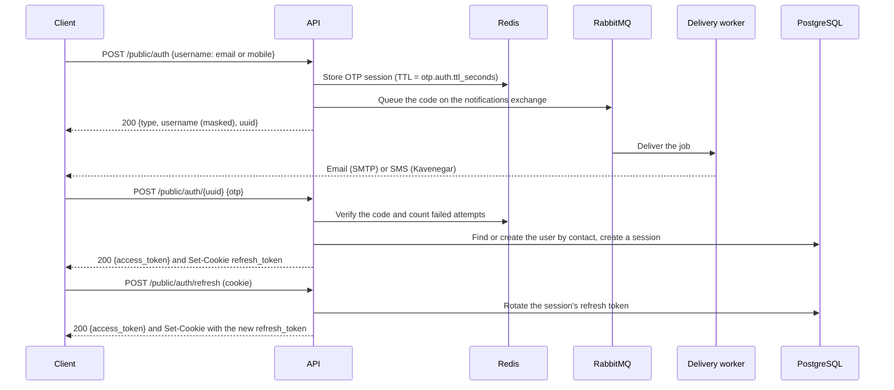

# API reference

This document describes the HTTP and WebSocket API as currently implemented on `main`. The OpenAPI document, [`docs/swagger.json`](swagger.json) and [`docs/swagger.yaml`](swagger.yaml), describes every route with its parameters and responses ([#54](https://github.com/mdastpak/Crypto-Exchange/issues/54)). It is generated from the annotations of the handlers, and the Swagger UI serves it at `/swagger/index.html` outside release mode. This document adds what the OpenAPI document cannot say: the conventions, the sign-in flow, and the WebSocket messages.

## Conventions

### Versions

The API is versioned under `/api/v1`. The paths in this document are relative to it: `POST /public/auth` is `POST /api/v1/public/auth`, and the WebSocket gateway is `/api/v1/ws/`. The exceptions are not part of the API and have no version: the health probes under `/system/`, which orchestrators and load balancers call, `/swagger/`, and `/`.

The unversioned paths of earlier releases, such as `/public/auth`, still answer the same, as deprecated aliases until a later release removes them. Their responses carry:

```http
Deprecation: @1793923200
Link: </api/v1/public/auth>; rel="successor-version"
```

`Deprecation` (RFC 9745) gives the date of the deprecation, 2026-11-06, and `Link` (RFC 8288) the path to use instead. A path and its alias share the rate limits, so the alias does not double them.

### Response envelope

Every endpoint except `/system/*` responds with:

```json
{
  "status": 200,
  "message": "Human-readable message",
  "info": {}
}
```

`status` repeats the HTTP status code. `info` holds the payload and is omitted when there is none.

### Errors

Error responses, of status `400` or more, use the same envelope with two more fields ([#53](https://github.com/mdastpak/Crypto-Exchange/issues/53)):

```json
{
  "status": 409,
  "message": "The currency has changed since that version; read it again and retry.",
  "code": "version_conflict",
  "request_id": "019a5a5e-7c1b-7d2e-9f30-1a2b3c4d5e6f",
  "info": { "code": "version_conflict", "version": 3 }
}
```

- **`code`** names the error, for clients to act on. It is stable: a published code keeps its meaning. `message` is for people and may change.
- **`request_id`** is the request's `X-Request-ID`. Quote it when reporting an error, to find the request in the server log.
- **`info`** holds the details of some errors: the invalid fields of a `validation_failed`, under `info.errors`, or the current version of a `version_conflict`. Codes that appeared in `info.code` before #53 are still there, as well as in `code`.

An error response contains only a fixed message for each error. Internal details, such as database, Redis, or provider errors, are only written to the server log. A panic in a handler returns `500`, `internal_error`, with the message `Internal server error`. An unknown path answers `404` (`not_found`), and a known path with another method `405` (`method_not_allowed`), in the same envelope.

| Code | Status | Meaning |
| --- | --- | --- |
| `invalid_request` | `400` | The request is malformed, for example a body that is not the expected JSON or an invalid UUID |
| `validation_failed` | `400` | Fields are invalid; `info.errors` maps each field to what is wrong |
| `unauthorized` | `401` | Authentication failed, without a more specific code |
| `token_missing` | `401` | No `Authorization` header |
| `token_invalid` | `401` | The access token is not a valid `Bearer` token of the route's role |
| `token_revoked` | `401` | The access token was revoked, for example by a logout |
| `session_inactive` | `401` | The token's session has ended |
| `refresh_token_missing` | `401` | `POST /public/auth/refresh` without the `refresh_token` cookie |
| `refresh_token_invalid` | `401` | The refresh token is invalid, expired, rotated, or of an ended session |
| `code_invalid` | `401` | A sign-in code is wrong, expired, or used up |
| `admin_inactive` | `401` | The administrator of an admin token is no longer active |
| `forbidden` | `403` | The request is not allowed, without a more specific code |
| `account_unavailable` | `403` | The account can no longer sign in: disabled, suspended, or deleted |
| `use_admin_sign_in` | `403` | An administrator used the user sign-in |
| `not_found` | `404` | No such resource, or a hidden one, or no such route |
| `method_not_allowed` | `405` | The path exists with other methods |
| `conflict` | `409` | The request conflicts with the current state, without a more specific code |
| `duplicate_symbol`, `duplicate_contract` | `409` | Another currency has this symbol or contract; `info.field` names the field |
| `version_conflict` | `409` | The currency changed since the version sent; `info.version` is the current one |
| `body_too_large` | `413` | The body is larger than `server.max_body_bytes` |
| `rate_limited` | `429` | A rate limit is used up; `Retry-After` says when to try again |
| `internal_error` | `500` | An unexpected failure, described in the server log |
| `not_implemented` | `501` | Not implemented yet |
| `unavailable` | `503` | A dependency is unavailable; try again later |
| `error` | other | A status without a code of its own |

### Pagination

List endpoints that can grow, such as the order and trade histories to come, return one page at a time ([#53](https://github.com/mdastpak/Crypto-Exchange/issues/53)):

- **Query parameters.** `limit` is the number of items, from 1 to 200, and 50 by default. `cursor` is the `next_cursor` of the previous page.
- **The page.** `info` is `{"items": [...], "next_cursor": "..."}`, and `next_cursor` is left out on the last page. To get the next page, send the same request with `cursor` set to it.
- **Errors.** An invalid `limit` or `cursor` gets `400` `validation_failed`, with the parameter in `info.errors`.
- **Cursors are opaque.** Do not build or change one. A cursor holds the position after the last item of its page, in the fixed order that each list documents. So items added in the meantime neither repeat nor move between pages, and any server instance can answer the next page.

`GET /public/currencies` is not paginated: it returns the whole list of public currencies, a small reference list that clients keep.

### Authentication

Protected routes, including both logout routes, expect the access token with the `Bearer` scheme:

```http
Authorization: Bearer <access token>
```

The scheme is case-insensitive. A bare token or any other scheme is rejected with `401`. Every `401` from the authentication middleware carries `WWW-Authenticate: Bearer`.

Tokens are JWTs signed with RS256. The header names the signing key in `kid`, and the claims are:

| Claim | Description |
| --- | --- |
| `uuid` | The user's public identifier (`users.hk`) |
| `role` | `user` or `admin` |
| `typ` | `access` or `refresh`. Protected routes accept only `access` tokens, and the refresh endpoint accepts only `refresh` tokens. |
| `sid` | The sign-in session the token belongs to |
| `jti` | A unique token ID |
| `iss` | `jwt.issuer` from the configuration |
| `aud` | `user-api` or `admin-api`, matching the role |
| `iat`, `exp` | Issue and expiry time. `exp` is required. |

Each role has its own signing keys. User routes accept only user tokens and admin routes only admin tokens, so a user token can never reach an admin route, even with a forged `role` claim. A token is rejected with `401` when any of the following holds:

- Its algorithm is not RS256.
- Its `kid` is missing or names no key of the route's role.
- Its issuer or audience is wrong.
- It has no expiry or has expired.
- Its type or role does not match the route.

Each sign-in creates a session in the `sessions` table. Only SHA-256 hashes of the tokens are stored.

On every request, the `/user/*` routes, except `POST /user/logout`, also check the token's session and user in the database. A token stays valid only while its session is active and has not expired, and while its user can still sign in. Logging out, refresh token reuse, and disabling, suspending, banning, or deleting the user therefore reject every access token of the session on the next request, also when the change is made directly in the database:

- `401 Unauthorized - Session is not active` when the session was logged out, revoked for refresh token reuse, or has expired. The client must sign in again.
- `403 This account is not available. Please contact support.` when the user became `INACTIVE`, `SUSPENDED`, or `BANNED`, was deleted, or became an administrator account.

### Request IDs

Every response carries an `X-Request-ID` header. A client may send its own ID, to trace a request across services: up to 64 letters, digits, and the characters `.`, `_`, `:`, and `-`. Any other value, or none, is replaced by a new UUIDv7, so that a request ID can never forge entries in the server log.

### Request bodies

A request body larger than `server.max_body_bytes` (1 MiB by default) is rejected with `413 Request body too large`, also when the client does not announce its length.

### Rate limiting

Rate-limited responses return `429 Too Many Requests` with the `X-RateLimit-Limit`, `X-RateLimit-Remaining`, and `Retry-After` headers. Every route is subject to the general REST limit per client IP. Sign-in adds two limits per client IP: code requests per hour and code verifications per minute. [docs/configuration.md](configuration.md#rate_limits) lists the limits and their routes.

## Sign-in flow



Codes are queued and delivered in the background: by email when the contact is an email address, and by SMS when it is a mobile number. Delivery is retried while the code is valid. A `200` response therefore means that the code was queued, not that it has arrived. [configuration.md](configuration.md#notifications) describes the channels. For local development, `otp.auth.dev_log_codes` writes codes to the server log instead (see [configuration.md](configuration.md#otp)). Codes and raw contacts are never logged otherwise.

### `POST /public/auth`

Requests an OTP.

```json
{ "username": "user@example.com" }
```

The `username` field holds the contact that receives the code, as one of the following:

| Contact type | Format | Delivered by |
| --- | --- | --- |
| `email` | A standard email address | Email (`notifications.email`) |
| `mobile` | An Iranian mobile number: `09` followed by 9 digits | SMS (`notifications.sms`) |

Usernames are not accepted, because a code cannot be delivered to a username, so it cannot prove who is signing in.

The contact is normalized before it is used, so that every way users usually type it reaches the same account ([#197](https://github.com/mdastpak/Crypto-Exchange/issues/197)):

- surrounding white space and invisible characters, such as the zero-width non-joiner, are removed;
- Persian digits (`۰` to `۹`) and Arabic-Indic digits (`٠` to `٩`) become ASCII digits;
- a mobile number with `+98`, `0098`, or `98` in front, without the leading `0`, or with spaces, dashes, dots, or parentheses becomes `09…`: `+98 912 345 6789` and `۰۹۱۲۳۴۵۶۷۸۹` are both `09123456789`.

The code and the authenticator code of admin sign-in may be typed with Persian or Arabic-Indic digits too.

Response `200`:

```json
{
  "status": 200,
  "message": "OTP sent to your contact",
  "info": { "type": "email", "username": "use*****@example.com", "uuid": "1b9d6bcd-bbfd-4b2d-9b5d-ab8dfbbd4bed" }
}
```

Errors:

- `400`: missing or invalid contact (`Invalid contact information`), or a contact type whose channel is not configured on the server, for example `Sign-in by mobile is not available`
- `429`: the rate limit is exceeded, the contact has received `otp.auth.contact_requests_per_hour` codes in the current hour (`Too many sign-in codes requested. Please try again later.`), or its verification attempts are used up (`Too many failed attempts. Please try again later.`). See [Sign-in limits](#sign-in-limits).
- `500`: the code could not be stored (`Failed to store OTP`) or queued (`Failed to send OTP`)

### `POST /public/auth/{uuid}`

Verifies the OTP for the session `uuid` returned by the previous call.

```json
{ "otp": "123456" }
```

Response `200`:

```json
{
  "status": 200,
  "message": "OTP verified successfully",
  "info": { "access_token": "<jwt>" }
}
```

The refresh token is **only** delivered in a cookie, never in the body, so scripts running in the page cannot read it:

```http
Set-Cookie: refresh_token=<jwt>; Path=/api/v1/public/auth; Max-Age=<refresh_token.expiration_minutes × 60>; HttpOnly; Secure; SameSite=Strict
```

The browser sends the cookie only to `/api/v1/public/auth/*`, which covers the refresh and logout routes. A sign-in through the deprecated alias sets it for `/public/auth` instead, so that the cookie goes to the auth routes of the version that issued it; a client that moves to `/api/v1` signs in again. Logout clears the cookie under both paths. Because it is `Secure`, browsers only store it over HTTPS. Chrome and Firefox also store it on `http://localhost` during development.

Errors:

- `400`: invalid UUID or missing code
- `401`: wrong, expired, or already used code
- `403`: the account is disabled, deleted, or suspended (`This account cannot sign in. Please contact support.`), or belongs to an administrator (`Administrators must use the admin sign-in.`). The code was right, so no information is revealed to someone who does not control the contact.
- `429`: the attempts of the code or of the contact are used up. See [Sign-in limits](#sign-in-limits).
- `500`: the user could not be created or loaded, or the session could not be read

The first successful verification for a contact creates the user. Each email address and mobile number belongs to at most one user, and concurrent first sign-ins for the same contact resolve to the same user. Email addresses are matched case-insensitively, so `Alice@Example.com` and `alice@example.com` are the same contact.

### Sign-in limits

These limits apply on top of the per-IP [rate limits](#rate-limiting):

- A code is valid for `otp.auth.ttl_seconds` and signs in only once, even when it is sent in concurrent requests.
- A code can be tried `otp.auth.retry_limit` times. Each attempt is counted before the code is checked, so concurrent requests cannot get more tries. A code that cannot be right, because it is not `otp.auth.length` digits, gets `401` (`code_invalid`) without using up an attempt. After the last failed attempt, the code is erased and further attempts get `429` until the session expires.
- Each email address or mobile number receives at most `otp.auth.contact_requests_per_hour` codes per hour for one client (its address, with IPv6 grouped by prefix), and at most `otp.auth.contact_requests_total_per_hour` from every client together. A client that signed in with the contact in the last 30 days is exempt from the total. Email addresses are compared case-insensitively.
- Each contact gets at most `otp.auth.contact_attempts_per_hour` attempts per hour across all of its codes, counted for the client that requested the codes, so requesting a new code does not bring new attempts. While they are used up, no new code is issued for the contact to that client. A successful sign-in resets the count.
- These limits count per client so that someone who knows only a contact cannot lock its owner out by failing codes for it ([#187](https://github.com/mdastpak/Crypto-Exchange/issues/187)). They are kept in Redis, so every server instance applies the same counts.

Redis stores only an HMAC of each code and the contact encrypted with AES-GCM, both keyed by `otp.auth.secret`.

### `POST /public/auth/refresh`

Exchanges the `refresh_token` cookie for a new access token. No request body is needed.

Response `200`: `{"info": {"access_token": "<jwt>"}}`, together with a `Set-Cookie` header that carries a **new** refresh token. Each refresh token can be used only once:

- The session's refresh token is replaced on every refresh (rotation), and its expiry moves forward by `refresh_token.expiration_minutes`.
- Presenting a refresh token that was already rotated is treated as theft: the whole session is revoked, and its newest refresh token stops working too. This also applies when a client sends the same refresh token in two concurrent requests, so clients must not refresh in parallel.

Errors: `401` when the cookie is missing, invalid, or expired, when it holds an access token, or when the session has been revoked; `403` when the user can no longer sign in (`This account is not available. Please contact support.`). A `401` or `403` also clears the cookie.

### `POST /public/auth/logout` and `POST /user/logout`

Ends the session of the access token sent in the `Authorization` header:

- The session is revoked, so its refresh token stops working.
- The access token is blacklisted until it expires.
- The refresh token cookie is cleared.

Every other access token of the session, such as one issued before the last refresh, is rejected from then on, because the user routes check the session on each request. Other sessions of the same user are not affected. Logout does not check the session or the account, so that a user whose account was disabled can still end the session.

Both routes require a user access token as `Authorization: Bearer <token>`. `POST /public/auth/logout` exists because the refresh token cookie is only sent to `/public/auth/*`, so only this route can clear it in the browser.

Response `200`. Errors: `401` for a missing, invalid, or blacklisted token, or a token without the `Bearer` scheme.

## Admin sign-in

Administrators are created by an operator with the `cmd/admin` command (see the [README](../README.md#6-create-an-administrator-optional)), never through the API. They sign in with two factors:

1. A one-time code sent to their email address.
2. A code from their authenticator app (TOTP, RFC 6238: 6 digits, 30-second steps).

Admin sign-in needs `jwt.ssl.admin` keys, [`admin.totp_key`](configuration.md#admin), and email delivery. Without them, both sign-in routes return `503 Admin sign-in is not available`.

### `POST /admin/auth`

Starts an admin sign-in.

```json
{ "email": "admin@example.com" }
```

Response `200` for every valid address, so that it does not reveal which addresses belong to administrators:

```json
{
  "status": 200,
  "message": "If this address belongs to an administrator, a sign-in code was sent to it",
  "info": { "uuid": "1b9d6bcd-bbfd-4b2d-9b5d-ab8dfbbd4bed" }
}
```

A code is only emailed when the address belongs to an active administrator. The [sign-in limits](#sign-in-limits) apply, counted separately from user sign-in.

Errors: `400` for an invalid address, `429` when a limit is reached, `503` when admin sign-in is not configured.

### `POST /admin/auth/{uuid}`

Completes the sign-in with both codes.

```json
{ "otp": "123456", "totp": "654321" }
```

Response `200`: `{"info": {"access_token": "<jwt>"}}`. Admin tokens are access tokens for the `admin-api` audience. There is no refresh token: administrators sign in again when the token expires after `access_token.expiration_minutes`.

- The emailed code is checked first, and this ends the sign-in session, so a wrong authenticator code needs a new emailed code.
- Each authenticator code is accepted once.

Errors:

- `400`: invalid UUID, or a missing code
- `401 Invalid or expired code`: either code is wrong or expired, or the address is not an active administrator. The answer does not say which.
- `429`: the attempts of the emailed code are used up
- `503`: admin sign-in is not configured

### `POST /admin/logout`

Requires an admin token. Blacklists the token until it expires. Response `200`.

### Checks on admin routes

On every request, all `/admin/*` routes except sign-in check that the token's administrator still has the admin role, the approved status, and an enrolled authenticator. Demoting or disabling an administrator therefore revokes its tokens at once, also when the change is made directly in the database. Such a token gets `401 Unauthorized - Administrator is not active`.

## Currencies

### Currency object

```json
{
  "id": 1,
  "hk": "0d4f2a7e-8c1b-4f0e-9a51-3c2f6f1b7d10",
  "status": "approved",
  "info": {
    "en_name": "Tether",
    "fa_name": "<name in Persian>",
    "symbol": "USDT",
    "if_fiat": false,
    "is_token": true,
    "contract": "TR7NHqjeKQxGTCi8q8ZY4pL8otSzgjLj6t"
  },
  "created_at": "2026-11-06T09:00:00Z",
  "updated_at": "2026-11-06T09:30:00Z"
}
```

`status` is one of `approved`, `pending`, `suspend`, or `deleted`. Only `approved` currencies are public: they are the only ones returned by public and user routes and announced to WebSocket clients. `symbol` is unique, and so is `contract` when it is not empty: native coins and fiat currencies have no contract. The field name `if_fiat` is a known typo for `is_fiat`. It will be renamed together with the move from `currencies` to the assets table ([#57](https://github.com/mdastpak/Crypto-Exchange/issues/57)), so that clients change only once.

### `GET /public/currencies`

Lists the public currencies, oldest first. Response `200` with an array in `info`, which is empty when there are none. `created_at` and `updated_at` are in RFC 3339, in UTC.

PostgreSQL holds the currencies, and Redis a copy of the whole list that every instance shares. A change through the admin routes drops the copy, so that the next read on any instance loads the list from PostgreSQL. A change made directly in the database shows after a little more than `redis.currency_cache_ttl_seconds`. While Redis is unavailable, the list is read from PostgreSQL. See [The shared currency list](architecture.md#the-shared-currency-list). `503` (`Currencies are temporarily unavailable.`) when the list is not cached and PostgreSQL cannot be read.

### `GET /public/currencies/{hk}`

Returns one public currency, from the same list. `hk` is a UUID in any spelling. Errors: `400` (`Invalid UUID format for HK`) when it is not a UUID; `404` when no public currency has it, with the same message for a hidden currency as for a missing one; `503` as for the list.

### `POST /admin/currencies` (admin)

Creates a currency.

```json
{
  "status": "pending",
  "info": {
    "en_name": "Tether",
    "fa_name": "<name in Persian>",
    "symbol": "USDT",
    "if_fiat": false,
    "is_token": true,
    "contract": "TR7NHqjeKQxGTCi8q8ZY4pL8otSzgjLj6t"
  }
}
```

| Field | Rules |
| --- | --- |
| `status` | `approved`, `pending`, or `suspend`. Optional, `pending` by default. A currency is only marked `deleted` by `DELETE`. |
| `info.en_name`, `info.fa_name` | Required, at most 100 characters. Leading and trailing spaces are removed. |
| `info.symbol` | Required, 2 to 15 letters or digits. It is stored in upper case, so `usdt` and `USDT` are the same symbol. |
| `info.is_token`, `info.if_fiat` | Optional, `false` by default. A fiat currency cannot be a token. |
| `info.contract` | Required for a token. At most 128 letters, digits, or `:`, `_`, `.`, `-`. |

Fields that the server controls, such as `id`, `hk`, `version`, and the timestamps, and any other unknown field, are rejected.

Response `201`, with the first version of the currency:

```json
{
  "status": 201,
  "message": "Currency created successfully.",
  "info": { "hk": "0d4f2a7e-8c1b-4f0e-9a51-3c2f6f1b7d10", "status": "pending", "version": 1 }
}
```

Errors:

- `400` with the message `Invalid input: Please check the provided data format.`: the body is not a JSON object of this shape.
- `400` with the message `Validation failed`: `info.errors` names each invalid field, for example `{"errors": {"info.symbol": "must be 2 to 15 upper-case letters or digits"}}`.
- `409`: the symbol or the contract belongs to another currency. `info` holds a stable code and the field: `{"code": "duplicate_symbol", "field": "info.symbol"}`, or `duplicate_contract` and `info.contract`.

### `GET /admin/currencies/{hk}` (admin)

Returns one currency, whatever its status, deleted ones included, with its `version` and `deleted_at`. `hk` is a UUID in any spelling. Errors: `400` for an invalid UUID, `404` when no currency has it.

### `PUT /admin/currencies/{hk}` (admin)

Partially updates a currency with a body of the same shape as `POST`. Only the fields that are sent change, and a flag can be set back to `false`. The updated currency must satisfy the same rules as a new one.

Every change adds one to the currency's `version` ([#89](https://github.com/mdastpak/Crypto-Exchange/issues/89)). To be sure not to overwrite a change it has not seen, a client sends the `version` it read, from `GET` or from the response of its last change. When the currency has changed since, the update is refused with `409` and changes nothing:

```json
{
  "status": 409,
  "message": "The currency has changed since that version; read it again and retry.",
  "info": { "code": "version_conflict", "version": 3 }
}
```

Without `version`, concurrent updates are applied one after the other, each to the result of the previous one.

Response `200` with the new version: `{"version": 3}`. Errors: `400` for an invalid UUID, an invalid body, invalid fields as for `POST`, or a `version` below 1; `404` when the currency is not found; `409` for a duplicate symbol or contract, or with `version_conflict`.

### `DELETE /admin/currencies/{hk}` (admin)

Soft-deletes a currency (sets `deleted_at` and `status = deleted`) and removes it from the cache. The optional query parameter `version` works as in `PUT`: `DELETE /admin/currencies/{hk}?version=3` is refused with `409` and `version_conflict` when the currency has changed since version 3.

Response `200` with the new version. Errors: `400` for an invalid UUID or a `version` that is not a number of at least 1, `404` when the currency is not found or already deleted, `409` with `version_conflict`.

Changes that affect the public view publish an event to the `price_updates` exchange:

```json
{
  "entity": "currencies",
  "action": "create",
  "hk": "0d4f2a7e-8c1b-4f0e-9a51-3c2f6f1b7d10",
  "info": { "symbol": "USDT" },
  "server_time": "2026-11-02T10:00:00Z"
}
```

Events and the cache describe what public clients can see, so they follow the visibility of a currency rather than the admin operation:

| Change | Cache | Event |
| --- | --- | --- |
| A currency becomes approved: it is created as approved, or updated to approved | Added | `create` with the currency's `info` |
| An approved currency is updated and stays approved | Replaced | `update` with the currency's `info` |
| An approved currency is suspended, set back to pending, or deleted | Removed | `delete` with `info` set to `{"status": "<new status>"}` |
| A currency that is not approved is created, updated, or deleted | Not cached | None |

## Audit log

### `GET /admin/audit` (admin)

Returns the audit log, newest first, in pages ([#51](https://github.com/mdastpak/Crypto-Exchange/issues/51)). [The audit log](architecture.md#the-audit-log) lists the actions it records.

| Parameter | Selects |
| --- | --- |
| `actor_id` | The events of a user or an administrator, by hk |
| `action` | One action, such as `currency.update` or `admin.sign_in` |
| `target_type`, `target_id` | The events of one target, such as `currency` and its hk |
| `outcome` | `success`, `failure`, or `denied` |
| `since`, `until` | Events at or after `since`, and before `until`, in RFC 3339 |
| `limit`, `cursor` | The page, as in [Pagination](#pagination) |

All parameters are optional and combine. Each item has the event's `hk`, `occurred_at`, `actor_type` and `actor_id`, `action`, `target_type` and `target_id`, `outcome` and `reason`, `request_id`, `ip`, `user_agent`, and, for a change, `changes` with the fields before and after.

Errors: `400` `validation_failed` naming each invalid parameter; `401` and `403` as for the other admin routes.

## User

The user routes require a user access token. The profile routes take no user ID: they always act on the user that the token names, so a user cannot read or change another user's profile.

### `GET /user/profile`

Returns the profile of the signed-in user:

```json
{
  "status": 200,
  "message": "Profile retrieved successfully.",
  "info": {
    "uuid": "5b0c1a52-3f5e-4c2a-9d1e-2f7f8f0b6a11",
    "status": "ACTIVE",
    "contact": { "email": "ali*****@example.com" },
    "first_name": "Ali",
    "last_name": null,
    "display_name": null,
    "kyc_status": "PENDING",
    "kyc_tier": "NONE",
    "created_at": "2026-11-05T09:30:00Z"
  }
}
```

`status` is `ACTIVE`, or `PENDING_VERIFICATION` for an account whose contact is not verified yet: accounts with any other status cannot read their profile. `contact` holds the primary email address and mobile number the user signs in with, masked: the first three characters stay visible, with the domain of an email address or the last three digits of a mobile number. Names that are not set, and a creation time that was not recorded, are `null`.

Errors: `401` for a missing or invalid token, or one whose session has ended; `403` when the account became `INACTIVE`, `SUSPENDED`, or `BANNED`, was deleted, or became an administrator account after the token was issued (`This account is not available. Please contact support.`). See [Authentication](#authentication).

### `PATCH /user/profile`

Changes the names in the profile and returns the updated profile, as `GET` does.

```json
{ "first_name": "Ali", "display_name": "" }
```

| Field | Rules |
| --- | --- |
| `first_name`, `last_name`, `display_name` | Optional. Spaces around the name are trimmed, and an empty string clears the field. At most 100 characters, without control characters or characters that reorder text (U+202A to U+202E and U+2066 to U+2069), and with at least one visible character. The zero-width non-joiner is allowed. |

Only the fields sent change, and at least one must be sent. Any other field, such as `uuid`, `contact`, `status`, or `kyc_tier`, is rejected. Errors: `400` for an invalid body, or with `Validation failed` and a message per field in `info.errors`; `401` and `403` as for `GET`.

## System

These endpoints return plain JSON without the envelope.

### `GET /system/live`

Liveness: `200` with `{"status": "ok"}` while the process serves requests. It checks no dependency, so that an orchestrator does not restart an instance because PostgreSQL, Redis, or RabbitMQ is down.

### `GET /system/ready`

Readiness: checks PostgreSQL, Redis, and RabbitMQ at once, each within two seconds, and answers `200` when all of them are available and `503` otherwise, so that load balancers and orchestrators send no traffic to an instance that cannot serve it. The Docker image's `HEALTHCHECK` uses it.

```json
{
  "status": "ok",
  "details": {
    "postgres": { "status": "ok", "last_check": "2026-11-02T10:00:00Z", "latency_ms": 1 },
    "redis": { "status": "ok", "last_check": "2026-11-02T10:00:00Z", "latency_ms": 1 },
    "rabbitmq": { "status": "ok", "last_check": "2026-11-02T10:00:00Z" }
  }
}
```

`status` is `degraded` when any dependency fails, and that dependency's `status` is `error`. RabbitMQ is reported as `error` while its connection or its publishing channel is being restored. In release mode, the response has only `status`, without `details`, because the details describe the internals.

Once the instance is shutting down, it answers `503` with `{"status": "draining"}` and checks no dependency, while it keeps serving the other routes for `server.drain_seconds`. See [Startup and shutdown](architecture.md#startup-and-shutdown).

### `GET /system/healthcheck`

The earlier name of `/system/ready`, with the same response.

### `GET /system/ping`

```json
{ "message": "pong", "timestamp": "2026-11-02T10:00:00Z" }
```

## WebSocket

Connect to `ws://<host>:<port>/api/v1/ws/`. The trailing slash is required. Browser origins must match `websocket.allowed_origins`, or the request must be same-origin when the list is empty.

### Authentication

A connection may bring a user access token. Without a token, the connection is anonymous and receives the public events. A token is checked like on the `/user/*` routes: its signature, the blacklist, its session, and its user (see [Authentication](#authentication)). The account channels of [#66](https://github.com/mdastpak/Crypto-Exchange/issues/66) will need it. The token can be sent in one of two ways:

- `Authorization: Bearer <access token>`, for clients that can set headers on the upgrade request;
- from a browser, which cannot, as the subprotocols `access_token` and the token: `new WebSocket(url, ["access_token", token])`. The server selects the subprotocol `access_token` in its answer, as the handshake requires.

A token in the URL is not read, because URLs end up in access logs. A request that brings a token gets an HTTP answer instead of the upgrade when the token is refused, in the error envelope of the REST API, with the codes of the user routes:

| Status | Code | When |
| --- | --- | --- |
| `401` | `token_invalid` | The token is invalid. Also when the `Authorization` header has another scheme, or the `access_token` subprotocol comes without a token. |
| `401` | `session_inactive` | The token's session has ended |
| `403` | `account_unavailable` | The user can no longer sign in |

A request that is not a WebSocket handshake gets `400` (`invalid_request`) in the same envelope, with `Sec-Websocket-Version: 13`, and an origin that is not allowed `403` (`forbidden`).

### Connection behavior

| Setting | Value |
| --- | --- |
| Maximum inbound message size | `websocket.max_message_size_bytes`, 4 KiB by default. A larger message closes the connection with `1009` (message too big). |
| Inbound message rate | `websocket.client_messages_per_second`, 10 by default, with bursts of `websocket.client_message_burst`, 20. A client that sends faster is disconnected with `1008` (policy violation) and the reason `too many messages`. |
| Server ping interval | `websocket.ping_interval_seconds`, 30 seconds by default |
| Read deadline | Two ping intervals, extended on every pong |
| Write timeout | `websocket.write_timeout_seconds`, 10 seconds by default |
| Connections | At most `websocket.max_connections` per server instance (10000), and `websocket.max_connections_per_ip` per client address (20). Further upgrades get `503` (`unavailable`) and `429` (`rate_limited`). The client address honors `server.trusted_proxies`. |
| Per-client outbound buffer | 256 messages. Messages are dropped when the buffer is full. |
| Instance shutdown | When an instance stops, for example during a rolling deploy, its clients get a close frame with `1001` (going away) and the reason `server is shutting down`. The other instances keep serving. Reconnect after a short random delay, so that the clients of one instance do not all reconnect at the same moment, and send the time zone again, since it belongs to the connection. |

### Client messages

Ping, optionally with an IANA time zone for the reply timestamp. An unknown zone, or a name longer than 64 characters, keeps the previous zone, which is UTC at first:

```json
{ "event": "ping", "timezone": "Europe/Berlin" }
```

The server replies:

```json
{ "event": "pong", "timestamp": "2026-11-02T11:00:00+01:00" }
```

`{"event": "subscribe", "channels": [...]}` is accepted but has no effect yet. The channel protocol is tracked in [#66](https://github.com/mdastpak/Crypto-Exchange/issues/66).

### Server messages

Currency events (see [Currencies](#currencies)) are broadcast to every connected client, with `server_time` set by the server that sends them:

```json
{
  "id": "019a5a5e-7c1b-7d2e-9f30-1a2b3c4d5e6f",
  "entity": "currencies",
  "action": "create",
  "hk": "0d4f2a7e-8c1b-4f0e-9a51-3c2f6f1b7d10",
  "info": {
    "en_name": "Tether",
    "fa_name": "تتر",
    "if_fiat": false,
    "symbol": "USDT",
    "is_token": true,
    "contract": "0xdac17f958d2ee523a2206206994597c13d831ec7"
  },
  "server_time": "2026-11-02T10:00:00Z"
}
```

An event is sent for every committed change to the public view, also when RabbitMQ was unavailable at the time of the change: it waits in the outbox until it can be published, and the events of one currency arrive in the order of their changes. Delivery is at least once, so an event can arrive twice; `id`, a version 7 UUID, identifies it, and a client drops an event whose `id` it has seen. Events from servers of an earlier version have no `id`.

Clients receive exactly these fields. For `create` and `update`, `info` holds the six fields above; for `delete`, it is `{"status": "pending" | "suspend" | "deleted"}`. The server rebuilds every event from this schema before it sends it, so a field that is not part of it never reaches a client. Anything that can publish to the broker's `price_updates` exchange therefore cannot push other content to clients. An event that does not fit the schema is dropped and logged:

- an unknown `entity` or `action`;
- an `hk` that is not a UUID in canonical form, or an `id` that is set and is not one;
- a missing `info`, or one with fields of the wrong type;
- a `delete` with another status;
- an event larger than 16 KiB.

Every server instance consumes the events through a queue of its own, so a client receives every event whichever instance it is connected to. Each message is a separate frame that holds exactly one JSON document.
