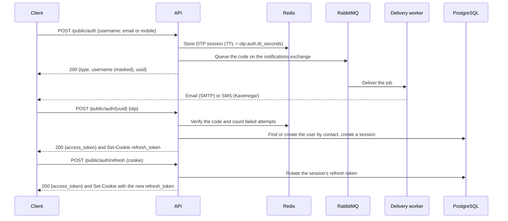

# API reference

This document describes the HTTP and WebSocket API as currently implemented on `main`. The OpenAPI document, [`docs/swagger.json`](swagger.json) and [`docs/swagger.yaml`](swagger.yaml), describes every route with its parameters and responses ([#54](https://github.com/mdastpak/Crypto-Exchange/issues/54)). It is generated from the annotations of the handlers, and the Swagger UI serves it at `/swagger/index.html` outside release mode. This document adds what the OpenAPI document cannot say: the conventions, the sign-in flow, and the WebSocket messages.

## Conventions

### Versions

The API is versioned under `/api/v1`. The paths in this document are relative to it: `POST /public/auth` is `POST /api/v1/public/auth`, and the WebSocket gateway is `/api/v1/ws/`. The exceptions are not part of the API and have no version: the health probes `/system/live` and `/system/ready`, which orchestrators and load balancers call, and `/swagger/` outside release mode. No other path answers.

### Response envelope

Every endpoint except `/system/*` responds with:

```json
{
  "status": 200,
  "message": "Human-readable message",
  "info": {}
}
```

`status` repeats the HTTP status code. `info` holds the payload and is omitted when there is none.

### Errors

Error responses, of status `400` or more, use the same envelope with two more fields ([#53](https://github.com/mdastpak/Crypto-Exchange/issues/53)):

```json
{
  "status": 409,
  "message": "The currency has changed since that version; read it again and retry.",
  "code": "version_conflict",
  "request_id": "019a5a5e-7c1b-7d2e-9f30-1a2b3c4d5e6f",
  "info": { "code": "version_conflict", "version": 3 }
}
```

- **`code`** names the error, for clients to act on. It is stable: a published code keeps its meaning. `message` is for people and may change.
- **`request_id`** is the request's `X-Request-ID`. Quote it when reporting an error, to find the request in the server log.
- **`info`** holds the details of some errors: the invalid fields of a `validation_failed`, under `info.errors`, or the current version of a `version_conflict`. Codes that appeared in `info.code` before #53 are still there, as well as in `code`.

An error response contains only a fixed message for each error. Internal details, such as database, Redis, or provider errors, are only written to the server log. A panic in a handler returns `500`, `internal_error`, with the message `Internal server error`. An unknown path answers `404` (`not_found`), and a known path with another method `405` (`method_not_allowed`), in the same envelope.

| Code | Status | Meaning |
| --- | --- | --- |
| `invalid_request` | `400` | The request is malformed, for example a body that is not the expected JSON or an invalid UUID |
| `validation_failed` | `400` | Fields are invalid; `info.errors` maps each field to what is wrong |
| `unauthorized` | `401` | Authentication failed, without a more specific code |
| `token_missing` | `401` | No `Authorization` header |
| `token_invalid` | `401` | The access token is not a valid `Bearer` token of the route's role |
| `token_revoked` | `401` | The access token was revoked, for example by a logout |
| `session_inactive` | `401` | The token's session has ended |
| `refresh_token_missing` | `401` | `POST /public/auth/refresh` without the `refresh_token` cookie |
| `refresh_token_invalid` | `401` | The refresh token is invalid, expired, rotated, or of an ended session |
| `code_invalid` | `401` | A sign-in code is wrong, expired, or used up |
| `challenge_invalid` | `401` | A [session limit](#session-limit) challenge is unknown, used, or expired |
| `admin_inactive` | `401` | The administrator of an admin token is no longer active |
| `forbidden` | `403` | The request is not allowed, without a more specific code |
| `account_unavailable` | `403` | The account can no longer sign in: disabled, suspended, or deleted |
| `account_frozen` | `403` | The account is frozen by a [restriction](#restrictions); its tokens no longer work and it cannot sign in |
| `currency_operation_disabled` | `403` | The [lifecycle](#delistings) of the currency does not allow the operation now; `info` names the capability and the state |
| `operation_restricted`, `asset_restricted` | `403` | A [restriction](#restrictions) blocks the operation; `info` names it |
| `verification_required` | `403` | The user's [verification level](#verification-levels) does not allow the action; `info.required_level` is the level it needs |
| `withdrawal_limit_exceeded` | `403` | The withdrawal is above a limit of the user's [verification level](#verification-levels); `info` has the limit and, for the daily one, what remains |
| `destination_not_owned` | `403` | The card, IBAN, or account of a new [withdrawal destination](#withdrawal-destinations) is not the user's |
| `destination_invalid` | `400` | Not a card number, an IBAN, an account number, or an address of its network; `info.reason` says why |
| `destination_exists`, `destination_taken`, `destination_limit_reached` | `409` | The [withdrawal destination](#withdrawal-destinations) is in the user's list already, is another user's card, IBAN, or account, or the list is full |
| `national_id_required` | `409` | A card, an IBAN, or an account needs the user's verified national ID first |
| `ownership_check_unavailable`, `destinations_unavailable` | `503` | The owner of a card, an IBAN, or an account cannot be checked now, or the destinations are unavailable |
| `confirmation_code_invalid` | `403` | The code of a [withdrawal confirmation](#withdrawal-confirmations) is wrong |
| `confirmation_locked` | `429` | Too many wrong codes of a confirmation, or too many codes requested |
| `confirmation_expired`, `confirmation_already_confirmed` | `409` | The confirmation is past its time, or was confirmed already |
| `confirmation_method_unavailable`, `confirmation_method_required` | `409` | The user cannot use that method now, or has no method to confirm withdrawals with |
| `confirmations_unavailable` | `503` | The confirmations are not available now |
| `use_admin_sign_in` | `403` | An administrator used the user sign-in |
| `not_found` | `404` | No such resource, or a hidden one, or no such route |
| `method_not_allowed` | `405` | The path exists with other methods |
| `conflict` | `409` | The request conflicts with the current state, without a more specific code |
| `duplicate_symbol`, `duplicate_contract` | `409` | Another currency has this symbol or contract; `info.field` names the field |
| `symbol_reserved` | `409` | The symbol is a [previous symbol](#previous-symbols) of another currency, until an administrator releases it |
| `session_limit_reached` | `409` | The user has the most active sessions allowed; `info` lists them with a challenge. See [Session limit](#session-limit) |
| `favorites_limit_reached` | `409` | The user has `favorites.max_per_user` favorites; `info.max_favorites` says how many |
| `order_mismatch` | `409` | A reorder of the favorites does not name each favorite of the kind once |
| `session_not_found` | `409` | The session to end at the [session limit](#session-limit) is not an active session of the user |
| `version_conflict` | `409` | The currency changed since the version sent; `info.version` is the current one |
| `control_ended` | `409` | The [maintenance or lockdown](#maintenance-and-lockdowns) has already ended or been lifted |
| `second_approval_required` | `409` | The administrator who asked to lift a [lockdown](#maintenance-and-lockdowns) cannot also approve the lift |
| `row_unverified` | `409` | The [restriction](#restrictions) or [control](#maintenance-and-lockdowns) to change was changed outside the backend, in `enforce` mode; an administrator reviews its [integrity finding](#integrity-findings) first |
| `admin_network_denied` | `403` | The client address is not in `admin.allowed_cidrs`, so the admin routes are closed to it |
| `second_factor_required` | `403` | The operation moves funds, and the user has not set an [account password](#second-factor-and-step-up) yet |
| `step_up_required` | `403` | The session must prove the account password again: `POST /user/step-up` |
| `second_factor_not_set` | `409` | A step-up of a user who has no password |
| `password_invalid` | `401`, `403` | The account password is wrong: `401` at the second step of a sign-in, `403` when changing it |
| `recovery_code_invalid` | `401` | The recovery code of a password reset is wrong, used, or replaced |
| `recovery_identity_mismatch` | `401` | An identity check of an [account recovery](#account-recovery) failed; `info.identity_attempts_left` says how many may still fail |
| `recovery_failed` | `403` | The recovery failed its identity checks and has ended |
| `recovery_cooldown` | `429` | A recovery of the account failed in the last 24 hours; `Retry-After` says when another can start |
| `recovery_contact_invalid` | `401` | The contact of the challenge is not a verified contact of the account, or not one that the recovery proved |
| `recovery_not_ready` | `409` | The recovery has more to prove, or its wait ends at `info.ready_at` |
| `recovery_not_found` | `404` | The account has no recovery in progress |
| `recovery_unavailable` | `503` | An identity check of a strict recovery cannot run now |
| `totp_invalid` | `401`, `403` | The code of the [authenticator app](#authenticator-app) is wrong or was used: `401` at a sign-in or a password reset, `403` in a session |
| `totp_locked` | `429` | Too many wrong authenticator codes in a row; `Retry-After` says when a code is checked again |
| `totp_enabled` | `409` | The user already has an authenticator app |
| `totp_not_enabled` | `409` | The user has no authenticator app, or no secret that waits for its first code |
| `passkey_invalid` | `400`, `401`, `403` | The answer of the device does not prove a [passkey](#passkeys) of the account, or no proof waits for it: `400` when adding one, `401` at a sign-in or a password reset, `403` in a session |
| `passkey_unavailable` | `503` | Passkeys are not configured in this deployment |
| `passkey_not_found` | `404`, `409` | The account has no such passkey, or none to prove |
| `passkey_exists` | `409` | The credential is already a passkey |
| `passkey_limit_reached` | `409` | The account has the most passkeys allowed; `info.max` says how many |
| `password_locked` | `429` | Too many wrong passwords in a row; `Retry-After` says when the password is checked again |
| `body_too_large` | `413` | The body is larger than `server.max_body_bytes` |
| `rate_limited` | `429` | A rate limit is used up; `Retry-After` says when to try again |
| `too_many_connections` | `429` | A WebSocket upgrade of a user who already has `websocket.max_connections_per_user` connections, over all server instances ([#234](https://github.com/mdastpak/Crypto-Exchange/issues/234)) |
| `internal_error` | `500` | An unexpected failure, described in the server log |
| `not_implemented` | `501` | Not implemented yet |
| `unavailable` | `503` | A dependency is unavailable; try again later |
| `database_busy` | `503` | The database refused the request for a moment: a lock wait or a statement past its timeout, a deadlock, or a failover in progress ([#230](https://github.com/mdastpak/Crypto-Exchange/issues/230)), or a Redis write of a sign-in counter or a logout that its replicas did not acknowledge in time ([#231](https://github.com/mdastpak/Crypto-Exchange/issues/231)). `Retry-After` is `1`; the request changed nothing and may be retried. Any route can answer it. |
| `service_unavailable` | `503` | Redis could not be reached, or could not serve for a moment, as during a failover, and the request needs it ([#130](https://github.com/mdastpak/Crypto-Exchange/issues/130)): an authenticated route whose token's revocation cannot be checked, which is still refused, a sign-in code that cannot be stored or checked, or currencies that neither the cache nor PostgreSQL can give. `Retry-After` is `1`. Any route that uses Redis can answer it. |
| `delivery_unavailable` | `503` | A code could not be queued for delivery because RabbitMQ is away ([#232](https://github.com/mdastpak/Crypto-Exchange/issues/232)). `Retry-After` is `5`. The sign-in, admin sign-in, and contact-change code requests answer it; the code that was issued is never sent, so request a new one. |
| `maintenance` | `503` | The exchange is under [maintenance](#maintenance-and-lockdowns); `info` has the message and the end, and `Retry-After` the wait when the end is known |
| `feature_locked` | `503` | A [lockdown](#maintenance-and-lockdowns) closes the feature; `info.feature` names it |
| `error` | other | A status without a code of its own |

### Pagination

List endpoints that can grow, such as the order and trade histories to come, return one page at a time ([#53](https://github.com/mdastpak/Crypto-Exchange/issues/53)):

- **Query parameters.** `limit` is the number of items, from 1 to 200, and 50 by default. `cursor` is the `next_cursor` of the previous page.
- **The page.** `info` is `{"items": [...], "next_cursor": "..."}`, and `next_cursor` is left out on the last page. To get the next page, send the same request with `cursor` set to it.
- **Errors.** An invalid `limit` or `cursor` gets `400` `validation_failed`, with the parameter in `info.errors`.
- **Cursors are opaque.** Do not build or change one. A cursor holds the position after the last item of its page, in the fixed order that each list documents. So items added in the meantime neither repeat nor move between pages, and any server instance can answer the next page.

`GET /public/currencies` is not paginated: it returns the whole list of public currencies, a small reference list that clients keep.

### Authentication

Protected routes, including both logout routes, expect the access token with the `Bearer` scheme:

```http
Authorization: Bearer <access token>
```

The scheme is case-insensitive. A bare token or any other scheme is rejected with `401`. Every `401` from the authentication middleware carries `WWW-Authenticate: Bearer`.

Tokens are JWTs signed with RS256. The header names the signing key in `kid`, and the claims are:

| Claim | Description |
| --- | --- |
| `uuid` | The user's public identifier (`users.hk`) |
| `role` | `user` or `admin` |
| `typ` | `access` or `refresh`. Protected routes accept only `access` tokens, and the refresh endpoint accepts only `refresh` tokens. |
| `sid` | The sign-in session the token belongs to |
| `jti` | A unique token ID |
| `iss` | `jwt.issuer` from the configuration |
| `aud` | `user-api` or `admin-api`, matching the role |
| `iat`, `exp` | Issue and expiry time. `exp` is required. |

Each role has its own signing keys. User routes accept only user tokens and admin routes only admin tokens, so a user token can never reach an admin route, even with a forged `role` claim. A token is rejected with `401` when any of the following holds:

- Its algorithm is not RS256.
- Its `kid` is missing or names no key of the route's role.
- Its issuer or audience is wrong.
- It has no expiry or has expired.
- Its type or role does not match the route.

Each sign-in creates a session in the `sessions` table. Only SHA-256 hashes of the tokens are stored.

On every request, the `/user/*` routes, except `POST /user/logout`, also check the token's session and user in the database. A token stays valid only while its session is active and has not expired, and while its user can still sign in. Logging out, refresh token reuse, and disabling, suspending, banning, or deleting the user therefore reject every access token of the session on the next request, also when the change is made directly in the database:

- `401 Unauthorized - Session is not active` when the session was logged out, revoked for refresh token reuse, or has expired, which it also does at its absolute lifetime, `jwt.sessions.max_lifetime_minutes` after the sign-in, however often it was refreshed. The client must sign in again.
- `403 This account is not available. Please contact support.` when the user became `INACTIVE`, `SUSPENDED`, or `BANNED`, was deleted, or became an administrator account.

### Request IDs

Every response carries an `X-Request-ID` header. A client may send its own ID, to trace a request across services: up to 64 letters, digits, and the characters `.`, `_`, `:`, and `-`. Any other value, or none, is replaced by a new UUIDv7, so that a request ID can never forge entries in the server log.

### Request bodies

A request body larger than `server.max_body_bytes` (1 MiB by default) is rejected with `413 Request body too large`, also when the client does not announce its length.

### Response headers

Every response carries these headers ([#191](https://github.com/mdastpak/Crypto-Exchange/issues/191)):

| Header | Value |
| --- | --- |
| `Cache-Control` | `no-store`. Responses hold tokens and personal data, so browsers and caches must not keep them. |
| `Content-Security-Policy` | `default-src 'none'; frame-ancestors 'none'; base-uri 'none'; form-action 'none'`, since the API returns only JSON. The Swagger UI under `/swagger/` gets a policy that allows its own scripts, styles, and images. |
| `Strict-Transport-Security` | `max-age=31536000`, when the server or a proxy in front of it terminates TLS; see `server.hsts` in [docs/configuration.md](configuration.md#server) |
| `X-Content-Type-Options`, `X-Frame-Options`, `Referrer-Policy`, `Permissions-Policy`, `Cross-Origin-Opener-Policy`, `Cross-Origin-Resource-Policy` | `nosniff`, `DENY`, `strict-origin-when-cross-origin`, no geolocation, microphone, or camera, `same-origin`, `same-origin` |
| `X-XSS-Protection` | `0`, which turns off the XSS auditor of old browsers, as recommended; the content security policy replaces it |

For an origin in `server.cors.allowed_origins`, `Access-Control-Expose-Headers` lists `X-Request-ID`, `Retry-After`, `X-RateLimit-Limit`, and `X-RateLimit-Remaining`, so that scripts of that origin can read them. Preflight requests (`OPTIONS`) count against the REST rate limit like other requests.

### Languages

The server answers in the language of each request where it has a translation ([#283](https://github.com/mdastpak/Crypto-Exchange/issues/283)). It takes the first supported locale of: the `lang` query parameter, the `X-Locale` header, the `locale` cookie, `Accept-Language`, the default locale of the [site](#get-publicsite) the call comes from, and `i18n.default_locale` (`en`). An unsupported value is skipped, never an error. `message` is translated; `code` never changes. `Content-Language` names the language that `message` is in, which is `en` when it has no translation, and error and translated answers carry `Vary: Accept-Language, Cookie, X-Locale`. [`docs/i18n.md`](i18n.md) describes the rules, the translations, and RTL layout.

### Rate limiting

Rate-limited responses return `429 Too Many Requests` with the `X-RateLimit-Limit`, `X-RateLimit-Remaining`, and `Retry-After` headers. Every route is subject to the general REST limit per client IP. Sign-in adds two limits per client IP: code requests per hour and code verifications per minute. [docs/configuration.md](configuration.md#rate_limits) lists the limits and their routes.

## Sign-in flow



Codes are queued and delivered in the background: by email when the contact is an email address, and by SMS when it is a mobile number. Delivery is retried while the code is valid. A `200` response therefore means that the code was queued, not that it has arrived. [configuration.md](configuration.md#notifications) describes the channels. For local development, `otp.auth.dev_log_codes` writes codes to the server log instead (see [configuration.md](configuration.md#otp)). Codes and raw contacts are never logged otherwise.

### `POST /public/auth`

Requests an OTP.

```json
{ "username": "user@example.com" }
```

The `username` field holds the contact that receives the code, as one of the following:

| Contact type | Format | Delivered by |
| --- | --- | --- |
| `email` | A standard email address | Email (`notifications.email`) |
| `mobile` | An Iranian mobile number: `09` followed by 9 digits | SMS (`notifications.sms`) |

Usernames are not accepted, because a code cannot be delivered to a username, so it cannot prove who is signing in.

The contact is normalized before it is used, so that every way users usually type it reaches the same account ([#197](https://github.com/mdastpak/Crypto-Exchange/issues/197)):

- surrounding white space and invisible characters, such as the zero-width non-joiner, are removed;
- Persian digits (`۰` to `۹`) and Arabic-Indic digits (`٠` to `٩`) become ASCII digits;
- a mobile number with `+98`, `0098`, or `98` in front, without the leading `0`, or with spaces, dashes, dots, or parentheses becomes `09…`: `+98 912 345 6789` and `۰۹۱۲۳۴۵۶۷۸۹` are both `09123456789`.

The code and the authenticator code of admin sign-in may be typed with Persian or Arabic-Indic digits too.

Response `200`:

```json
{
  "status": 200,
  "message": "OTP sent to your contact",
  "info": { "type": "email", "username": "use*****@example.com", "uuid": "1b9d6bcd-bbfd-4b2d-9b5d-ab8dfbbd4bed" }
}
```

Errors:

- `400`: missing or invalid contact (`Invalid contact information`), or a contact type whose channel is not configured on the server, for example `Sign-in by mobile is not available`
- `429`: the rate limit is exceeded, the contact has received `otp.auth.contact_requests_per_hour` codes in the current hour (`Too many sign-in codes requested. Please try again later.`), or its verification attempts are used up (`Too many failed attempts. Please try again later.`). See [Sign-in limits](#sign-in-limits).
- `500`: the code could not be stored (`Failed to store OTP`) or queued (`Failed to send OTP`)

### `POST /public/auth/{uuid}`

Verifies the OTP for the session `uuid` returned by the previous call.

```json
{ "otp": "123456" }
```

Response `200`:

```json
{
  "status": 200,
  "message": "OTP verified successfully",
  "info": { "access_token": "<jwt>" }
}
```

The refresh token is **only** delivered in a cookie, never in the body, so scripts running in the page cannot read it:

```http
Set-Cookie: refresh_token=<jwt>; Path=/api/v1/public/auth; Max-Age=<refresh_token.expiration_minutes × 60>; HttpOnly; Secure; SameSite=Strict
```

The browser sends the cookie only to `/api/v1/public/auth/*`, which covers the refresh and logout routes. Logout clears it. Because it is `Secure`, browsers only store it over HTTPS. Chrome and Firefox also store it on `http://localhost` during development.

Errors:

- `400`: invalid UUID or missing code
- `401`: wrong, expired, or already used code
- `403`: the account is disabled, deleted, or suspended (`This account cannot sign in. Please contact support.`), or belongs to an administrator (`Administrators must use the admin sign-in.`). The code was right, so no information is revealed to someone who does not control the contact.
- `409` (`session_limit_reached`): the user has `jwt.sessions.max_per_user` active sessions. See [Session limit](#session-limit).
- `429`: the attempts of the code or of the contact are used up. See [Sign-in limits](#sign-in-limits).
- `500`: the user could not be created or loaded, or the session could not be read

A user who has an [account password](#account-password) gets `202` instead of `200` for a correct code ([#307](https://github.com/mdastpak/Crypto-Exchange/issues/307)): no token, no cookie, and a challenge for the [second step](#post-publicauthsecond-step).

The first successful verification for a contact creates the user. Each email address and mobile number belongs to at most one user, and concurrent first sign-ins for the same contact resolve to the same user. Email addresses are matched case-insensitively, so `Alice@Example.com` and `alice@example.com` are the same contact.

A mobile number of an account with a verified national ID is checked again at sign-in once its last check is older than `identity.mobile_ownership.recheck_days` ([#252](https://github.com/mdastpak/Crypto-Exchange/issues/252)). Mobile numbers are recycled, so a number that the provider no longer matches to that national ID is taken off the account. The account keeps its data, every one of its sessions ends, and a [security hold](#security-hold) starts. The sign-in then continues as for an unknown number, with a new, empty account: the new subscriber never sees the previous owner's account. When the check is due and the provider cannot answer, the sign-in answers `503 identity_unavailable`; request a new code later, or sign in with the email address.

### `POST /public/auth/second-step`

Finishes the sign-in of a user who has an [account password](#account-password) ([#307](https://github.com/mdastpak/Crypto-Exchange/issues/307)). A code alone proves control of a mobile number or a mailbox, which a SIM swap or a compromised mailbox gives away; the password is a second step after it, never a replacement for it.

A correct code answers `202`:

```json
{
  "status": 202,
  "message": "The code is correct. Enter your password to finish signing in.",
  "info": { "second_step_required": true, "challenge": "<challenge>", "expires_in": 300, "methods": ["password"] }
}
```

The password, with the challenge, signs in:

```json
{ "challenge": "<challenge>", "password": "correct horse battery" }
```

Response `200`, with the access token and the refresh cookie as for a sign-in without a second step. The session's `auth_method` is `OTP+PASSWORD`.

- The challenge works for five minutes, until a sign-in succeeds with it. It is in Redis, as a hash, so any instance finishes a sign-in that another one started.
- `401 password_invalid`: the password is wrong. The challenge stays usable.
- `429 password_locked`, with `Retry-After`: after `security.password.max_failures` wrong passwords in a row (5 by default), the password of the account is locked for `security.password.lock_minutes` (15 by default), and no password is checked. Each attempt is counted in PostgreSQL before the password is checked, so concurrent guesses on any instance cannot pass the limit. Only someone who already has a correct code can reach it.
- `401 challenge_invalid`: the challenge is unknown, expired, or used.
- `403 account_frozen` or `account_unavailable`: the account was frozen or disabled since the code, or its password row [was changed outside the backend](data-protection.md).
- `409 session_limit_reached`: as for the code; see [Session limit](#session-limit).
- The route has the per-IP limit of a code verification. Every refusal is in the [audit log](#audit-log) as a failed `user.sign_in`, with the reason and never the password.

### `POST /public/auth/password-reset`

Resets a forgotten [account password](#account-password) ([#307](https://github.com/mdastpak/Crypto-Exchange/issues/307)). The code of a contact alone never does: whoever took over a mobile number would reset the password with it. A reset needs two proofs:

1. The code sent to a contact, as for a sign-in. Its `202` answer has the challenge, and `password_reset` lists the second proofs that the account has left: `["recovery_code"]`, or `[]`.
2. One of the [recovery codes](#recovery-codes) of the account.

```json
{ "challenge": "<challenge>", "recovery_code": "ABCD-EFGH-JKLM-NPQR", "new_password": "a new and better password" }
```

Response `200`, with the access token and the refresh cookie: the reset signs in.

- The recovery code is used up, **every** session of the user ends, and the [security hold](#security-hold) starts, all with the new password or not at all.
- Each recovery code has a [row seal](data-protection.md#row-seals) (#337). Its hash has no key, so a code stored, or a used one put back, in SQL could otherwise reset the password: in `enforce` mode such a code answers `403 account_unavailable`.
- The new password follows the policy of `PUT /user/password`; `400 validation_failed` names the problem under `errors.new_password`, and uses no code.
- `401 recovery_code_invalid`: the code is wrong, used, or replaced. The challenge stays usable. Each try counts toward the lock of the password, so the codes cannot be guessed: `429 password_locked` with `Retry-After`.
- `401 challenge_invalid`, `403 account_frozen` and `account_unavailable`: as for the second step.
- Audited as `user.password_reset`, also when it is refused. A code may be typed in lower case and with or without its dashes.
- An account with no recovery code left cannot reset its password here. It needs [account recovery](#account-recovery).
- A reset cancels an account recovery in progress.

### Account recovery

For a user who has neither the [account password](#account-password) nor a [recovery code](#recovery-codes) ([#307](https://github.com/mdastpak/Crypto-Exchange/issues/307)). The recovery is slow on purpose: what it proves, the contacts of the account, is exactly what the password protects the account against losing. So it proves **every** contact, can ask for the identity of the owner again, and then **waits**, during which the owner stops it by proving the password.

`POST /public/auth/recovery` starts a recovery, or adds a proof to the one in progress:

```json
{ "challenge": "<challenge>", "national_id": "0012345678" }
```

1. **Every contact.** The challenge comes from the `202` answer to a correct sign-in code, and proves the contact of that code. The recovery needs each verified email address and mobile number of the account, so the user signs in with each in turn and sends each challenge here.
2. **The identity, in the strict mode.** With `security.recovery.mode: strict`, an account with a verified national ID also passes the steps of `security.recovery.steps`:
   - `national_id`: the national ID of the owner, in `national_id` of a request. Persian digits are accepted.
   - `mobile_ownership`: the identity provider confirms that each proved mobile number is registered to that national ID, so a number that was given to someone else recovers nothing.

   An account without a verified national ID has no identity to check again, and recovers in the standard mode. It holds no funds either ([#157](https://github.com/mdastpak/Crypto-Exchange/issues/157)).
3. **The wait.** When everything is proved, the recovery is `waiting` until `ready_at`, `security.recovery.wait_hours` later (72 by default).

Response `200`, with the state:

```json
{ "id": "…", "mode": "strict", "status": "verifying", "contacts_required": 2, "contacts_proven": 1,
  "steps_required": ["national_id", "mobile_ownership"], "steps_remaining": ["national_id"],
  "identity_attempts_left": 3, "started_at": "…", "expires_at": "…" }
```

- `401 recovery_identity_mismatch`: an identity check failed; `info` has the state, with `identity_attempts_left`. The third failure ends the recovery with `403 recovery_failed`, and the account starts no other for 24 hours: `429 recovery_cooldown` with `Retry-After`.
- `503 recovery_unavailable`: the identity provider, or the keys that open the national ID, cannot answer. Nothing is decided, and a strict recovery never falls back to the standard one.
- `401 recovery_contact_invalid`: the contact of the challenge is no longer a verified contact of the account. `401 challenge_invalid`, `403 account_frozen` and `account_unavailable`: as for the second step. `account_unavailable` also answers a recovery that was [changed outside the backend](data-protection.md#row-seals), in `enforce` mode.
- A recovery has 24 hours to prove everything. An account has one recovery at a time.

`POST /public/auth/recovery/complete` sets the new password once the wait has ended:

```json
{ "challenge": "<challenge>", "new_password": "a new and better password" }
```

Response `200`, with ten new `recovery_codes`, shown this once, and `hold_until`. It does not sign in: the user signs in with a code and the new password.

- The challenge must be of a contact that the recovery proved: `401 recovery_contact_invalid` otherwise.
- `409 recovery_not_ready`, with `info.ready_at` and `Retry-After`, before the wait ends; `404 recovery_not_found` without a recovery, also after one was cancelled. A recovery can be completed for seven days after its wait.
- The new password follows the policy of `PUT /user/password`.
- **Every** session of the user ends, the earlier recovery codes stop working, and the [security hold](#security-hold) starts, so an account that was recovered cannot withdraw at once.

**The password cancels a recovery.** Whenever the account password is proved, at the second step of a sign-in, at `POST /user/step-up`, or for a password change, an open recovery of the account is cancelled, on every instance, since its state is in PostgreSQL. The owner sees a recovery in progress in `recovery` of the `202` answer to a code and of `GET /user/security`.

Audited as `user.recovery_start`, `user.recovery_identity` (a failed identity check), `user.recovery_cancel` (with the reason: `password_proven`, `password_reset`, or `identity_failed`), and `user.recovery_complete`, each in the transaction of its change, with the recovery as the target.

### Sign-in limits

These limits apply on top of the per-IP [rate limits](#rate-limiting):

- A code is valid for `otp.auth.ttl_seconds` and signs in only once, even when it is sent in concurrent requests.
- A code can be tried `otp.auth.retry_limit` times. Each attempt is counted before the code is checked, so concurrent requests cannot get more tries. A code that cannot be right, because it is not `otp.auth.length` digits, gets `401` (`code_invalid`) without using up an attempt. After the last failed attempt, the code is erased and further attempts get `429` until the session expires.
- Each email address or mobile number receives at most `otp.auth.contact_requests_per_hour` codes per hour for one client (its address, with IPv6 grouped by prefix), and at most `otp.auth.contact_requests_total_per_hour` from every client together. A client that signed in with the contact in the last 30 days is exempt from the total. Email addresses are compared case-insensitively.
- Each contact gets at most `otp.auth.contact_attempts_per_hour` attempts per hour across all of its codes, counted for the client that requested the codes, so requesting a new code does not bring new attempts. While they are used up, no new code is issued for the contact to that client. A successful sign-in resets the count.
- These limits count per client so that someone who knows only a contact cannot lock its owner out by failing codes for it ([#187](https://github.com/mdastpak/Crypto-Exchange/issues/187)). They are kept in Redis, so every server instance applies the same counts.

Redis stores only an HMAC of each code and the contact encrypted with AES-GCM, both keyed by the `otp-mac` [data key](data-protection.md), which every instance shares. A session names the version of its key, so a rotation does not end the pending codes.

### Session limit

A user has at most `jwt.sessions.max_per_user` (default 5) active sessions, so that a sign-in on another device means ending one of them ([#212](https://github.com/mdastpak/Crypto-Exchange/issues/212)). Sessions that were ended, revoked, or have expired do not count. A sign-in with a right code past the limit creates no session and answers `409`:

```json
{
  "status": 409,
  "code": "session_limit_reached",
  "message": "You have the most active sessions allowed. End one of them to sign in.",
  "info": {
    "challenge": "<opaque>",
    "expires_in": 300,
    "max_sessions": 5,
    "sessions": [
      { "id": "<uuid>", "auth_method": "OTP", "user_agent": "…", "ip": "203.0.113.7",
        "created_at": "…", "last_used_at": "…", "expires_at": "…", "current": false }
    ]
  }
}
```

The sessions are listed newest first, in the form of [`GET /user/sessions`](#sessions). The client shows them and lets the user pick one to end, then sends:

#### `POST /public/auth/sessions/replace`

```json
{ "challenge": "<opaque>", "session_id": "<uuid>" }
```

It ends that session and signs in, in one transaction, and answers like `POST /public/auth/{uuid}`, with the access token and the refresh cookie. No new code is needed: the challenge stands for the verified code, works once, and expires after five minutes. The ended session is audited as `user.session_revoke` with the reason `replaced_at_sign_in`, and its tokens stop working at once.

Errors:

- `400` (`validation_failed`): the challenge is missing or `session_id` is not a UUID
- `401` (`challenge_invalid`): the challenge is unknown, used, or expired. Sign in again.
- `403` (`account_unavailable`): the account was disabled since the code was verified
- `409` (`session_not_found`): the session is not one of the user's active sessions. The challenge stays usable until it expires, so the client can pick another one.
- `409` (`session_limit_reached`): another sign-in took the free slot in the meantime. The answer carries a new challenge and the current sessions.
- `429`: the rate limit of code verifications

On several instances, the count runs in the transaction that creates the session, after a lock of the user's row, so concurrent sign-ins on any instance never exceed the limit. The challenge is kept in Redis under its SHA-256 hash and taken atomically, so it is used once across instances.

### `POST /public/auth/refresh`

Exchanges the `refresh_token` cookie for a new access token. No request body is needed.

Response `200`: `{"info": {"access_token": "<jwt>"}}`, together with a `Set-Cookie` header that carries a **new** refresh token. Each refresh token can be used only once:

- The session's refresh token is replaced on every refresh (rotation), and its expiry moves forward by `refresh_token.expiration_minutes`, but never past the session's absolute lifetime: `jwt.sessions.max_lifetime_minutes` (30 days by default) after the sign-in ([#144](https://github.com/mdastpak/Crypto-Exchange/issues/144)). From then on, the refresh answers `401 refresh_token_invalid` and the session's access tokens get `401 session_inactive`, so a refresh token that someone keeps rotating, as a thief may while the user is offline, still ends. The user signs in again with a code.
- Presenting a refresh token that was already rotated is treated as theft: the whole session is revoked, and its newest refresh token stops working too.
- Except for concurrent refreshes ([#194](https://github.com/mdastpak/Crypto-Exchange/issues/194)): the tabs of a browser share the cookie and may refresh at the same moment. For `jwt.refresh_token.reuse_grace_seconds` (10 by default) after a rotation, the refresh token that it replaced still gets `200` with a new access token, but no `Set-Cookie`, so the cookie keeps the token that the winning request set. Only the token replaced by the last rotation has this grace, and only for that time; later, or for an older token, it is a reuse. A stolen refresh token used within the grace period therefore gets an access token, as with any refresh token that is not yet rotated.

Errors: `401` when the cookie is missing, invalid, or expired, when it holds an access token, or when the session has been revoked; `403` when the user can no longer sign in (`This account is not available. Please contact support.`). A `401` or `403` also clears the cookie.

### `POST /public/auth/logout` and `POST /user/logout`

Ends the session of the access token sent in the `Authorization` header:

- The session is revoked, so its refresh token stops working.
- The access token is blacklisted until it expires.
- The refresh token cookie is cleared.

Every other access token of the session, such as one issued before the last refresh, is rejected from then on, because the user routes check the session on each request. Other sessions of the same user are not affected; the [session list](#sessions) ends them. Logout does not check the session or the account, so that a user whose account was disabled can still end the session.

Both routes require a user access token as `Authorization: Bearer <token>`. `POST /public/auth/logout` exists because the refresh token cookie is only sent to `/public/auth/*`, so only this route can clear it in the browser.

Response `200`. Errors: `401` for a missing, invalid, or blacklisted token, or a token without the `Bearer` scheme.

## Admin sign-in

Administrators are created by an operator with the `cmd/admin` command (see the [README](../README.md#6-create-an-administrator-optional)), never through the API. They sign in with two factors:

1. A one-time code sent to their email address.
2. A code from their authenticator app (TOTP, RFC 6238: 6 digits, 30-second steps).

Admin sign-in needs `jwt.ssl.admin` keys, the [data keys](configuration.md#keys), which seal the authenticator secrets, and email delivery. Without them, both sign-in routes return `503 Admin sign-in is not available`.

### `POST /admin/auth`

Starts an admin sign-in.

```json
{ "email": "admin@example.com" }
```

Response `200` for every valid address, so that it does not reveal which addresses belong to administrators:

```json
{
  "status": 200,
  "message": "If this address belongs to an administrator, a sign-in code was sent to it",
  "info": { "uuid": "1b9d6bcd-bbfd-4b2d-9b5d-ab8dfbbd4bed" }
}
```

A code is only emailed when the address belongs to an active administrator. The [sign-in limits](#sign-in-limits) apply, counted separately from user sign-in.

Neither the answer nor its limits nor its duration tell an administrator's address from an unknown one ([#190](https://github.com/mdastpak/Crypto-Exchange/issues/190)). An unknown address gets a code too, which is never sent, so it reaches the limits after the same number of requests, and its session is refused like a wrong code. Every answer to a valid address takes at least `admin.sign_in_min_response_ms` (400 ms by default), which covers the email that only an administrator gets. A `500`, when the email cannot be queued, can still only happen for an administrator.

Errors: `400` for an invalid address, `429` when a limit is reached, `503` when admin sign-in is not configured.

### `POST /admin/auth/{uuid}`

Completes the sign-in with both codes.

```json
{ "otp": "123456", "totp": "654321" }
```

Response `200`: `{"info": {"access_token": "<jwt>"}}`. Admin tokens are access tokens for the `admin-api` audience. There is no refresh token: administrators sign in again when the token expires after `access_token.expiration_minutes`.

- The emailed code is checked first, and this ends the sign-in session, so a wrong authenticator code needs a new emailed code.
- Each authenticator code is accepted once.

Errors:

- `400`: invalid UUID, or a missing code
- `401 Invalid or expired code`: either code is wrong or expired, or the address is not an active administrator. The answer does not say which.
- `429`: the attempts of the emailed code are used up
- `503`: admin sign-in is not configured

Each sign-in starts a session, stored in PostgreSQL, which the token belongs to ([#308](https://github.com/mdastpak/Crypto-Exchange/issues/308)). An administrator has at most `admin.sessions.max_per_admin` sessions (2 by default): a sign-in past it ends the oldest. A session lasts as long as its token. The session has a [row seal](data-protection.md#row-seals) (#337): in `enforce` mode a revoked session set back to active in SQL, one made to last, or a step-up lengthened there answers `401`.

### `POST /admin/logout`

Requires an admin token. Ends the token's session in the database, so the token stops working on every instance at once, whatever Redis holds; the token also joins the blacklist until it expires. Response `200`. Audited as `admin.logout`.

### `GET /admin/sessions`

The active sessions of the administrator of the token, newest first:

```json
{"info": [{"id": "4f0c…", "ip": "203.0.113.7", "user_agent": "Mozilla/5.0 …", "created_at": "2026-11-10T09:00:00Z", "expires_at": "2026-11-10T09:15:00Z", "last_used_at": "2026-11-10T09:04:00Z", "current": true}]}
```

`current` marks the session of the request. `last_used_at` is written at most once a minute.

### `DELETE /admin/sessions/{id}`

Ends one of the administrator's own sessions; its token gets `401 session_inactive` from its next request on. Ending the session of the request signs out. `404` for a session that is not an active session of this administrator. Audited as `admin.session_revoke`.

An operator ends every session of an administrator with `admin end-sessions -email <address>`, for a token that may be stolen; `disable` and `reset-totp` do so too.

### `POST /admin/step-up`

The sensitive admin routes need a session that gave an authenticator code lately ([#308](https://github.com/mdastpak/Crypto-Exchange/issues/308)): within `admin.step_up_minutes` (5 by default) of the sign-in or of this request. Without it they answer `403 step_up_required`, with `info.step_up` naming this route, and nothing changes. So a stolen admin token alone cannot lock the platform, freeze a user, or accept a changed row.

Request: `{"totp": "123456"}`. Response `200`: `{"info": {"elevated_until": "2026-11-10T09:10:00Z"}}`. `GET /admin/sessions` shows `elevated_until` of each session.

- Each code is accepted once, so a step-up right after a sign-in waits for the next code.
- `401 code_invalid`: the code is wrong or already used. After 5 wrong codes on a session, the next one ends the session (`401 session_inactive`), and the administrator signs in again.
- Audited as `admin.step_up`, with the failures.

The sensitive routes:

| Routes | What they change |
| --- | --- |
| `POST /admin/platform/controls`, `PATCH /admin/platform/controls/{id}`, `POST /admin/platform/controls/{id}/lift` | Maintenance and lockdowns of the platform |
| `POST /admin/users/{hk}/restrictions`, `POST /admin/users/{hk}/restrictions/{id}/lift` | Freezes and restrictions of users |
| `POST /admin/currencies/{hk}/delistings`, `POST …/delistings/{id}/cancel` | Delistings |
| `POST /admin/currencies/{hk}/migrations`, `POST …/migrations/{id}/cancel` | Currency migrations |
| `PUT` and `DELETE /admin/currencies/{hk}/capabilities/{capability}` | Capability overrides |
| `POST /admin/integrity/findings/{id}/reseal` | Re-seals |

Every admin route that changes something is classified in one table, `adminRoutes` of `internal/app/admin_routes.go`. A route that is not there is refused with `403 route_not_classified`, and a test fails, so a new route cannot skip the decision.

### Checks on admin routes

Before anything else, the admin routes, sign-in included, check where the request comes from ([#308](https://github.com/mdastpak/Crypto-Exchange/issues/308)): with [`server.admin_listen_addr`](configuration.md#where-the-admin-routes-are-served) they exist only on that address and answer `404` on the public one, and with `admin.allowed_cidrs` a client outside the listed networks gets `403 admin_network_denied`.

On every request, all `/admin/*` routes except sign-in check that the token's administrator still has the admin role, the approved status, and an enrolled authenticator. Demoting or disabling an administrator therefore revokes its tokens at once, also when the change is made directly in the database. Such a token gets `401 Unauthorized - Administrator is not active`. They also check that the token's session is active: a token of an ended session, or without one, gets `401 session_inactive`.

## Currencies

### Currency object

```json
{
  "id": 1,
  "hk": "0d4f2a7e-8c1b-4f0e-9a51-3c2f6f1b7d10",
  "status": "approved",
  "info": {
    "en_name": "Tether",
    "fa_name": "<name in Persian>",
    "symbol": "USDT",
    "if_fiat": false,
    "is_token": true,
    "contract": "TR7NHqjeKQxGTCi8q8ZY4pL8otSzgjLj6t",
    "logo_url": "https://example.com/logos/usdt.svg"
  },
  "created_at": "2026-11-06T09:00:00Z",
  "updated_at": "2026-11-06T09:30:00Z",
  "lifecycle": {
    "state": "active",
    "capabilities": {
      "deposit": true, "withdraw": true, "buy": true, "sell": true,
      "convert_into": true, "convert_from": true, "listed": true
    }
  }
}
```

`status` is one of `approved`, `pending`, `suspend`, or `deleted`. Only `approved` currencies are public: they are the only ones returned by public and user routes and announced to WebSocket clients. `symbol` is unique, and so is `contract` when it is not empty: native coins and fiat currencies have no contract. `logo_url`, optional, is an https URL of at most 2048 characters. `lifecycle` says where the currency is in a [delisting](#delistings) and what users may do with it now, with what a [migration](#currency-migrations) pauses; `next`, when present, is the next scheduled step. `previous_symbols`, when present, are the symbols the currency had before a rebrand, newest first. `migration`, on the source of a migration from its announcement on, has its `id`, `target_hk`, `phase`, `forced`, `ratio`, and `next` phase, so that clients can show a banner. The field name `if_fiat` is a known typo for `is_fiat`. It will be renamed together with the move from `currencies` to the assets table ([#57](https://github.com/mdastpak/Crypto-Exchange/issues/57)), so that clients change only once.

### `GET /public/currencies`

Lists the public currencies, oldest first by default, a page at a time, as in [Pagination](#pagination). Response `200` with `items` and, when more follow, `next_cursor`. `created_at` and `updated_at` are in RFC 3339, in UTC. The filters below are optional and combine ([#218](https://github.com/mdastpak/Crypto-Exchange/issues/218)):

| Parameter | Selects |
| --- | --- |
| `q` | Text in the symbol, a previous symbol, the English name, or the Persian name. Without `sort`, the currencies whose symbol is `q` come first, then those whose symbol starts with it or whose previous symbol is `q`, then the rest. |
| `symbol` | Symbols, in any case, repeated or comma-separated: `symbol=btc,eth`. A previous symbol finds the currency too. |
| `en_name`, `fa_name` | Text in the name |
| `contract` | The contract address, exactly, in any case |
| `has_contract` | `true` or `false` |
| `is_token`, `if_fiat` | `true` or `false` |
| `created_since`, `created_until`, `updated_since` | RFC 3339 times. `created_until` excludes that time. |
| `lifecycle` | [Lifecycle states](#delistings), several: `lifecycle=delist_announced,sell_only` |
| `favorites` | `true`: only the [favorites](#favorites) of the signed-in user. It needs the user's access token in `Authorization`. Public list only. |
| `sort` | `symbol`, `en_name`, `created_at`, or `updated_at`, with `-` for descending. The `hk` breaks ties; in the default order by creation, the `id` does, so currencies created in one second keep their order. |
| `limit`, `cursor` | The page. A cursor is valid only with the order that issued it. |

A [delisted](#delistings) currency, whose `listed` capability is false, leaves the public list; it can still be read with `GET /public/currencies/{hk}`, for history.

Text filters are at most 64 characters, ignore case, and match the parts of a name, such as `bitcoin` in `Wrapped Bitcoin`. Persian text is compared normalized on both sides: the Arabic `ي`, `ى`, and `ك` are read as the Persian `ی` and `ک`, Persian and Arabic digits as ASCII digits, and the zero-width non-joiner, tatweel, and diacritics are ignored, so `بيتكوين` finds `بیت‌کوین`. A parameter that is not one of these is refused with `400 validation_failed`, so that a misspelled filter does not return everything.

PostgreSQL holds the currencies, and Redis a copy of the whole list that every instance shares. The filters, sorts, and pages run over that list, so every instance answers the same, from the cache or from PostgreSQL, and a cursor from one instance works on another. A change through the admin routes drops the copy, so that the next read on any instance loads the list from PostgreSQL. A change made directly in the database shows after a little more than `redis.currency_cache_ttl_seconds`. While Redis is unavailable, the list is read from PostgreSQL. See [The shared currency list](architecture.md#the-shared-currency-list). `503` (`Currencies are temporarily unavailable.`) when the list is not cached and PostgreSQL cannot be read.

### `GET /public/currencies/{hk}`

Returns one public currency, from the same list. `hk` is a UUID in any spelling. Errors: `400` (`Invalid UUID format for HK`) when it is not a UUID; `404` when no public currency has it, with the same message for a hidden currency as for a missing one; `503` as for the list.

### `POST /admin/currencies` (admin)

Creates a currency.

```json
{
  "status": "pending",
  "info": {
    "en_name": "Tether",
    "fa_name": "<name in Persian>",
    "symbol": "USDT",
    "if_fiat": false,
    "is_token": true,
    "contract": "TR7NHqjeKQxGTCi8q8ZY4pL8otSzgjLj6t"
  }
}
```

| Field | Rules |
| --- | --- |
| `status` | `approved`, `pending`, or `suspend`. Optional, `pending` by default. A currency is only marked `deleted` by `DELETE`. |
| `info.en_name`, `info.fa_name` | Required, at most 100 characters. Leading and trailing spaces are removed. |
| `info.symbol` | Required, 2 to 15 letters or digits. It is stored in upper case, so `usdt` and `USDT` are the same symbol; the database refuses any other case. |
| `info.is_token`, `info.if_fiat` | Optional, `false` by default. A fiat currency cannot be a token. |
| `info.contract` | Required for a token. At most 128 letters, digits, or `:`, `_`, `.`, `-`. |

Fields that the server controls, such as `id`, `hk`, `version`, and the timestamps, and any other unknown field, are rejected. An unknown field is named by its path, so a field inside `info` is reported as `info.<name>`, such as `{"errors": {"info.decimals": "is not accepted"}}`.

Response `201`, with the first version of the currency:

```json
{
  "status": 201,
  "message": "Currency created successfully.",
  "info": { "hk": "0d4f2a7e-8c1b-4f0e-9a51-3c2f6f1b7d10", "status": "pending", "version": 1 }
}
```

Errors:

- `400` with the message `Invalid input: Please check the provided data format.`: the body is not a JSON object of this shape.
- `400` with the message `Validation failed`: `info.errors` names each invalid field, for example `{"errors": {"info.symbol": "must be 2 to 15 upper-case letters or digits"}}`.
- `409`: the symbol or the contract belongs to another currency. `info` holds a stable code and the field: `{"code": "duplicate_symbol", "field": "info.symbol"}`, or `duplicate_contract` and `info.contract`. A symbol that another currency had before a rebrand answers `symbol_reserved`; see [Previous symbols](#previous-symbols).

### `GET /admin/currencies` (admin)

Lists the currencies of every status, deleted ones included, newest first by default, each with its `version`. It reads PostgreSQL, not the public cache, so a change shows at once. It takes every filter, sort, and page parameter of [`GET /public/currencies`](#get-publiccurrencies), with the same meaning, and one more:

| Parameter | Selects |
| --- | --- |
| `status` | `approved`, `pending`, `suspend`, or `deleted`, repeated or comma-separated |

```json
{
  "status": 200,
  "message": "Currencies retrieved successfully.",
  "info": {
    "items": [
      { "id": 7, "hk": "0d4f2a7e-8c1b-4f0e-9a51-3c2f6f1b7d10", "status": "pending", "version": 1,
        "info": { "en_name": "Tether", "fa_name": "تتر", "symbol": "USDT", "if_fiat": false, "is_token": true, "contract": "0xdac1..." },
        "created_at": "2026-11-07T10:00:00Z", "updated_at": "2026-11-07T10:00:00Z" }
    ],
    "next_cursor": "eyJ2IjoxLCJhIjp7..."
  }
}
```

Errors: `400` with `validation_failed`, naming each invalid parameter. Users and anonymous clients get `401`.

### `GET /admin/currencies/{hk}` (admin)

Returns one currency, whatever its status, deleted ones included, with its `version` and `deleted_at`. `hk` is a UUID in any spelling. Errors: `400` for an invalid UUID, `404` when no currency has it.

### `PUT /admin/currencies/{hk}` (admin)

Partially updates a currency with a body of the same shape as `POST`. Only the fields that are sent change, and a flag can be set back to `false`. The updated currency must satisfy the same rules as a new one.

Every change adds one to the currency's `version` ([#89](https://github.com/mdastpak/Crypto-Exchange/issues/89)). To be sure not to overwrite a change it has not seen, a client sends the `version` it read, from `GET` or from the response of its last change. When the currency has changed since, the update is refused with `409` and changes nothing:

```json
{
  "status": 409,
  "message": "The currency has changed since that version; read it again and retry.",
  "info": { "code": "version_conflict", "version": 3 }
}
```

Without `version`, concurrent updates are applied one after the other, each to the result of the previous one.

Response `200` with the new version: `{"version": 3}`. Errors: `400` for an invalid UUID, an invalid body, invalid fields as for `POST`, or a `version` below 1; `404` when the currency is not found; `409` for a duplicate symbol or contract, or with `version_conflict`.

### `DELETE /admin/currencies/{hk}` (admin)

Soft-deletes a currency (sets `deleted_at` and `status = deleted`) and removes it from the cache. The optional query parameter `version` works as in `PUT`: `DELETE /admin/currencies/{hk}?version=3` is refused with `409` and `version_conflict` when the currency has changed since version 3.

Response `200` with the new version. Errors: `400` for an invalid UUID or a `version` that is not a number of at least 1, `404` when the currency is not found or already deleted, `409` with `version_conflict`.

A deleted currency keeps its symbol and contract: creating another currency with them answers `409`, so that a symbol keeps naming one `hk` for clients that cached it. Restore it instead.

### `POST /admin/currencies/{hk}/restore` (admin)

Undoes a delete: clears `deleted_at` and sets `status = pending`. The currency keeps its `hk`, symbol, and contract, and is public again only once an administrator approves it with `PUT`. The optional query parameter `version` works as in `DELETE`. The restore is recorded in the audit log as `currency.restore`.

Response `200` with the new version. Errors: `400` for an invalid UUID or `version`, `404` when the currency is not found, `409` with `not_deleted` when the currency is not deleted, or with `version_conflict`.

Changes that affect the public view publish an event to the `price_updates` exchange:

```json
{
  "entity": "currencies",
  "action": "create",
  "hk": "0d4f2a7e-8c1b-4f0e-9a51-3c2f6f1b7d10",
  "info": { "symbol": "USDT" },
  "server_time": "2026-11-02T10:00:00Z"
}
```

Events and the cache describe what public clients can see, so they follow the visibility of a currency rather than the admin operation:

| Change | Cache | Event |
| --- | --- | --- |
| A currency becomes approved: it is created as approved, or updated to approved | Added | `create` with the currency's `info` |
| An approved currency is updated and stays approved | Replaced | `update` with the currency's `info` |
| An approved currency is suspended, set back to pending, or deleted | Removed | `delete` with `info` set to `{"status": "<new status>"}` |
| A currency that is not approved is created, updated, or deleted | Not cached | None |
| The lifecycle of an approved currency changes: a delisting is scheduled or cancelled, a step applies, or a capability is overridden | Replaced | `update` with the currency's `info` and its new `lifecycle` |

An event without `lifecycle` leaves the lifecycle as it was.

### Previous symbols

A rebrand that changes the symbol, as MATIC became POL, keeps the symbol before as a previous symbol of the currency ([#215](https://github.com/mdastpak/Crypto-Exchange/issues/215)). The lists find the currency by it, and no other currency can take it: a create or an update with it answers `409 symbol_reserved`. A currency can take back a symbol it had. A database trigger keeps the symbols in the transaction of every change, and their primary key makes a symbol name one currency at a time under concurrent changes on any instance.

`DELETE /admin/currencies/{hk}/symbols/{symbol}` (admin) releases a previous symbol, so that another currency can take it, as the new LUNA took LUNA from the renamed LUNC. Response `200`. Errors: `404` when it is not a previous symbol of the currency, and `409 symbol_current` for the current one. Audited as `currency.symbol_release`.

The history of a currency, each change with its fields before and after, is in the audit log: `GET /admin/audit?target_type=currency&target_id={hk}`.

## Market data

The global market data catalog ([`docs/market-data.md`](market-data.md#public-api)): crypto assets, their prices at other exchanges, and their charts, read only and without sign-in. These assets are not the currencies of this exchange: each has `verified` and `label`, which is `unverified` unless an administrator linked it to a listed currency. Hidden assets are never served.

Answers are cached for `market_data.api.cache_seconds` (30), with `Cache-Control: public, max-age=…` and an `ETag`; send it back in `If-None-Match` to get `304 Not Modified`. Prices, supplies, and volumes are decimal strings, times RFC 3339 in UTC.

### `GET /market-data/assets`

The assets by market cap rank, the unranked last, then by slug, [paginated](#pagination). `sort=newest` lists them instead by `created_at`, when the catalog first collected them, newest first ([Newest assets](market-data.md#newest-assets)); `sort=rank` is the default. A cursor works only with the order that gave it. `q` (at most 64 characters) matches the exact symbol in any case, or a part of the name or slug, in either order. `400 validation_failed` for another `sort`.

```json
{"items": [{"slug": "bitcoin", "symbol": "BTC", "name": "Bitcoin", "kind": "coin", "verified": false, "label": "unverified",
  "active": true, "market_cap_rank": 1, "max_supply": "21000000", "attribution": "Data from CoinGecko",
  "created_at": "2026-11-01T09:30:00Z", "updated_at": "2026-11-08T12:00:00Z"}],
 "next_cursor": "eyJ2IjoxLCJhIjp7InIiOjEsInMiOiJiaXRjb2luIn19"}
```

### `GET /market-data/assets/{slug}`

The asset, with `description`, `links`, and its token `contracts` by network. `404 market_asset_not_found` for an unknown or hidden asset.

### `GET /market-data/assets/{slug}/venues`

The latest ticker of the asset at each enabled venue that this release shows, to compare exchanges. Each quote has `venue`, `venue_name`, `region`, `pair`, `quote`, `last`, the optional `bid`, `ask`, `volume_base`, `volume_quote`, `high`, `low`, `open`, and `observed_at`, with:

- `stale`: observed more than `stale_after_seconds` ago.
- `outlier`: further than `outlier_percent` from the `median` of the fresh prices of the same quote at the venues; the median needs `min_venues` venues.

Prices of different quotes (`USDT`, `USD`, `IRT` for tomans) are never compared.

### `GET /market-data/assets/{slug}/candles`

The closed candles of the asset's pair at a venue, oldest first: `{"t": open time, "o", "h", "l", "c", "v": volume in the base}`.

| Parameter | |
| --- | --- |
| `venue` | Required, such as `binance` or `nobitex`. |
| `quote` | Required, such as `USDT` or `IRT`. |
| `interval` | Required: `1m`, `5m`, `15m`, `1h`, or `1d`. Each [collection tier](market-data.md#collection-tiers) is kept at some only: `1m` for the hot pairs, `5m` and `15m` for the hot and active ones, so the chart of another pair at those is empty. |
| `from`, `to` | Optional, RFC 3339: the candles that open in `[from, to)`, at most 1000. Without `to`, up to now; without `from`, the 500 candles before `to`. |

`400 validation_failed` for a missing or invalid parameter, or a range of more than 1000 candles; `404 market_pair_not_found` when the venue has no such pair, or is not shown in this release.

### `GET /market-data/feed/assets`

The assets in the order they last changed, for a service that keeps a copy of the catalog, such as the blog ([Feed for the blog](market-data.md#feed-for-the-blog)). Start from the beginning or from `updated_since` (RFC 3339), read while `has_more` is true, then keep `next_cursor`, which every page has, the last one too, and ask with it later. `limit` is 1 to 200 (50).

```json
{"items": [
  {"slug": "bitcoin", "updated_at": "2026-11-09T09:00:00Z", "removed": false,
   "asset": {"slug": "bitcoin", "symbol": "BTC", "name": "Bitcoin", "verified": false, "label": "unverified", "description": "…", "links": {"website": "https://bitcoin.org"}, "contracts": []},
   "attribution": {"text": "Data provided by CoinGecko", "url": "https://www.coingecko.com"},
   "structured_data": {"@context": "https://schema.org", "@type": "Thing", "name": "Bitcoin", "alternateName": "BTC", "sameAs": ["https://bitcoin.org"]}},
  {"slug": "scam", "updated_at": "2026-11-09T09:01:00Z", "removed": true}],
 "next_cursor": "eyJ2IjoxLCJhIjp7…", "has_more": false}
```

A `removed` asset was hidden by an administrator: take its page down. An asset is listed once its change is a minute old, and again after each change. `400 validation_failed` for an invalid `updated_since`, `cursor`, or `limit`.

## Market data administration

The administration of the [market data catalog](market-data.md#administration) ([#270](https://github.com/mdastpak/Crypto-Exchange/issues/270)), under `/admin/market-data`, for active administrators. Assets, pairs, conflicts, and runs are named by their numeric `id`. The lists of assets, pairs, conflicts, and runs are [paginated](#pagination). Each change is audited as a `market_data.*` action, and drops the cache of the public market data routes on every instance. A change that would change nothing answers `200` with the row as it is and records nothing. The changes take an optional JSON body with `reason`, which a pause and a hide require.

| Route | |
| --- | --- |
| `GET /admin/market-data/sources` | Each source: `paused`, `reason`, `requests_this_minute`, `requests_this_month`, `healthy` (no job failed its last run), and its `jobs`. |
| `POST /admin/market-data/sources/{source}/pause`, `/resume` | Every worker stops, or starts again, running the jobs of the source. |
| `GET /admin/market-data/jobs` | Each job: `running`, `holder`, `failures`, `next_run_at`, and its last start, end, and success. |
| `POST /admin/market-data/jobs/{job}/run` | `202`: a worker runs the job at its next poll. `404 market_not_found` for a job that no worker has claimed, `409 market_job_running` while one runs it. |
| `GET /admin/market-data/runs?job=&status=` | The runs, newest first, with what each read and wrote and its `error`. |
| `GET /admin/market-data/venues` | The venues, enabled or not. |
| `POST /admin/market-data/venues/{id}/enable`, `/disable` | Collect a venue, and show it in the public API, or stop. |
| `GET /admin/market-data/assets?status=&q=` | The assets, hidden ones too, in the order they were added; `q` matches the symbol, or the start of the slug or name. |
| `GET /admin/market-data/assets/{id}` | One asset, with its `tier_override`. |
| `POST /admin/market-data/assets/{id}/hide`, `/unhide` | Never serve an asset, or serve it again as unverified. `409 market_asset_linked` for a linked asset. |
| `POST /admin/market-data/assets/{id}/link` | `{"currency_hk": "…", "reason": "…"}` links the asset to a listed currency, which is not changed. `422 market_currency_not_found`, `409 market_currency_linked` when another asset is linked to it, `409 market_asset_linked` when the asset is linked to another, `409 market_asset_hidden`. |
| `POST /admin/market-data/assets/{id}/unlink` | Ends the link. `409 market_asset_not_linked`. |
| `PUT /admin/market-data/assets/{id}/tier`, `PUT /admin/market-data/pairs/{id}/tier` | `{"tier": "hot"}` sets the [collection tier](market-data.md#collection-tiers) of an asset's pairs or of a pair, `{"tier": null}` clears it. |
| `GET /admin/market-data/pairs?venue=&unmapped=` | The pairs, with their assets and tiers; `unmapped=true` selects those without a base or quote asset. |
| `PUT /admin/market-data/pairs/{id}/mapping` | `{"base_asset_id": 1, "quote_asset_id": 2}` maps a pair. |
| `GET /admin/market-data/conflicts?source=&resolved=` | The open conflicts of identity, or the resolved ones, oldest first. |
| `POST /admin/market-data/conflicts/{id}/resolve` | `{"note": "…"}`, required, closes a conflict. `409 market_conflict_resolved`. |

An unknown source, venue, asset, pair, or conflict answers `404 market_not_found`, an invalid parameter or body `400 validation_failed`.

## Integrity findings

The rows that did not match their [row seal](data-protection.md#row-seals) ([#139](https://github.com/mdastpak/Crypto-Exchange/issues/139)), for active administrators.

| Route | |
| --- | --- |
| `GET /admin/integrity/findings?all=&limit=` | The open findings, or every finding with `all=true`, newest first, [paginated](#pagination): `table`, `row_key`, `check` (`missing`, `mismatch`, `unknown_key`, `row_missing`), `detected_by` (`read`, `verifier`), `seen_count`, and, once resolved, `resolution` (`resealed`, `report_mode`, `row_gone`), `resolved_by`, and `reason`. |
| `POST /admin/integrity/findings/{id}/reseal` | `{"reason": "…"}`, required, at most 1000 characters. It needs two administrators ([#308](https://github.com/mdastpak/Crypto-Exchange/issues/308)): the first request records the reason and answers `202` with the finding and `reseal_requested_by`; the same request by another administrator within 24 hours seals the row as it now is, resolves the finding, and answers `200`. `403 second_approval_required` for the administrator who asked, and `403 own_row` for the administrator whose account the row belongs to, at either step. A request older than 24 hours is replaced by a new one, and so is a request without its sealed `integrity.reseal_request` audit event, such as one written in SQL in the name of another administrator ([#337](https://github.com/mdastpak/Crypto-Exchange/issues/337)). Audited as `integrity.reseal_request` and `integrity.reseal`. `404` for an unknown finding, `409 already_resolved`, `503` when the server has no data keys. Needs a [step-up](#post-adminstep-up). |

## Currency migrations

A migration moves the holders of one or more source currencies to one target, each source at its ratio: the units of the target that one unit of the source becomes ([#215](https://github.com/mdastpak/Crypto-Exchange/issues/215)). It models a rebrand with a new token (MATIC to POL, 1), a redenomination (100 LEND = 1 AAVE, 0.01; 1 MKR = 24,000 SKY, 24000), and a merger (AGIX and OCEAN into FET, each at its own ratio). Ratios are decimals with at most 18 digits after the point, never floats.

A migration goes through scheduled phases, each applied at its time by the scheduler of every instance, exactly once, as the steps of a [delisting](#delistings) are:

| Phase | A forced migration | An optional migration |
| --- | --- | --- |
| `announced` | The sources show the migration; everything is allowed | The same |
| `deposits_paused` | Deposits and withdrawals of the sources stop | Not allowed |
| `trading_halted` | Trading and conversions of the sources stop too | Not allowed |
| `converting` | Balances are converted | The conversion is offered |
| `completed` | The sources leave the lists | The sources stay |

The phases narrow the capabilities of the sources, which an operation checks, and refuse with `403 currency_operation_disabled`, whose `info.migration` names the migration. The conversion of balances, idempotent per migration and account, rounded down to the precision of the target with the dust recorded, and the conversion of late deposits of an old token, come with the ledger ([#60](https://github.com/mdastpak/Crypto-Exchange/issues/60)); the notices to holders with [#170](https://github.com/mdastpak/Crypto-Exchange/issues/170).

### `POST /admin/currencies/{hk}/migrations` (admin)

`hk` is the target.

```json
{
  "sources": [{ "currency_hk": "<hk of LEND>", "ratio": "0.01" }],
  "forced": true,
  "steps": [
    { "phase": "announced", "at": "2026-12-01T00:00:00Z" },
    { "phase": "deposits_paused", "at": "2026-12-08T00:00:00Z" },
    { "phase": "trading_halted", "at": "2026-12-08T00:10:00Z" },
    { "phase": "converting", "at": "2026-12-08T01:00:00Z" },
    { "phase": "completed", "at": "2026-12-08T06:00:00Z" }
  ],
  "announcement_url": "https://example.com/news/lend-to-aave"
}
```

The steps follow the order of the phases, each at a later time, and start with `announced` and end with `completed`. An optional migration takes no pause phases. The target and the sources are approved currencies, and a source is in one open migration at a time. Response `201` with the migration. Errors: `400` (`validation_failed`), and `409` with `not_listed`, `source_in_migration`, or `target_in_migration`. Audited as `currency.migration_schedule`, and each phase as `currency.migration_phase`.

### `GET /admin/currencies/{hk}/migrations` (admin)

The migrations that the currency is the target or a source of, newest first, with their sources, phases, and when each applied.

### `POST /admin/currencies/{hk}/migrations/{id}/cancel` (admin)

Cancels a migration into `hk` before it converts: the phases that are left do not apply, and the sources get back what the phases paused. The optional body `{"version": 3}` refuses a cancel based on another version with `409 version_conflict`. Other errors: `404`, and `409` with `migration_not_open` for a completed or cancelled migration, or `migration_irreversible` from `converting` on. Audited as `currency.migration_cancel`.

## Delistings

A delisting takes an approved currency, step by step, from `active` to `delisted`, so that holders can act before each step ([#216](https://github.com/mdastpak/Crypto-Exchange/issues/216)). Each lifecycle state sets the capabilities of the currency, which every flow that moves it checks:

| State | Deposit | Buy, convert into | Sell, convert from | Withdraw | Listed |
| --- | --- | --- | --- | --- | --- |
| `active`, `delist_announced` | yes | yes | yes | yes | yes |
| `deposits_disabled` | no | yes | yes | yes | yes |
| `sell_only` | no | no | yes | yes | yes |
| `trading_halted`, `withdrawal_only` | no | no | no | yes | yes |
| `frozen` | no | no | no | no | yes |
| `delisted` | no | no | no | no | no |

An administrator can override any capability of a currency, whatever its state, until the override is removed: to pause the deposits of one currency during an incident, or to keep withdrawals open at `frozen`. An operation that a capability refuses answers `403 currency_operation_disabled`, with the currency, the capability, and the state in `info`:

```json
{
  "status": 403,
  "message": "This currency is being delisted, and this operation is no longer available for it.",
  "code": "currency_operation_disabled",
  "info": { "currency_hk": "0d4f2a7e-8c1b-4f0e-9a51-3c2f6f1b7d10", "capability": "deposit", "lifecycle": "deposits_disabled" }
}
```

The steps apply at their times. Every instance runs a scheduler, every `delisting.interval_seconds`, which claims each step that is due with `FOR UPDATE SKIP LOCKED` and applies it in one transaction with its audit event (`currency.lifecycle_change`) and its currency event in the outbox, so each step applies exactly once, and a step whose instance stopped before its commit is applied by the next run. Steps that came due while every instance was down apply in order. A flow that checks a capability in its transaction holds a share lock of the currency, so a step waits for it to finish.

At `frozen`, the balances that are left are settled per the delisting's `settlement`: converted into another approved currency at the last trade price, a TWAP, or a fixed price, or held for their owners to claim for `claim_days`. The policy is recorded and announced with the schedule; the settlement itself, the cancellation of open orders, and the notices to holders come with the ledger ([#60](https://github.com/mdastpak/Crypto-Exchange/issues/60)) and notifications ([#170](https://github.com/mdastpak/Crypto-Exchange/issues/170)).

### `POST /admin/currencies/{hk}/delistings` (admin)

```json
{
  "kind": "standard",
  "steps": [
    { "state": "delist_announced", "at": "2026-12-01T00:00:00Z" },
    { "state": "deposits_disabled", "at": "2026-12-15T00:00:00Z" },
    { "state": "sell_only", "at": "2026-12-22T00:00:00Z" },
    { "state": "trading_halted", "at": "2026-12-29T00:00:00Z" },
    { "state": "withdrawal_only", "at": "2026-12-29T00:01:00Z" },
    { "state": "frozen", "at": "2027-01-29T00:00:00Z" },
    { "state": "delisted", "at": "2027-02-01T00:00:00Z" }
  ],
  "settlement": "convert",
  "settlement_currency_hk": "<hk of USDT>",
  "price_source": "twap",
  "announcement_url": "https://example.com/news/delisting"
}
```

The steps follow the order of the lifecycle, each at a later time, and any of them may be left out. A `standard` delisting starts with `delist_announced`; an `emergency` one, for a security or regulatory reason, starts at `trading_halted` or later, and can start now. A delisting that stops before `delisted`, such as an emergency halt, stays `scheduled`: cancelling it relists the currency, and a new delisting, whose first step is after the state of the currency, supersedes it. `settlement` is `convert`, with `settlement_currency_hk` and `price_source` (`last_trade`, `twap`, or `fixed` with `fixed_price`), or `claim`, with `claim_days`. The schedule is audited as `currency.delisting_schedule`.

Response `201` with the delisting. Errors: `400` (`validation_failed`), `404` for an unknown currency, `409` with `not_listed` for a currency that is not approved, or `delisting_in_progress` when a delisting of the currency has steps left or it is delisted.

### `GET /admin/currencies/{hk}/delistings` (admin)

The delistings of the currency, newest first, with their steps and when each applied.

### `POST /admin/currencies/{hk}/delistings/{id}/cancel` (admin)

Cancels a delisting before `frozen`: the steps that are left do not apply, and the currency returns to `active`. The optional body `{"version": 3}` refuses a cancel based on another version with `409 version_conflict`. Other errors: `404`, and `409` with `delisting_not_scheduled` for a completed or cancelled delisting, or `delisting_irreversible` from `frozen` on. Audited as `currency.delisting_cancel`.

### `PUT` and `DELETE /admin/currencies/{hk}/capabilities/{capability}` (admin)

`PUT` with `{"allowed": false, "note": "node upgrade"}` overrides `deposit`, `withdraw`, `buy`, `sell`, `convert_into`, `convert_from`, or `listed`; `DELETE` removes the override. Response `200` with the lifecycle of the currency. Audited as `currency.capability_override`.

## Restrictions

Administrators restrict a user for a court order, an AML review, a sanctions match, fraud, or another case ([#220](https://github.com/mdastpak/Crypto-Exchange/issues/220)). A restriction has one of three scopes:

| Scope | Effect |
| --- | --- |
| `account` | Freezes the account. Every session of the user ends in the transaction that creates the freeze, so the access and refresh tokens stop working at once on every instance. Sign-in, refresh, and every user route answer `403 account_frozen`, and WebSocket connections close with `4403 account_frozen` at the next session check. |
| `operation` | Blocks the listed `operations` on every currency. The user still signs in and sees their account. |
| `asset` | Blocks the listed `operations` on one currency, `currency_hk`, held for review. |

The operations are `deposit`, `withdraw`, `convert`, `buy`, `sell`, and `trade`, which covers `buy` and `sell`. A restriction applies from its creation until it is lifted or reaches `ends_at`; no job is needed to end it. Several restrictions can apply at once. Restrictions are never deleted, so the history stays.

A blocked operation answers `403`, with `operation_restricted` for a block of every currency and `asset_restricted` for a hold. When both apply, the block of every currency is reported:

```json
{
  "status": 403,
  "code": "asset_restricted",
  "message": "This operation is not available for this currency on your account. Please contact support.",
  "info": { "operation": "withdraw", "currency_hk": "<uuid>", "until": "2026-12-01T00:00:00Z" }
}
```

The user never learns the reason, the case, or the note. `until` is shown only when the restriction has an end and its reason is `security`, `user_request`, or `other`: the end of a court order, AML review, sanctions match, or fraud case could tip off its subject.

Every operation that moves money checks the restrictions in its own transaction, after a share lock of the user's row, and creating a restriction takes the exclusive lock of that row. A restriction therefore waits for the operations in flight, on any instance, and every operation that starts after it sees it. Deposits, withdrawals, conversions, and trades call this check as they are built ([#70](https://github.com/mdastpak/Crypto-Exchange/issues/70)).

Each restriction has a [row seal](data-protection.md#reads-of-every-row) (#337). A check reads every restriction of the user, lifted and ended ones too, so a freeze lifted in SQL is found: in `enforce` mode a restriction that fails its check counts as a freeze, and a new session or a checked operation answers `403 account_frozen`.

### `POST /admin/users/{hk}/restrictions` (admin)

```json
{
  "scope": "asset",
  "currency_hk": "<uuid>",
  "operations": ["withdraw", "convert"],
  "reason": "aml_review",
  "case_ref": "AML-2026-0042",
  "note": "Large inflow from a flagged address",
  "ends_at": "2026-12-01T00:00:00Z"
}
```

`reason` is one of `court_order`, `aml_review`, `sanctions`, `fraud`, `security`, `user_request`, and `other`. A freeze takes no `operations`; the other scopes need at least one. `case_ref` is at most 64 characters, `note` at most 1000, and `ends_at`, optional, is in the future.

Response `201` with the restriction and `ended_sessions`, the number of sessions that a freeze ended. Errors: `400` (`validation_failed`), `404` for an unknown user, and `409` (`not_a_user`) for an administrator or a deleted user. The restriction is audited as `user.restriction_add` with its reason, and each ended session as `user.session_revoke` with the reason `account_frozen`.

### `GET /admin/users/{hk}/restrictions` (admin)

The restrictions of the user, newest first, at most 200, with their reasons, cases, notes, versions, and `active`. With `active=true`, only those that apply now.

### `POST /admin/users/{hk}/restrictions/{id}/lift` (admin)

```json
{ "note": "The court order was revoked" }
```

Ends the restriction now. The `note` is required. The optional query parameter `version` works as for currencies. A lifted freeze lets the user sign in again; the sessions it ended stay ended. Response `200` with the restriction. Errors: `404`, and `409` with `already_lifted`, `version_conflict`, or `row_unverified` for a restriction changed outside the backend, in `enforce` mode. Audited as `user.restriction_lift`.

### `GET /user/restrictions`

The restrictions that apply to the signed-in user, as they see them: `id`, `scope`, `operations`, `currency_hk`, `until` (when shown), and `created_at`, so that a client can disable what they block ahead of time. `security_hold_until` is when the [security hold](#security-hold) ends, and is absent without one.

### Security hold

A change of a security setting of an account holds, for `security.change_hold_hours` (24 by default), the operations that a second factor protects ([#251](https://github.com/mdastpak/Crypto-Exchange/issues/251)). If someone else made the change, they cannot use it at once to move funds out, and the owner has time to notice and undo it.

- **What starts it:** adding, replacing, or removing an email address or mobile number, and, once they exist, a change of the second factor (#161) or a contact taken by another account (#252). A change during a hold extends it; it is never shortened.
- **What it holds:** withdrawals of every kind, which answer `403 security_hold` with `info.operation` and `info.until`, and, once they exist, registering a withdrawal destination (#160) and turning off the second factor (#161). A restriction of an administrator comes first and answers with its own code.
- **What it does not hold:** contact changes, so that the owner can undo an unwanted change at once ([#250](https://github.com/mdastpak/Crypto-Exchange/issues/250) keeps a new contact from changing the older ones), sign-in, deposits, and trading.

The hold is part of the user's row and is read in the transaction of each held operation, so it applies on every instance at once. The audit event of the change records `security_hold_until`.

## Verification levels

What a user may do depends on their verification level ([#157](https://github.com/mdastpak/Crypto-Exchange/issues/157)):

| Level | Verified | What it allows, by default |
| --- | --- | --- |
| 0 | A contact (email or mobile number) only | Nothing that moves funds |
| 1 | The national ID matches the owner of the user's bank card or account ([#158](https://github.com/mdastpak/Crypto-Exchange/issues/158)) | Deposits, OTC and market trading, and fiat withdrawals within a daily limit |
| 2 | Level 1, plus a reviewed video identity check and commitment letter ([#162](https://github.com/mdastpak/Crypto-Exchange/issues/162)) | Crypto withdrawals too, and fiat withdrawals without a limit of the exchange: the payouts follow the transfer limits of the banks and payment providers, in several transfers when needed |

**Where the level comes from.** It is the user's KYC tier: `NONE` is 0, `BASIC` 1, and `STANDARD` or higher 2. Only an approved tier counts. A tier that expired, or whose status is anything but `APPROVED`, is level 0 until it is renewed. The tier is part of the user's [sealed row](data-protection.md#row-seals). In `enforce` mode, a tier raised outside the backend counts as level 0, and the finding is recorded.

**Configuration.** The lowest level of each action, and the withdrawal limits per currency and level, are [settings](configuration.md#verification):

- the actions are `deposit_fiat`, `deposit_crypto`, `trade_otc`, `trade_market`, `withdraw_fiat`, and `withdraw_crypto`;
- a daily limit counts what the user has requested to withdraw in any 24 hours, in all their accounts together, the fee included;
- a cancelled or failed withdrawal gives its amount back.

**Refusals:**

- An action below its level answers `403 verification_required`. `info` has `action`, the user's `level`, and `required_level`.
- A withdrawal above a limit answers `403 withdrawal_limit_exceeded`. `info` has `action`, `level`, `currency_hk`, `period` (`transaction` or `24h`), and `limit`. For the daily limit, it also has `used` and `remaining`.

The deposit, withdrawal (#70), OTC (#61, #62), and order (#76) paths all check through the same component, `internal/verification`. A withdrawal request checks its level and limits in its own transaction, under a lock of the user's withdrawals of the currency, and locks its funds in that same transaction. Two requests of the same user therefore never pass the limit together.

### `GET /user/verification`

Returns the signed-in user's verification:

- `level`, and the `kyc_tier` and `kyc_status` it comes from;
- `actions`: every action, with `allowed` and `required_level`;
- `withdrawal_limits`: the limits of the currencies the user may withdraw at their level. Each has `currency_hk`, `symbol`, and `daily` and `per_transaction`, each absent when there is no bound. It also has `used` in the last 24 hours, `remaining`, and `window_hours`.

A client uses it to show what each level unlocks, and what remains of the daily limits.

## Withdrawal destinations

A withdrawal goes only to a destination in the user's list, which the withdrawal names by its `id`. A number or address typed with the withdrawal is never used ([#160](https://github.com/mdastpak/Crypto-Exchange/issues/160)).

| Kind | What it is | Checked when it is added |
| --- | --- | --- |
| `card` | A bank card: 16 digits that pass the Luhn check | It must belong to the user's verified national ID |
| `iban` | An IBAN (Sheba): `IR` and 24 digits, with valid check digits. `IR` may be left out | It must belong to the user's verified national ID |
| `account` | A bank account number, 5 to 26 digits, with its `bank` | It must belong to the user's verified national ID |
| `crypto` | An address on a `network`: `bitcoin` (legacy, P2SH, or SegWit), `ethereum` (in one case or EIP-55 checksummed), or `tron` | It must be valid for its network |

**Ownership.** A provider checks, when a card, an IBAN, or an account is added, that it belongs to the user's verified national ID ([#158](https://github.com/mdastpak/Crypto-Exchange/issues/158), [`identity.bank_ownership`](configuration.md#identity)).

- Without a verified national ID, the answer is `409 national_id_required`.
- When the card, IBAN, or account is someone else's, the answer is `403 destination_not_owned`, and the attempt is audited.
- When the provider cannot answer, the answer is `503 ownership_check_unavailable`.
- A card, an IBAN, or an account can be in only one user's list at a time (`409 destination_taken`). The same crypto address can be in several lists.

**Bank.** Each fiat destination records its bank: from the card's prefix, from the IBAN's bank code, or as given for an account. Payouts prefer an account-to-account transfer when they can make one in the same bank ([#70](https://github.com/mdastpak/Crypto-Exchange/issues/70)). A card whose prefix is not known has no bank.

**Input.** Numbers may have spaces and dashes, and Persian or Arabic digits. They are stored in their canonical form: digits only, or `IR` and digits. Addresses are stored checksummed (Ethereum) or in lower case (SegWit).

**Guards.** Adding or removing a destination is a funds operation, so it needs the following:

- **A second factor, proved recently:** `403 second_factor_required` without one in `required_for_funds` mode, and `403 step_up_required` without a recent proof.
- **The right verification level:** a fiat destination needs the level of fiat withdrawals, and a crypto one the level of crypto withdrawals. Otherwise the answer is `403 verification_required`.
- **No security hold:** a recent change of a security setting holds new destinations (`403 security_hold`).
- **No lockdown of withdrawals:** adding waits for one to end. A lockdown does not hold a removal, so a user can take out a destination that is no longer safe at once.

**Waiting period.** A new destination is usable from `usable_from`: at once for a card, an IBAN, or an account by default, and after 24 hours for a crypto address ([settings](configuration.md#withdrawals)).

**Protection.** The numbers and addresses are stored encrypted only, and found by keyed blind indexes. The rows are sealed: a destination changed in SQL is left out of the list, and a withdrawal refuses it in `enforce` mode ([data protection](data-protection.md#field-encryption)). Before a withdrawal uses a destination, its number or address is checked again, as it was when it was added: a card's Luhn digit, an IBAN's check digits, an address for its network. One that fails is refused. The user's national ID, which the ownership check sends to the provider, is also checked again whenever it is read: 10 digits, with its check digit. Each addition and removal is audited, with the number masked.

### `GET /user/withdrawal-destinations`

The destinations in the user's list, newest first. Each has `id`, `kind`, `label`, `masked` (the number or address with its middle hidden), `bank` or `network`, `usable_from`, and `created_at`.

### `POST /user/withdrawal-destinations`

Adds a destination. The body is one of these:

- `{"kind": "card", "number": "6037-9900-0000-0006"}`
- `{"kind": "iban", "number": "IR82 0540 1026 8002 0817 9090 02"}`
- `{"kind": "account", "number": "0123456789", "bank": "mellat"}`
- `{"kind": "crypto", "network": "tron", "address": "T..."}`

Each takes an optional `label` of up to 50 characters. The answer is `201` with the destination.

The refusals are listed above. There are three more:

- `400 destination_invalid`, with `info.reason`;
- `409 destination_exists`, for a destination already in the list;
- `409 destination_limit_reached`.

### `DELETE /user/withdrawal-destinations/{id}`

Removes the destination: no withdrawal can use it afterwards. It answers `404` for a destination that is not in the user's list.

## Withdrawal confirmations

Every withdrawal, through the panel or the API, is confirmed with a code of the user's second factor before it runs ([#161](https://github.com/mdastpak/Crypto-Exchange/issues/161)). An API key alone never moves funds out.

**Methods.** The user confirms with one of these:

- `passkey`: one of their passkeys (`POST /user/passkeys`, [#373](https://github.com/mdastpak/Crypto-Exchange/issues/373)). It is the one method that resists phishing: the device signs only for the exchange's own domain. A confirmation by passkey returns `passkey`, the options for `navigator.credentials.get`. Its ceremony is bound to the confirmation, so the device's answer to one confirmation's challenge confirms no other. The device cannot show what it confirms, so the app shows `details` beside its prompt.
- `totp`: a code of their authenticator app (`POST /user/totp`). Each code is accepted once, and wrong codes lock it for a while.
- `sms`: a code sent to their verified mobile number. It is offered only when the SMS provider has a withdrawal template (`notifications.sms.kavenegar.withdrawal_template`).
- `email`: a code sent to their verified email address.

The user chooses the method. Until they do, or while the chosen one is unavailable, confirmations use the first of `passkey`, `totp`, `sms`, and `email` that is available. A user who has none answers `409 confirmation_method_required` when a withdrawal starts.

**Bound to the operation.**

- When a withdrawal starts, the server records a confirmation with the digest of the withdrawal: a SHA-256 of its amount, currency, and destination.
- It sends the code with a message that says what it confirms, such as `100 USDT to TR7NHq...gjLj6t`. The message never uses the sign-in text, so a withdrawal code cannot pass for a sign-in code.
- The withdrawal consumes the confirmation, in its own transaction, only with the same digest. So a code confirms that withdrawal and no other, once.

**Limits.**

- Wrong codes: after five, the confirmation can no longer be confirmed (`429 confirmation_locked`). The code store and the authenticator also apply their own limits per contact and per code.
- Lifetime: a confirmation lasts as long as a code (`otp.auth.ttl`) for its code, and as long again, once confirmed, for its withdrawal to run (`409 confirmation_expired`).
- Separate namespace: the codes have a namespace of their own in the code store, so a confirmation code cannot sign in, and a sign-in code cannot confirm.

**Protection.** The confirmations are sealed rows: one marked confirmed in SQL runs nothing, and its finding is recorded ([data protection](data-protection.md#row-seals)). A code goes only to a contact whose row matches its seal. Each confirmation, right or wrong, is audited as `user.operation_confirm`, without the code. A change of the method is audited as `user.confirmation_method_set`.

### `GET /user/confirmation-method` and `PUT /user/confirmation-method`

`GET` returns three fields:

- `method`: the one the user chose, absent when none;
- `effective`: the one confirmations use;
- `available`: the methods the user can use now.

`PUT` with `{"method": "totp"}` chooses a method. The method must be available, or the answer is `409 confirmation_method_unavailable`. The change needs a fresh proof of the second factor (`403 step_up_required`).

### `POST /user/confirmations/{id}`

The proof of a confirmation. It is a code, as `{"code": "482913"}`, in ASCII, Persian, or Arabic digits. For a confirmation by passkey, it is the device's answer, as `{"passkey": { … }}`. An attempt takes the passkey ceremony, so after a wrong answer, `/resend` begins a new one. The answer is `200` when the proof is right. The other answers are:

- `403 confirmation_code_invalid`;
- `429 confirmation_locked`;
- `409 confirmation_expired` or `confirmation_already_confirmed`;
- `404` for a confirmation that is not the user's.

It has the limits of a sign-in. The withdrawal workflow ([#70](https://github.com/mdastpak/Crypto-Exchange/issues/70)) returns the `id` of the confirmation when a withdrawal starts, and runs the withdrawal once it is confirmed.

### `POST /user/confirmations/{id}/resend`

Sends a new code of an SMS or email confirmation, or begins a new ceremony of a confirmation by passkey and returns its options, and gives the confirmation a new lifetime. It has the limits of a code request (`429 confirmation_locked`). A confirmation by the authenticator has nothing to send (`409 confirmation_method_unavailable`).

## Anti-phishing code

A user may set an anti-phishing code: a phrase of their own that every email from the exchange to their verified contacts shows ([#375](https://github.com/mdastpak/Crypto-Exchange/issues/375)). This covers the codes of sign-ins, contact changes, and withdrawal confirmations, and the reminders. An email without it, or with another, is not from the exchange. In the HTML, the code is in a box under the sender's name. In the text, it is where the template puts it, or else on the first line.

- **Only verified contacts.** The code goes only to a verified email of the account whose row matches its seal. An address that a contact change is adding never gets it: a hijacked session that adds its own address would otherwise learn the code and copy it into its phishing. SMS never carries it. Emails of administrators carry none.
- **Never in the API.** `GET` returns only its first two characters (`hint`). The whole code is in every email, so a stolen session cannot read it to copy into a phishing email.
- **Protected.** It is stored encrypted only, bound to its user, and the row is sealed: a code copied or changed in SQL is not shown ([data protection](data-protection.md)). Setting and removing it are audited as `user.anti_phishing_code_set` and `user.anti_phishing_code_remove`, never with the code.
- **Rotation.** Each email that shows the code counts a use. Once the code is `anti_phishing.rotation.max_age_days` old, or `max_uses` emails have shown it, the exchange suggests a new one. `change_suggested` and `change_reason` (`age` or `uses`) say so, and a reminder goes by email and SMS with the number of emails, again every `reminder_interval_days` until the code changes. The reminder has no link: the user opens the exchange themselves ([configuration](configuration.md#anti_phishing)).

### `GET /user/anti-phishing-code`

Returns `set`, `hint`, `set_at`, `shown_count`, `change_suggested`, and `change_reason`.

### `PUT /user/anti-phishing-code` and `DELETE /user/anti-phishing-code`

`PUT` with `{"code": "blue falcon 7"}` sets or changes the code. A code is 4 to 20 letters, digits, spaces, or hyphens, of any script, Persian among them; runs of spaces become one. Anything else answers `400 anti_phishing_code_invalid`, and the current code answers `409 anti_phishing_code_same`. A new code starts with no uses. `DELETE` removes it (`404 anti_phishing_code_not_set` without one). Both need a fresh proof of the second factor for a user who has one (`403 step_up_required`), and are closed by the `profile_changes` lockdown.

## Maintenance and lockdowns

Administrators take the whole service, or one feature, out of users' reach for planned maintenance or in an incident ([#235](https://github.com/mdastpak/Crypto-Exchange/issues/235)). A control is one of:

- **A full maintenance** (`kind: maintenance`). Every route of users answers `503 maintenance`: the currency reads, sign-in, refresh, and every `/user/*` route, and new WebSocket connections are refused while open ones close. Still open are `GET /public/status`, the probes under `/system`, sign-out, ending sessions (`DELETE /user/sessions`, `DELETE /user/sessions/{id}`), and every admin route. Sessions are kept, so users are still signed in afterwards. `allow_networks` and `allow_users` let testers, or the office network, through to check the service before it reopens.
- **A lockdown** (`kind: lockdown`) of one feature, which answers `503 feature_locked` while the rest stays open:

| Feature | Closes |
| --- | --- |
| `sign_up` | New accounts. Existing users still sign in. A new contact learns it after its code, since the server does not reveal which contacts have accounts. |
| `sign_in` | New sign-ins (`POST /public/auth`, `/public/auth/{uuid}`, `/public/auth/sessions/replace`). Sessions and refreshes continue. |
| `profile_changes` | `PATCH /user/profile` and contact changes |
| `deposits`, `withdrawals`, `trading` | The money flows, which check them in their own transaction as they are built ([#70](https://github.com/mdastpak/Crypto-Exchange/issues/70), [#62](https://github.com/mdastpak/Crypto-Exchange/issues/62)) |
| `api_keys` | Requests signed with API keys ([#64](https://github.com/mdastpak/Crypto-Exchange/issues/64)), once they exist |
| `websocket` | New WebSocket connections, and the open ones |
| `read_only` | Every change by users: every `/user/*` method but `GET`, and the features above that change something. Reads continue. |
| `scheduler`, `outbox` | Pause the scheduler of delistings and migrations, or the relay of the outbox, for work that needs a quiet database or broker. Users never see these. |
| `market_data` | Pauses every job of [`cmd/market-worker`](market-data.md) on every worker, for maintenance or to leave the sources alone at once. A run in progress stops at its next batch. Users never see it. |

A control applies from `starts_at`, now by default, until it is lifted or reaches `ends_at`. A scheduled control starts and ends at its times without a job. Users see it from `announce_at`, which defaults to its creation, on `GET /public/status` and over the WebSocket, so the apps can show a countdown. Several controls may apply at once; a maintenance comes first. Controls are never deleted, so the history stays.

A refusal:

```json
{
  "status": 503,
  "code": "maintenance",
  "message": "The exchange is under maintenance. Please try again later.",
  "info": {
    "kind": "maintenance",
    "feature": "service",
    "ends_at": "2026-11-08T04:00:00Z",
    "message": { "fa": "...", "en": "We are upgrading the database" }
  }
}
```

`feature` is the closed feature of a lockdown, and for a maintenance the use that was refused (`service` for any request, or a feature). `Retry-After` gives the seconds until `ends_at`; a control without an end has none.

**Every instance applies the same controls.** They are stored in PostgreSQL. Each instance keeps a copy in memory, so the gates need no query per request, and reads the version of the controls every `platform.poll_interval_ms` (1 second by default): a change made on any instance, or with `cmd/admin platform`, applies everywhere within it, and the instance that made it applies it at once. An instance that starts during a maintenance starts in it, and its readiness stays green, so that a load balancer keeps routing to it the `503` answers and the status. Without RabbitMQ or Redis, the controls keep working. The money flows check the controls again in their transaction, under a share lock that a new control waits for, so an operation in flight when a lockdown is created either commits before it or is refused.

**While an instance cannot read the controls**, for example during a database failover, it keeps applying the last ones it read for `platform.stale_after_seconds` (30), and then also closes the features of `platform.fail_closed` (deposits, withdrawals, and trading by default) with `503 feature_locked`, `info.state_unknown: true`, and `Retry-After: 5`, until a read succeeds. It does the same from its start until its first read. It never opens silently. A control that fails its [row seal](data-protection.md#reads-of-every-row) check in `enforce` mode, such as a lockdown lifted in SQL, makes the controls unreadable in the same way (#337).

### `GET /public/locales`

The supported locales, each with `code`, `name`, `native_name`, and `dir` (`ltr` or `rtl`), in the order of a language switcher; `default`; and `current` with its `source` (`query`, `header`, `cookie`, `accept_language`, `site`, or `default`): the locale of this request, for `<html lang dir>`.

```json
{
  "default": "en",
  "current": { "code": "fa", "name": "Persian", "native_name": "فارسی", "dir": "rtl" },
  "source": "accept_language",
  "locales": [
    { "code": "en", "name": "English", "native_name": "English", "dir": "ltr" },
    { "code": "fa", "name": "Persian", "native_name": "فارسی", "dir": "rtl" }
  ]
}
```

### `GET /public/site`

Where the visitor belongs ([#285](https://github.com/mdastpak/Crypto-Exchange/issues/285)); [`docs/i18n.md`](i18n.md#sites-and-redirects) gives the rules. `path` is the page, a local path (default `/`); anything else answers `400 invalid_path`. `current_site` is the site the call comes from, by its `Origin`, by `X-Forwarded-Host` through a trusted proxy, or by `Host`, or `null`; `site` is the site the visitor belongs to, and `reason` why (`enforced`, `crawler`, `choice`, `stay`, `country`, or `default`); `redirect.needed` is true when the two differ. Without sites, `site` is `null` and nothing redirects.

```json
{
  "country": "IR",
  "country_source": "database",
  "current_site": "global",
  "site": { "id": "ir", "domain": "example.ir", "url": "https://example.ir", "countries": ["IR"], "locales": ["fa", "en"], "default_locale": "fa", "enforce": false },
  "reason": "country",
  "locale": { "code": "fa", "name": "Persian", "native_name": "فارسی", "dir": "rtl" },
  "locale_source": "accept_language",
  "redirect": { "needed": true, "url": "https://example.ir/markets" },
  "sites": [],
  "alternates": [{ "site": "ir", "locale": "fa", "hreflang": "fa-IR", "url": "https://example.ir/markets" }]
}
```

### `GET /public/site/redirect`

`302 Found` with `Location` set to `path` on the visitor's site, chosen as `GET /public/site` chooses it, or `204 No Content` when they are already on it, when the call comes from no site, or when there are no sites. A locale other than the site's default is added as `lang`. `400 invalid_path` for a path that is not local.

### `POST /public/site/choice`

`{"site": "global", "locale": "en"}`: saves the visitor's choice as the `site` and `locale` cookies (a year, `SameSite=Lax`, `Secure`, and `HttpOnly`: `GET /public/site` tells the frontend the choice), so that GeoIP no longer moves them, except to a site that enforces their country. An empty or missing value clears that cookie. `400 unknown_site` or `400 unknown_locale` for a value that names none.

### `GET /public/status`

What users see: `mode` (`open` or `maintenance`), `lockdowns` (the features closed now), `active` (the controls that apply now), and `scheduled` (those announced that start later), each with `kind`, `feature`, `starts_at`, `ends_at`, and `message`. Reasons, allow lists, and the `scheduler`, `outbox`, and `market_data` lockdowns are left out. It answers from the memory of the instance, during a maintenance too.

```json
{
  "mode": "open",
  "lockdowns": ["withdrawals"],
  "active": [{ "kind": "lockdown", "feature": "withdrawals", "starts_at": "2026-11-08T06:00:00Z", "message": { "en": "Withdrawals are paused" } }],
  "scheduled": [{ "kind": "maintenance", "starts_at": "2026-11-09T02:00:00Z", "ends_at": "2026-11-09T04:00:00Z", "message": { "fa": "...", "en": "..." } }]
}
```

### `POST /admin/platform/controls` (admin)

```json
{
  "kind": "maintenance",
  "starts_at": "2026-11-09T02:00:00Z",
  "ends_at": "2026-11-09T04:00:00Z",
  "announce_at": "2026-11-08T12:00:00Z",
  "message": { "fa": "...", "en": "Scheduled maintenance" },
  "reason": "PostgreSQL major upgrade",
  "allow_networks": ["203.0.113.0/24"],
  "allow_users": ["<uuid>"]
}
```

A lockdown has `"kind": "lockdown"` and a `feature`, and no allow lists. `reason` is required, at most 1000 characters, and only administrators see it; each message is at most 500 characters. `starts_at` may be up to a minute in the past, which means now; `ends_at` is after the start; `announce_at` is not after the start. At most 50 networks (addresses or CIDR) and 50 users. Response `201` with the control. Errors: `400` (`validation_failed`). Audited as `platform.control_create`.

### `GET /admin/platform` (admin)

The status of `GET /public/status`, and every control that applies now or starts later, with its reason, allow lists, version, and `lift_requested_by`, read from the database.

### `GET /admin/platform/controls` (admin)

Every control, newest first, at most 200, lifted and ended ones included.

### `PATCH /admin/platform/controls/{id}` (admin)

```json
{ "ends_at": "2026-11-09T05:00:00Z", "message": { "fa": "...", "en": "Extended by an hour" } }
```

Extends or shortens a control that has not ended, or changes its message; the status, the WebSocket, and `Retry-After` follow. At least one field is required. The optional query parameter `version` works as for currencies. Response `200` with the control. Errors: `400`, `404`, and `409` with `control_ended` or `version_conflict`. Audited as `platform.control_update`.

### `POST /admin/platform/controls/{id}/lift` (admin)

```json
{ "note": "Wallet checked, signatures rotated" }
```

Ends a control now, or cancels one that has not started. An active lockdown of a feature in `platform.lift_approval` (withdrawals and trading by default) needs two administrators: the first call answers `202` and records `lift_requested_by`, while the lockdown keeps applying; a call by another administrator lifts it with `200`. The administrator who asked gets `409 second_approval_required`. The approval needs the sealed `platform.control_lift_request` audit event of the request, in every mode: a request without it, such as one written in SQL in the name of another administrator, counts as none, and the call asks again with `202` ([#337](https://github.com/mdastpak/Crypto-Exchange/issues/337)). The `note` is required. The optional query parameter `version` works as for currencies. Errors: `400`, `404`, and `409` with `control_ended`, `second_approval_required`, `version_conflict`, or `row_unverified`. Audited as `platform.control_lift_request` and `platform.control_lift`.

When the API itself is unhealthy, `cmd/admin platform status | maintenance | lockdown | lift` does the same against the database; see the [architecture](architecture.md#platform-commands).

## Audit log

### `GET /admin/audit` (admin)

Returns the audit log, newest first, in pages ([#51](https://github.com/mdastpak/Crypto-Exchange/issues/51)). [The audit log](architecture.md#the-audit-log) lists the actions it records.

| Parameter | Selects |
| --- | --- |
| `actor_id` | The events of a user or an administrator, by hk |
| `action` | One action, such as `currency.update` or `admin.sign_in` |
| `target_type`, `target_id` | The events of one target, such as `currency` and its hk |
| `outcome` | `success`, `failure`, or `denied` |
| `since`, `until` | Events at or after `since`, and before `until`, in RFC 3339 |
| `limit`, `cursor` | The page, as in [Pagination](#pagination) |

All parameters are optional and combine. Each item has the event's `hk`, `occurred_at`, `actor_type` and `actor_id`, `action`, `target_type` and `target_id`, `outcome` and `reason`, `request_id`, `ip`, `user_agent`, for a change, `changes` with the fields before and after, and its `integrity`: `verified`, `mismatch` (changed outside the backend), `unsealed`, or `unchecked` ([audit events](data-protection.md#audit-events)).

Errors: `400` `validation_failed` naming each invalid parameter; `401` and `403` as for the other admin routes.

## User

The user routes require a user access token. The profile routes take no user ID: they always act on the user that the token names, so a user cannot read or change another user's profile.

### Account password

A user may set a password on the account ([#307](https://github.com/mdastpak/Crypto-Exchange/issues/307)). From then on, their sign-in needs it after the code, as a [second step](#post-publicauthsecond-step). It is stored as an Argon2id hash (64 MiB, three passes) with its own salt, in a row that is [sealed](data-protection.md) like the account.

`GET /user/security` returns the sign-in protections of the user:

```json
{ "password": { "set": true, "changed_at": "2026-11-11T09:30:00Z" }, "password_min_length": 10 }
```

`PUT /user/password` sets the first password, or changes it:

```json
{ "current_password": "correct horse battery", "new_password": "a new and better password" }
```

- `current_password` is required for a change and left out for the first password.
- A new password has at least `security.password.min_length` characters (10 by default), at most 256 bytes, and at least five different characters. No character classes are asked for (NIST SP 800-63B). A password that is refused answers `400 validation_failed` with the reason under `errors.new_password`.
- `403 password_invalid`: the current password is wrong. It counts toward the lock of the password, and `429 password_locked` answers while it is locked.
- The answer has `sessions_ended`: setting or changing the password ends every other session of the user, which signed in without it.
- Setting or changing the password is a change of the second factor, so it starts the [security hold](#security-hold); the answer has `security_hold_until`. Someone who took over the contacts of an account and set its password cannot withdraw at once.
- Audited as `user.password_set` and `user.password_change`, also when a change is refused. The route closes during a lockdown of profile changes.

A password cannot be removed. A forgotten one is reset with a recovery code at [`POST /public/auth/password-reset`](#post-publicauthpassword-reset), and without one by an [account recovery](#account-recovery).

### Recovery codes

The first password comes with ten recovery codes, in `recovery_codes` of the answer of `PUT /user/password`. Each one resets a forgotten password once. They are shown **only then**: the server keeps a SHA-256 hash of each, bound to the account, so the user must store them, away from the device that receives the sign-in codes.

- `GET /user/security` has `recovery_codes_left`.
- `POST /user/recovery-codes` replaces them: the unused codes stop working, and the answer has ten new ones. It needs a fresh proof of the password (`403 step_up_required`), so a stolen session cannot take new codes. `409 second_factor_not_set` answers a user without a password. Audited as `user.recovery_codes_generate`.

### Authenticator app

A user who has an account password can add an authenticator app (TOTP: RFC 6238, HMAC-SHA1, 6 digits, 30 seconds) ([#307](https://github.com/mdastpak/Crypto-Exchange/issues/307)). A code of the app then proves the second step **instead of** the password, wherever the password is asked for: the password stays, with its recovery codes, as the way back when the device is lost.

- `POST /user/totp` answers a new `secret`, in base32, and its otpauth `uri` for a QR code. It needs a password (`409 second_factor_not_set`) and a fresh proof of it (`403 step_up_required`). Until the secret is confirmed, a new call replaces it. `409 totp_enabled` answers a user who has an authenticator.
- `POST /user/totp/confirm` with `{"code": "123456"}` checks the first code and turns the authenticator on. `403 totp_invalid`: the code is wrong; `409 totp_not_enabled`: no secret waits for its code.
- `DELETE /user/totp` turns it off, with a fresh proof of the second factor.
- `GET /user/security` has `totp_enabled`.

Once it is on:

- The `202` answer to a sign-in code lists `"totp"` in `methods` and in `password_reset`.
- [`POST /public/auth/second-step`](#post-publicauthsecond-step) takes `totp_code` instead of `password`. The session's `auth_method` is `OTP+TOTP`.
- `POST /user/step-up` takes `totp_code` instead of `password`.
- [`POST /public/auth/password-reset`](#post-publicauthpassword-reset) takes `totp_code` instead of `recovery_code`, and uses no recovery code.
- A right code cancels an [account recovery](#account-recovery), as the password does.

A code is accepted once: the time step of the last accepted code is stored, so a code that was seen cannot be replayed, on any instance. Wrong codes are counted in PostgreSQL with the limits of the password, `security.password.max_failures` and `lock_minutes`, but separately from it: `429 totp_locked` with `Retry-After` locks the authenticator, and the password still works. A wrong code answers `401 totp_invalid` at a sign-in and `403 totp_invalid` in a session.

The secret is sealed with the [data-protection keys](data-protection.md), bound to the user, and is shown only at enrollment. Without the keys no authenticator is enrolled or checked. Its row has a [row seal](data-protection.md#row-seals), so an authenticator turned on, or back on, in SQL proves nothing: in `enforce` mode a sign-in with it answers `403 account_unavailable`, and a step-up or a confirmation `403 totp_invalid`. Turning the authenticator on or off is a change of the second factor, so it starts the [security hold](#security-hold); both are audited, as `user.totp_enable`, also when the first code is wrong, and `user.totp_disable`.

### Passkeys

A passkey is a WebAuthn credential that lives on a device of the user or in their password manager: Face ID, Touch ID, a fingerprint, Windows Hello, or a security key ([#307](https://github.com/mdastpak/Crypto-Exchange/issues/307)). It is bound to the domain of the exchange, so a phishing site gets nothing from it, and the server stores only a public key. A user who has an account password can add up to ten passkeys, and then prove the second step with one **instead of** the password. The device must verify its holder, with a biometric or a PIN, at every use.

Passkeys need `security.passkeys.rp_id` and `origins`; without them every route below answers `503 passkey_unavailable`, and `GET /user/security` has `passkeys_available: false`.

Each ceremony has two calls: the first answers the options for the browser, under `publicKey`, and the second takes the answer of the device as JSON, as `navigator.credentials.create` or `get` returns it. A ceremony is answered once, within five minutes; its state is in Redis, so any instance finishes it.

- **Add.** `POST /user/passkey-registration` answers the options for `navigator.credentials.create`. `POST /user/passkeys` with `{"name": "iPhone", "credential": { … }}` adds the passkey: `201` with `passkey` and `security_hold_until`. Both need a password (`409 second_factor_not_set`) and a fresh proof of the second factor (`403 step_up_required`). `400 passkey_invalid`: the answer does not match the registration; `409 passkey_exists`; `409 passkey_limit_reached`.
- **List.** `GET /user/passkeys` answers `passkeys`, each with `id`, `name`, `synced` (the provider backs it up and syncs it), `created_at`, and `last_used_at`, and `max`.
- **Remove.** `DELETE /user/passkeys/{id}`, with a fresh proof of the second factor. `404 passkey_not_found`.
- **Sign in.** The `202` answer to a sign-in code lists `"passkey"` in `methods` and in `password_reset`. `POST /public/auth/second-step/passkey` with `{"challenge": "<challenge>"}` answers the options for `navigator.credentials.get`, and [`POST /public/auth/second-step`](#post-publicauthsecond-step) takes the answer as `passkey` instead of `password`. The session's `auth_method` is `OTP+PASSKEY`. `401 passkey_invalid`: the answer proves nothing, and a new proof must begin.
- **Step up.** `POST /user/step-up/passkey` answers the options, and `POST /user/step-up` takes the answer as `passkey`. `403 passkey_invalid`.
- **Reset a forgotten password.** [`POST /public/auth/password-reset`](#post-publicauthpassword-reset) takes `passkey`, from the options of `POST /public/auth/second-step/passkey`, instead of `recovery_code`.

A proof is bound to what it began for: one sign-in challenge, or one session. A right proof cancels an [account recovery](#account-recovery), as the password does. A credential whose signature counter goes back may have been copied: it is refused, and the refusal is audited with the reason `passkey_cloned`.

The rows of `user_passkeys` are [sealed](data-protection.md) like the account: a credential that is written or moved in SQL is left out, and proves nothing. Adding or removing a passkey is a change of the second factor, so it starts the [security hold](#security-hold); both are audited, as `user.passkey_add` and `user.passkey_remove`.

A passkey belongs to one relying party ID. A deployment that serves several registrable domains ([country sites](configuration.md)) uses one `rp_id` for the origins under it; the others sign in with the password or the authenticator app.

### Second factor and step-up

The account password is the second factor of a user ([#307](https://github.com/mdastpak/Crypto-Exchange/issues/307)). `GET /user/security` shows where the session stands:

```json
{ "second_factor": { "mode": "required_for_funds", "enrolled": true, "elevated_until": "2026-11-11T09:35:00Z" } }
```

- **Funds need a second factor.** With `security.second_factor.mode: required_for_funds`, the default, a user must set a password before the first deposit or withdrawal, fiat or crypto: without one, those operations answer `403 second_factor_required`. With `optional`, a user without a password is not asked for one.
- **Protected operations need a fresh proof.** A user who has a password must have proved it in the same session within `security.second_factor.step_up_minutes` (5 by default); otherwise the operation answers `403 step_up_required`. A sign-in with the password counts as the proof. Setting a password does not: a stolen session could set one.
- `POST /user/step-up` with `{"password": "…"}` renews the proof and answers `200` with `elevated_until`. `403 password_invalid` and `429 password_locked` are as for a password change; `409 second_factor_not_set` answers a user without a password. Audited as `user.step_up`.
- Today the protected operations are the [contact changes](#contacts). Deposits, withdrawals, and API keys call the same guard (`userauth.Guard.Check`, in the transaction of the change) when they are built.
- The proof belongs to one session and is kept in PostgreSQL, so every instance sees it. Its row has a [row seal](data-protection.md#row-seals): in `enforce` mode, a proof lengthened in SQL counts as none, and the operation answers `403 step_up_required` until the user proves the factor again.

### `GET /user/profile`

Returns the profile of the signed-in user:

```json
{
  "status": 200,
  "message": "Profile retrieved successfully.",
  "info": {
    "uuid": "5b0c1a52-3f5e-4c2a-9d1e-2f7f8f0b6a11",
    "status": "ACTIVE",
    "contact": { "email": "ali*****@example.com" },
    "first_name": "Ali",
    "last_name": null,
    "display_name": null,
    "locale": "fa",
    "theme": "system",
    "kyc_status": "PENDING",
    "kyc_tier": "NONE",
    "created_at": "2026-11-05T09:30:00Z"
  }
}
```

`status` is `ACTIVE`, or `PENDING_VERIFICATION` for an account whose contact is not verified yet: accounts with any other status cannot read their profile. `contact` holds the primary email address and mobile number the user signs in with, masked: the first three characters stay visible, with the domain of an email address or the last three digits of a mobile number. Names that are not set, and a creation time that was not recorded, are `null`.

`locale` and `theme` are the user's preferences, which follow them across devices and domains ([#286](https://github.com/mdastpak/Crypto-Exchange/issues/286)). `locale` is a tag of [`GET /public/locales`](#get-publiclocales), or `null` when the user made no choice. `theme` is `light`, `dark`, or `system` (the default), which tells a frontend to follow the device (`prefers-color-scheme`); the server renders nothing with it.

Errors: `401` for a missing or invalid token, or one whose session has ended; `403` when the account became `INACTIVE`, `SUSPENDED`, or `BANNED`, was deleted, or became an administrator account after the token was issued (`This account is not available. Please contact support.`). See [Authentication](#authentication).

### `PATCH /user/profile`

Changes the names and the preferences in the profile and returns the updated profile, as `GET` does.

```json
{ "first_name": "Ali", "display_name": "", "locale": "fa", "theme": "dark" }
```

| Field | Rules |
| --- | --- |
| `first_name`, `last_name`, `display_name` | Optional. Spaces around the name are trimmed, and an empty string clears the field. At most 100 characters, without control characters or characters that reorder text (U+202A to U+202E and U+2066 to U+2069), and with at least one visible character. The zero-width non-joiner is allowed. |
| `locale` | Optional. A tag of `GET /public/locales`, in any case, saved as listed; an empty string clears the choice. The saved locale applies at once, from the answer of this request on, to every signed-in request that names no locale of its own ([the locale of a request](i18n.md#the-locale-of-a-request)). |
| `theme` | Optional. `light`, `dark`, or `system`. |

Only the fields sent change, and at least one must be sent; a change is audited like the names. Any other field, such as `uuid`, `contact`, `status`, or `kyc_tier`, is rejected. Errors: `400` for an invalid body, or with `Validation failed` and a message per field in `info.errors`; `401` and `403` as for `GET`.

### Favorites

A user keeps a personal list of favorite currencies and trading pairs, each kind in their own order ([#217](https://github.com/mdastpak/Crypto-Exchange/issues/217)). Only an approved currency or an active pair can be added. A favorite stays when its currency is later suspended or deleted, or its pair stops trading, and is listed with that state, so it does not vanish without the user knowing. A user has at most `favorites.max_per_user` (100 by default) favorites, of both kinds together. The count runs in the transaction of the add, after a lock of the user's row, so concurrent adds on several instances cannot pass it. Favorites are personal preferences and are not audited.

| Route | Effect |
| --- | --- |
| `GET /user/favorites` | `{"currencies": [...], "pairs": [...]}`, each in the user's order. A currency has `hk`, `symbol`, `en_name`, `fa_name`, `status`, and `added_at`; a pair has `id`, `base`, `quote`, `status`, and `added_at`. |
| `PUT /user/favorites/currencies/{hk}` | Adds the currency at the end. `200` with `changed: false` when it already is a favorite. `404` for a currency that is not approved, and `409 favorites_limit_reached` past the cap, with `info.max_favorites`. |
| `DELETE /user/favorites/currencies/{hk}` | Removes it. `200` with `changed: false` when it was not a favorite. |
| `PUT` and `DELETE /user/favorites/pairs/{id}` | The same for a trading pair |
| `PUT /user/favorites/order` | `{"currencies": ["<hk>", ...], "pairs": ["<id>", ...]}`: the new order of each kind that is sent. A kind that is sent must name each of its favorites exactly once, or the answer is `409 order_mismatch` and nothing changes. Answers the new list. |

`GET /public/currencies?favorites=true` lists only the favorite currencies of the user of the request's access token, with every other filter. The token gets the checks of the user routes; without one the answer is `401 token_missing`.

### Contacts

A user holds at most one email address and one mobile number, both verified, and signs in with either one: they reach the same account. Every change needs two proofs. A code goes to a verified contact that the account already has, which shows that the change is the owner's and not only a stolen session's. To add or replace a contact, a second code goes to the new contact, which shows that the user controls it. These codes are not sign-in codes and cannot sign in.

`GET /user/contacts` lists the contacts, masked as in the profile:

```json
{ "items": [ { "type": "email", "value": "ali*****@example.com", "verified_at": "2026-11-07T10:00:00Z" } ] }
```

A user who has an account password must have proved it in the session shortly before: both routes of a change answer `403 step_up_required` otherwise ([Second factor and step-up](#second-factor-and-step-up)).

`POST /user/contacts/changes` starts a change:

| Field | Rules |
| --- | --- |
| `action` | `add`, `replace`, or `remove` |
| `value` | The new contact, for `add` and `replace`. An email address, or an Iranian mobile number in any usual form, which is normalized. |
| `type` | `email` or `mobile`: the contact to remove. For `add` and `replace`, it is taken from `value`. |
| `verify_with` | Optional, `email` or `mobile`: the verified contact that receives the account code. By default, the contact being replaced or removed, or for `add`, the one the user has. A user who lost a mobile number replaces it with `verify_with: "email"`, unless the email address is newer than the mobile number and was verified less than `contacts.new_contact_cooldown_hours` ago. |

The answer names where the codes went, and for how many seconds they are valid:

```json
{ "change_id": "3f1c…", "account_code_sent_to": "ali*****@example.com", "new_code_sent_to": "091*****789", "expires_in": 60 }
```

`POST /user/contacts/changes/{change_id}` with `{"account_code": "…", "new_code": "…"}` applies the change and answers with the contacts after it. A wrong code answers `401` with `code_invalid` and names it in `info.field`. A code that was accepted stays accepted, so a retry needs only the other one. A change applies once.

Errors of both routes, with their `code`:

| Status | `code` | When |
| --- | --- | --- |
| `400` | `validation_failed` | An invalid field, named in `info.errors` |
| `401` | `code_invalid` | A wrong or expired code |
| `404` | `change_not_found` | An unknown or expired change, or one that another user started |
| `403` | `contact_too_new` | The contact to verify with was verified after the one being replaced or removed, less than `contacts.new_contact_cooldown_hours` ago ([#250](https://github.com/mdastpak/Crypto-Exchange/issues/250)). `info.available_at` says when it may. Verify with the contact being changed, or an older one, instead. Checked on start and again on confirm. |
| `403` | `mobile_owner_mismatch` | On confirm: the new mobile number is not registered to the user's verified national ID ([#253](https://github.com/mdastpak/Crypto-Exchange/issues/253)). The change is gone; nothing changed. See [Mobile ownership](#mobile-ownership). |
| `409` | `mobile_required` | Removing the mobile number of a user who has a verified national ID; replace it instead |
| `409` | `identity_changed` | The user's verified national ID changed between the check and the change; start again |
| `503` | `identity_unavailable` | On confirm: the number cannot be checked against the national ID now, because the provider does not answer or none is configured. The change and its accepted codes stay until they expire, so confirm again later. |
| `409` | `contact_exists` | Adding a type the user already has; replace it instead |
| `409` | `contact_not_found` | Replacing or removing a type the user does not have, or verifying with one |
| `409` | `same_contact` | Replacing a contact with itself |
| `409` | `last_contact` | Removing the last verified contact |
| `409` | `contact_in_use` | The new contact is a mobile number of another account that the provider still matches to that account's national ID. This is only said once the code proved control of it. Starting the change does not tell. See [Contacts of another account](#contacts-of-another-account). |
| `409` | `channel_unavailable` | Codes cannot be sent to that type of contact |
| `429` | `rate_limited` | Too many codes, or too many wrong codes, which also end the change |

#### Contacts of another account

A contact belongs to one account at a time. When the new contact of a change is held by another account, and the codes prove that the user controls it, it moves to the user ([#252](https://github.com/mdastpak/Crypto-Exchange/issues/252)):

- The other account loses the contact. Its row is kept, marked removed. Every session of that account ends, a [security hold](#security-hold) starts on it, and it is audited as `user.contact_claimed` with the reason `claimed_by_another_account`. The account keeps its data and its other contacts, and recovers through support if that was its last one.
- A mobile number of an account with a verified national ID moves only when the provider no longer matches it to that ID. One that still matches stays, and the change answers `409 contact_in_use`. When the provider cannot answer, it answers `503 identity_unavailable`, and nothing moves.
- Both accounts are locked, in a fixed order, while the contact moves, so two claims of one contact on any instances leave it on exactly one account.

#### Mobile ownership

For a user who has a verified national ID, a mobile number is more than a line that receives codes: it must be registered to the user's national ID, as the Shahkar service of the Communications Regulatory Authority answers it through the configured KYC provider (`identity.mobile_ownership`, [#253](https://github.com/mdastpak/Crypto-Exchange/issues/253)).

- Adding or replacing a mobile number is checked once both codes are right, before anything changes. A number in someone else's name answers `403 mobile_owner_mismatch`, and the attempt is audited. When the provider cannot answer, the confirmation answers `503 identity_unavailable` and can be sent again.
- The mobile number cannot be removed (`409 mobile_required`), only replaced.
- The time, the provider, and its reference of the last successful check are kept with the number, for disputes and for the recheck at sign-in ([#252](https://github.com/mdastpak/Crypto-Exchange/issues/252)).
- A user without a verified national ID (level 0) changes the mobile number with the codes alone; the number is checked when the national ID is verified ([#158](https://github.com/mdastpak/Crypto-Exchange/issues/158)).

Each applied change is audited as `user.contact_add`, `user.contact_replace`, or `user.contact_remove`, with the contacts masked. A confirmation with a wrong code is recorded as a `failure`. The contacts are checked again when the change is applied, under a lock of the user, so that concurrent changes on any instance see each other.

## System

These endpoints return plain JSON without the envelope.

### `GET /system/live`

Liveness: `200` with `{"status": "ok"}` while the process serves requests. It checks no dependency, so that an orchestrator does not restart an instance because PostgreSQL, Redis, or RabbitMQ is down.

### `GET /system/ready`

Readiness: checks PostgreSQL, Redis, and RabbitMQ at once, each within two seconds. It answers `503` while PostgreSQL or Redis is unavailable, so that load balancers and orchestrators send no traffic to an instance that cannot serve it, and `200` otherwise. Without RabbitMQ the instance stays ready, with the status `degraded` ([#232](https://github.com/mdastpak/Crypto-Exchange/issues/232)): every instance shares the broker, and only the delivery of sign-in codes needs it at once, so a sign-in code request answers `503 delivery_unavailable` while it is away, and everything else keeps working. The Docker image's `HEALTHCHECK` uses it. With GeoIP and a database configured, `geoip` is checked too, also as optional: a database that is not loaded, failed to reload, or is older than `geoip.max_age_days` makes the status `degraded` ([docs/geoip.md](geoip.md#health)).

```json
{
  "status": "ok",
  "details": {
    "postgres": { "status": "ok", "last_check": "2026-11-02T10:00:00Z", "latency_ms": 1 },
    "redis": { "status": "ok", "last_check": "2026-11-02T10:00:00Z", "latency_ms": 1 },
    "rabbitmq": { "status": "ok", "last_check": "2026-11-02T10:00:00Z" }
  }
}
```

`status` is `degraded` when any dependency fails, and that dependency's `status` is `error`. RabbitMQ is reported as `error` while its connection or its publishing channel is being restored, also while the server moves to another node of a cluster. In release mode, the response has only `status`, without `details`, because the details describe the internals.

Once the instance is shutting down, it answers `503` with `{"status": "draining"}` and checks no dependency, while it keeps serving the other routes for `server.drain_seconds`. See [Startup and shutdown](architecture.md#startup-and-shutdown).

### Sessions

A user sees and ends their own sessions, for example after a device was lost ([#193](https://github.com/mdastpak/Crypto-Exchange/issues/193)). The routes need a user access token of an active session, like the other `/user/*` routes, and never show or end the sessions of another user.

`GET /user/sessions` lists the active sessions, newest first, with the [pagination](#pagination) convention (`limit`, `cursor`). The session of the request has `current: true`:

```json
{
  "items": [
    {
      "id": "2f1c0b9e-3c55-4c5b-9a4e-2d7f9f1d6c11",
      "auth_method": "OTP",
      "user_agent": "Mozilla/5.0 ...",
      "ip": "203.0.113.7",
      "created_at": "2026-11-07T09:00:00Z",
      "last_used_at": "2026-11-07T10:42:00Z",
      "expires_at": "2026-11-14T09:00:00Z",
      "current": true
    }
  ]
}
```

`last_used_at` is updated by the requests of the session at most once a minute, and by every refresh. The list shows the address and the user agent of the sign-in, not a location.

`DELETE /user/sessions/{id}` ends one session: its refresh token and every access token stop working on their next request, and a WebSocket connection of it is closed within `websocket.session_check_seconds`. Ending the current session also clears the refresh token cookie. An `id` that is not an active session of the user, including a session of another user, gets `404`.

`DELETE /user/sessions` ends every session but the current one, and answers `{"revoked": <count>}`.

Each ended session records a `user.session_revoke` event in the [audit log](architecture.md#the-audit-log).

## WebSocket

Connect to `ws://<host>:<port>/api/v1/ws/`. The trailing slash is required. Browser origins must match `websocket.allowed_origins`, or the request must be same-origin when the list is empty.

### Language

The locale of a connection is negotiated once, at the upgrade request, as for a REST request ([Languages](#languages)): the `lang` query parameter (`/api/v1/ws/?lang=fa`), `X-Locale`, the `locale` cookie, the signed-in user's saved locale, `Accept-Language`, the site, and the default ([#296](https://github.com/mdastpak/Crypto-Exchange/issues/296)). The refusals of the upgrade carry their `message` in it, with `Content-Language`, and so does the `message` of an `error` event. A `reauth` applies the user's saved locale as it is then, unless the upgrade chose one explicitly. Codes and close frame reasons never change: they are for clients to act on, and a close reason is limited to 123 bytes.

### Authentication

A connection may bring a user access token. Without a token, the connection is anonymous and receives the public events. A token is checked like on the `/user/*` routes: its signature, the blacklist, its session, and its user (see [Authentication](#authentication)). The account channels of [#66](https://github.com/mdastpak/Crypto-Exchange/issues/66) will need it. The token can be sent in one of two ways:

- `Authorization: Bearer <access token>`, for clients that can set headers on the upgrade request;
- from a browser, which cannot, as the subprotocols `access_token` and the token: `new WebSocket(url, ["access_token", token])`. The server selects the subprotocol `access_token` in its answer, as the handshake requires.

A token in the URL is not read, because URLs end up in access logs. A request that brings a token gets an HTTP answer instead of the upgrade when the token is refused, in the error envelope of the REST API, with the codes of the user routes:

| Status | Code | When |
| --- | --- | --- |
| `401` | `token_invalid` | The token is invalid. Also when the `Authorization` header has another scheme, or the `access_token` subprotocol comes without a token. |
| `401` | `session_inactive` | The token's session has ended |
| `403` | `account_unavailable` | The user can no longer sign in |
| `403` | `account_frozen` | The account is frozen |
| `503` | `maintenance`, `feature_locked` | A [maintenance or a WebSocket lockdown](#maintenance-and-lockdowns) applies. It is checked after the token, so that a maintenance can let its allowed users through; `Retry-After` is set as on the REST routes. |

An authenticated connection lasts as long as its authorization, as a REST request would:

- It is closed when its access token expires, unless the client sends a newer token first (see `reauth` below).
- Every `websocket.session_check_seconds` (60 by default), each server instance checks the sessions of its own authenticated connections, and closes those whose session ended, by logout, revocation, or expiry, and those of users who can no longer sign in. A revoked session can therefore stay connected for up to that interval. A check that fails for another reason, such as an unreachable database, keeps the connection and is retried at the next check.

The close frame says why, with the codes of the REST routes in its reason:

| Close code | Reason | When |
| --- | --- | --- |
| `4401` | `token_expired` | The access token expired |
| `4401` | `session_inactive` | The session ended |
| `4401` | `token_invalid` | A `reauth` brought a token that is invalid, that names another user, or no token |
| `4403` | `account_unavailable` | The user can no longer sign in |
| `4403` | `account_frozen` | The account is frozen; the connection closes at the next session check |
| `4429` | `too_many_connections` | A `reauth` signed in an anonymous connection of a user who already has `websocket.max_connections_per_user` connections |
| `1013` | `maintenance`, `feature_locked` | A [maintenance or a WebSocket lockdown](#maintenance-and-lockdowns) started. The `platform.status` event comes about a second before; reconnect once it ends. |

After `4401`, refresh the access token and reconnect with the new one; after `4403`, do not reconnect. An anonymous connection is never closed for these reasons.

A request that is not a WebSocket handshake gets `400` (`invalid_request`) in the same envelope, with `Sec-Websocket-Version: 13`, and an origin that is not allowed `403` (`forbidden`).

### Connection behavior

| Setting | Value |
| --- | --- |
| Maximum inbound message size | `websocket.max_message_size_bytes`, 4 KiB by default. A larger message closes the connection with `1009` (message too big). |
| Inbound message rate | `websocket.client_messages_per_second`, 10 by default, with bursts of `websocket.client_message_burst`, 20. A client that sends faster is disconnected with `1008` (policy violation) and the reason `too many messages`. |
| Server ping interval | `websocket.ping_interval_seconds`, 30 seconds by default |
| Read deadline | Two ping intervals, extended on every pong |
| Write timeout | `websocket.write_timeout_seconds`, 10 seconds by default |
| Connections | At most `websocket.max_connections` per server instance (10000), `websocket.max_connections_per_ip` per client address (20), and `websocket.max_connections_per_user` per signed-in user (10). The last two hold over all server instances ([#234](https://github.com/mdastpak/Crypto-Exchange/issues/234)). Further upgrades get `503` (`unavailable`), `429` (`rate_limited`), and `429` (`too_many_connections`). The client address honors `server.trusted_proxies`. A connection's place is freed when it closes, or within a minute when its server instance stops without closing it. |
| Per-client outbound buffer | 256 messages. Messages are dropped when the buffer is full. |
| Instance shutdown | When an instance stops, for example during a rolling deploy, its clients get a close frame with `1001` (going away) and the reason `server is shutting down`. The other instances keep serving. Reconnect after a short random delay, so that the clients of one instance do not all reconnect at the same moment, and send the time zone again, since it belongs to the connection. |

### Client messages

Ping, optionally with an IANA time zone for the reply timestamp. An unknown zone, or a name longer than 64 characters, keeps the previous zone, which is UTC at first:

```json
{ "event": "ping", "timezone": "Europe/Berlin" }
```

The server replies:

```json
{ "event": "pong", "timestamp": "2026-11-02T11:00:00+01:00" }
```

Reauth, with a newer access token of the same user, before the current one expires. It keeps the connection open past the expiry of the first token. It also turns an anonymous connection into an authenticated one:

```json
{ "event": "reauth", "token": "<access token>" }
```

The server replies with the expiry of the new token:

```json
{ "event": "reauth", "expires_at": "2026-11-07T12:15:00Z" }
```

The token is checked like the token of the upgrade. When it is refused, the connection is closed with the code of the table above. When it cannot be checked, for example because the database is unreachable, the connection stays open with its current token, and the server replies `{"event": "error", "code": "unavailable", "message": "..."}`.

`{"event": "subscribe", "channels": [...]}` is accepted but has no effect yet. The channel protocol is tracked in [#66](https://github.com/mdastpak/Crypto-Exchange/issues/66).

### Server messages

When what users see of the [maintenance and lockdowns](#maintenance-and-lockdowns) changes (a control is announced, starts, ends, changes, or is lifted), every connection receives the status of `GET /public/status`. Each instance sends it from its own copy of the controls, without the broker:

```json
{ "event": "platform.status", "status": { "mode": "maintenance", "lockdowns": [], "active": [...], "scheduled": [] } }
```

Currency events (see [Currencies](#currencies)) are broadcast to every connected client, with `server_time` set by the server that sends them:

```json
{
  "id": "019a5a5e-7c1b-7d2e-9f30-1a2b3c4d5e6f",
  "entity": "currencies",
  "action": "create",
  "hk": "0d4f2a7e-8c1b-4f0e-9a51-3c2f6f1b7d10",
  "info": {
    "en_name": "Tether",
    "fa_name": "تتر",
    "if_fiat": false,
    "symbol": "USDT",
    "is_token": true,
    "contract": "0xdac17f958d2ee523a2206206994597c13d831ec7"
  },
  "server_time": "2026-11-02T10:00:00Z"
}
```

An event is sent for every committed change to the public view, also when RabbitMQ was unavailable at the time of the change: it waits in the outbox until it can be published, and the events of one currency arrive in the order of their changes. Delivery is at least once, so an event can arrive twice; `id`, a version 7 UUID, identifies it, and a client drops an event whose `id` it has seen. Events from servers of an earlier version have no `id`.

Clients receive exactly these fields. For `create` and `update`, `info` holds the six fields above; for `delete`, it is `{"status": "pending" | "suspend" | "deleted"}`. The server rebuilds every event from this schema before it sends it, so a field that is not part of it never reaches a client. Anything that can publish to the broker's `price_updates` exchange therefore cannot push other content to clients. An event that does not fit the schema is dropped and logged:

- an unknown `entity` or `action`;
- an `hk` that is not a UUID in canonical form, or an `id` that is set and is not one;
- a missing `info`, or one with fields of the wrong type;
- a `delete` with another status;
- an event larger than 16 KiB.

Every server instance consumes the events through a queue of its own, so a client receives every event whichever instance it is connected to. Each message is a separate frame that holds exactly one JSON document.

When an instance loses its subscription to the broker, because the broker restarted or the node it used went down, the events published until it subscribes again are lost for its clients. Once it has subscribed again, it tells every client so ([#232](https://github.com/mdastpak/Crypto-Exchange/issues/232)):

```json
{ "event": "currencies.resync", "server_time": "2026-11-08T06:30:00Z" }
```

A client that receives it reloads the currencies with `GET /public/currencies`. An instance that started without the broker sends it too, once it subscribes.
