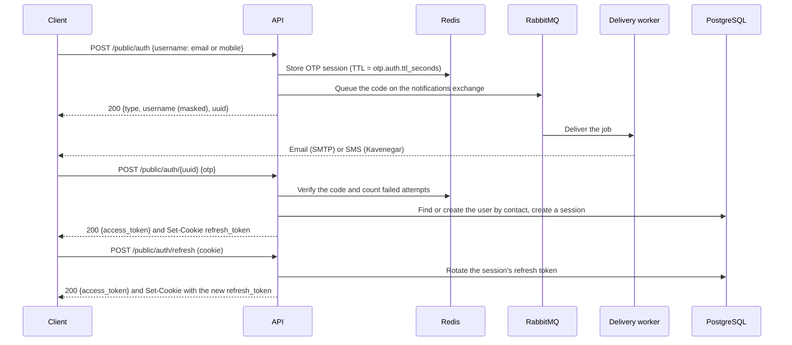

# API reference

This document describes the HTTP and WebSocket API as currently implemented on `main`. The API is not versioned yet. Moving it under `/api/v1` with a stable error contract is tracked in [#53](https://github.com/mdastpak/Crypto-Exchange/issues/53). The generated Swagger UI at `/swagger/index.html` currently covers only the currency endpoints ([#54](https://github.com/mdastpak/Crypto-Exchange/issues/54)).

## Conventions

### Response envelope

Every endpoint except `/system/*` responds with:

```json
{
  "status": 200,
  "message": "Human-readable message",
  "info": {}
}
```

`status` repeats the HTTP status code. `info` holds the payload and is omitted when there is none. Error responses use the same envelope and contain only a fixed message for each error. Internal details, such as database, Redis, or provider errors, are only written to the server log. A panic in a handler returns `500` with the message `Internal server error`.

### Authentication

Protected routes, including both logout routes, expect the access token with the `Bearer` scheme:

```http
Authorization: Bearer <access token>
```

The scheme is case-insensitive. A bare token or any other scheme is rejected with `401`. Every `401` from the authentication middleware carries `WWW-Authenticate: Bearer`.

Tokens are JWTs signed with RS256. The header names the signing key in `kid`, and the claims are:

| Claim | Description |
| --- | --- |
| `uuid` | The user's public identifier (`users.hk`) |
| `role` | `user` or `admin` |
| `typ` | `access` or `refresh`. Protected routes accept only `access` tokens, and the refresh endpoint accepts only `refresh` tokens. |
| `sid` | The sign-in session the token belongs to |
| `jti` | A unique token ID |
| `iss` | `jwt.issuer` from the configuration |
| `aud` | `user-api` or `admin-api`, matching the role |
| `iat`, `exp` | Issue and expiry time. `exp` is required. |

Each role has its own signing keys. User routes accept only user tokens and admin routes only admin tokens, so a user token can never reach an admin route, even with a forged `role` claim. A token is rejected with `401` when any of the following holds:

- Its algorithm is not RS256.
- Its `kid` is missing or names no key of the route's role.
- Its issuer or audience is wrong.
- It has no expiry or has expired.
- Its type or role does not match the route.

Each sign-in creates a session in the `sessions` table. Only SHA-256 hashes of the tokens are stored.

### Rate limiting

Rate-limited responses return `429 Too Many Requests` with the `X-RateLimit-Limit`, `X-RateLimit-Remaining`, and `Retry-After` headers. Every route is subject to the general REST limit per client IP. Sign-in adds two limits per client IP: code requests per hour and code verifications per minute. [docs/configuration.md](configuration.md#rate_limits) lists the limits and their routes.

## Sign-in flow



Codes are queued and delivered in the background: by email when the contact is an email address, and by SMS when it is a mobile number. Delivery is retried while the code is valid. A `200` response therefore means that the code was queued, not that it has arrived. [configuration.md](configuration.md#notifications) describes the channels. For local development, `otp.auth.dev_log_codes` writes codes to the server log instead (see [configuration.md](configuration.md#otp)). Codes and raw contacts are never logged otherwise.

### `POST /public/auth`

Requests an OTP.

```json
{ "username": "user@example.com" }
```

The `username` field holds the contact that receives the code, as one of the following:

| Contact type | Format | Delivered by |
| --- | --- | --- |
| `email` | A standard email address | Email (`notifications.email`) |
| `mobile` | An Iranian mobile number: `09` followed by 9 digits | SMS (`notifications.sms`) |

Usernames are not accepted, because a code cannot be delivered to a username, so it cannot prove who is signing in.

Response `200`:

```json
{
  "status": 200,
  "message": "OTP sent to your contact",
  "info": { "type": "email", "username": "use*****@example.com", "uuid": "1b9d6bcd-bbfd-4b2d-9b5d-ab8dfbbd4bed" }
}
```

Errors:

- `400`: missing or invalid contact (`Invalid contact information`), or a contact type whose channel is not configured on the server, for example `Sign-in by mobile is not available`
- `429`: the rate limit is exceeded, the contact has received `otp.auth.contact_requests_per_hour` codes in the current hour (`Too many sign-in codes requested. Please try again later.`), or its verification attempts are used up (`Too many failed attempts. Please try again later.`). See [Sign-in limits](#sign-in-limits).
- `500`: the code could not be stored (`Failed to store OTP`) or queued (`Failed to send OTP`)

### `POST /public/auth/{uuid}`

Verifies the OTP for the session `uuid` returned by the previous call.

```json
{ "otp": "123456" }
```

Response `200`:

```json
{
  "status": 200,
  "message": "OTP verified successfully",
  "info": { "access_token": "<jwt>" }
}
```

The refresh token is **only** delivered in a cookie, never in the body, so scripts running in the page cannot read it:

```http
Set-Cookie: refresh_token=<jwt>; Path=/public/auth; Max-Age=<refresh_token.expiration_minutes × 60>; HttpOnly; Secure; SameSite=Strict
```

The browser sends the cookie only to `/public/auth/*`, which covers the refresh and logout routes. Because it is `Secure`, browsers only store it over HTTPS. Chrome and Firefox also store it on `http://localhost` during development.

Errors:

- `400`: invalid UUID or missing code
- `401`: wrong, expired, or already used code
- `403`: the account is disabled, deleted, or suspended (`This account cannot sign in. Please contact support.`), or belongs to an administrator (`Administrators must use the admin sign-in.`). The code was right, so no information is revealed to someone who does not control the contact.
- `429`: the attempts of the code or of the contact are used up. See [Sign-in limits](#sign-in-limits).
- `500`: the user could not be created or loaded, or the session could not be read

The first successful verification for a contact creates the user. Each email address and mobile number belongs to at most one user, and concurrent first sign-ins for the same contact resolve to the same user. Email addresses are matched case-insensitively, so `Alice@Example.com` and `alice@example.com` are the same contact.

### Sign-in limits

These limits apply on top of the per-IP [rate limits](#rate-limiting):

- A code is valid for `otp.auth.ttl_seconds` and signs in only once, even when it is sent in concurrent requests.
- A code can be tried `otp.auth.retry_limit` times. Each attempt is counted before the code is checked, so concurrent requests cannot get more tries. After the last failed attempt, the code is erased and further attempts get `429` until the session expires.
- Each email address or mobile number receives at most `otp.auth.contact_requests_per_hour` codes per hour. Email addresses are compared case-insensitively.
- Each contact gets at most `otp.auth.contact_attempts_per_hour` attempts per hour across all of its codes, so requesting a new code does not bring new attempts. While they are used up, no new code is issued for the contact. A successful sign-in resets the count.

Redis stores only an HMAC of each code and the contact encrypted with AES-GCM, both keyed by `otp.auth.secret`.

### `POST /public/auth/refresh`

Exchanges the `refresh_token` cookie for a new access token. No request body is needed.

Response `200`: `{"info": {"access_token": "<jwt>"}}`, together with a `Set-Cookie` header that carries a **new** refresh token. Each refresh token can be used only once:

- The session's refresh token is replaced on every refresh (rotation), and its expiry moves forward by `refresh_token.expiration_minutes`.
- Presenting a refresh token that was already rotated is treated as theft: the whole session is revoked, and its newest refresh token stops working too. This also applies when a client sends the same refresh token in two concurrent requests, so clients must not refresh in parallel.

Errors: `401` when the cookie is missing, invalid, or expired, when it holds an access token, or when the session has been revoked. A `401` also clears the cookie.

### `POST /public/auth/logout` and `POST /user/logout`

Ends the session of the access token sent in the `Authorization` header:

- The session is revoked, so its refresh token stops working.
- The access token is blacklisted until it expires.
- The refresh token cookie is cleared.

Other access tokens issued earlier for the same session stay valid until they expire (`access_token.expiration_minutes`).

Both routes require a user access token as `Authorization: Bearer <token>`. `POST /public/auth/logout` exists because the refresh token cookie is only sent to `/public/auth/*`, so only this route can clear it in the browser.

Response `200`. Errors: `401` for a missing, invalid, or blacklisted token, or a token without the `Bearer` scheme.

## Admin sign-in

Administrators are created by an operator with the `cmd/admin` command (see the [README](../README.md#6-create-an-administrator-optional)), never through the API. They sign in with two factors:

1. A one-time code sent to their email address.
2. A code from their authenticator app (TOTP, RFC 6238: 6 digits, 30-second steps).

Admin sign-in needs `jwt.ssl.admin` keys, [`admin.totp_key`](configuration.md#admin), and email delivery. Without them, both sign-in routes return `503 Admin sign-in is not available`.

### `POST /admin/auth`

Starts an admin sign-in.

```json
{ "email": "admin@example.com" }
```

Response `200` for every valid address, so that it does not reveal which addresses belong to administrators:

```json
{
  "status": 200,
  "message": "If this address belongs to an administrator, a sign-in code was sent to it",
  "info": { "uuid": "1b9d6bcd-bbfd-4b2d-9b5d-ab8dfbbd4bed" }
}
```

A code is only emailed when the address belongs to an active administrator. The [sign-in limits](#sign-in-limits) apply, counted separately from user sign-in.

Errors: `400` for an invalid address, `429` when a limit is reached, `503` when admin sign-in is not configured.

### `POST /admin/auth/{uuid}`

Completes the sign-in with both codes.

```json
{ "otp": "123456", "totp": "654321" }
```

Response `200`: `{"info": {"access_token": "<jwt>"}}`. Admin tokens are access tokens for the `admin-api` audience. There is no refresh token: administrators sign in again when the token expires after `access_token.expiration_minutes`.

- The emailed code is checked first, and this ends the sign-in session, so a wrong authenticator code needs a new emailed code.
- Each authenticator code is accepted once.

Errors:

- `400`: invalid UUID, or a missing code
- `401 Invalid or expired code`: either code is wrong or expired, or the address is not an active administrator. The answer does not say which.
- `429`: the attempts of the emailed code are used up
- `503`: admin sign-in is not configured

### `POST /admin/logout`

Requires an admin token. Blacklists the token until it expires. Response `200`.

### Checks on admin routes

On every request, all `/admin/*` routes except sign-in check that the token's administrator still has the admin role, the approved status, and an enrolled authenticator. Demoting or disabling an administrator therefore revokes its tokens at once, also when the change is made directly in the database. Such a token gets `401 Unauthorized - Administrator is not active`.

## Currencies

### Currency object

```json
{
  "id": 1,
  "hk": "0d4f2a7e-8c1b-4f0e-9a51-3c2f6f1b7d10",
  "status": "approved",
  "info": {
    "en_name": "Tether",
    "fa_name": "<name in Persian>",
    "symbol": "USDT",
    "if_fiat": false,
    "is_token": true,
    "contract": "TR7NHqjeKQxGTCi8q8ZY4pL8otSzgjLj6t"
  },
  "created_at": "",
  "updated_at": ""
}
```

`status` is one of `approved`, `pending`, `suspend`, or `deleted`. Only `approved` currencies are public: they are the only ones returned by public and user routes and announced to WebSocket clients. `symbol` is unique, and so is `contract` when it is not empty: native coins and fiat currencies have no contract. The field name `if_fiat` is a known typo ([#35](https://github.com/mdastpak/Crypto-Exchange/issues/35)).

### `GET /public/currencies`

Lists the public currencies, read from the Redis cache. Response `200` with an array in `info`, which is empty when there are none.

### `GET /public/currencies/{hk}`

Returns one public currency. Errors: `404` when it is not cached or not public, with the same message, so a hidden currency looks like a missing one.

### `POST /admin/currencies` (admin)

Creates a currency.

```json
{
  "status": "pending",
  "info": {
    "en_name": "Tether",
    "fa_name": "<name in Persian>",
    "symbol": "USDT",
    "if_fiat": false,
    "is_token": true,
    "contract": "TR7NHqjeKQxGTCi8q8ZY4pL8otSzgjLj6t"
  }
}
```

| Field | Rules |
| --- | --- |
| `status` | `approved`, `pending`, or `suspend`. Optional, `pending` by default. A currency is only marked `deleted` by `DELETE`. |
| `info.en_name`, `info.fa_name` | Required, at most 100 characters. Leading and trailing spaces are removed. |
| `info.symbol` | Required, 2 to 15 letters or digits. It is stored in upper case, so `usdt` and `USDT` are the same symbol. |
| `info.is_token`, `info.if_fiat` | Optional, `false` by default. A fiat currency cannot be a token. |
| `info.contract` | Required for a token. At most 128 letters, digits, or `:`, `_`, `.`, `-`. |

Fields that the server controls, such as `id`, `hk`, and the timestamps, and any other unknown field, are rejected.

Response `201`:

```json
{
  "status": 201,
  "message": "Currency created successfully.",
  "info": { "hk": "0d4f2a7e-8c1b-4f0e-9a51-3c2f6f1b7d10", "status": "pending" }
}
```

Errors:

- `400` with the message `Invalid input: Please check the provided data format.`: the body is not a JSON object of this shape.
- `400` with the message `Validation failed`: `info.errors` names each invalid field, for example `{"errors": {"info.symbol": "must be 2 to 15 upper-case letters or digits"}}`.
- `409`: the symbol or the contract belongs to another currency. `info` holds a stable code and the field: `{"code": "duplicate_symbol", "field": "info.symbol"}`, or `duplicate_contract` and `info.contract`.

### `PUT /admin/currencies/{hk}` (admin)

Partially updates a currency with a body of the same shape as `POST`. Only the fields that are sent change, and a flag can be set back to `false`. The updated currency must satisfy the same rules as a new one.

Response `200`. Errors: `400` for an invalid UUID, an invalid body, or invalid fields, as for `POST`; `404` when the currency is not found; `409` for a duplicate symbol or contract.

### `DELETE /admin/currencies/{hk}` (admin)

Soft-deletes a currency (sets `deleted_at` and `status = deleted`) and removes it from the cache.

Response `200`. Errors: `400` for an invalid UUID, `404` when the currency is not found or already deleted.

Changes that affect the public view publish an event to the `price_updates` exchange:

```json
{
  "entity": "currencies",
  "action": "create",
  "hk": "0d4f2a7e-8c1b-4f0e-9a51-3c2f6f1b7d10",
  "info": { "symbol": "USDT" },
  "server_time": "2026-11-02T10:00:00Z"
}
```

Events and the cache describe what public clients can see, so they follow the visibility of a currency rather than the admin operation:

| Change | Cache | Event |
| --- | --- | --- |
| A currency becomes approved: it is created as approved, or updated to approved | Added | `create` with the currency's `info` |
| An approved currency is updated and stays approved | Replaced | `update` with the currency's `info` |
| An approved currency is suspended, set back to pending, or deleted | Removed | `delete` with `info` set to `{"status": "<new status>"}` |
| A currency that is not approved is created, updated, or deleted | Not cached | None |

## User

The user routes require a user access token. The profile routes take no user ID: they always act on the user that the token names, so a user cannot read or change another user's profile.

### `GET /user/profile`

Returns the profile of the signed-in user:

```json
{
  "status": 200,
  "message": "Profile retrieved successfully.",
  "info": {
    "uuid": "5b0c1a52-3f5e-4c2a-9d1e-2f7f8f0b6a11",
    "status": "approved",
    "contact": { "email": "ali*****@example.com" },
    "first_name": "Ali",
    "last_name": null,
    "display_name": null,
    "kyc_status": "PENDING",
    "kyc_tier": "NONE",
    "created_at": "2026-11-05T09:30:00Z"
  }
}
```

`contact` holds the email address and the mobile number the user signs in with, masked: the first three characters stay visible, with the domain of an email address or the last three digits of a mobile number. Names that are not set, and a creation time that was not recorded, are `null`.

Errors: `401` for a missing or invalid token; `403` when the account was disabled, deleted, or suspended, or became an administrator account, after the token was issued (`This account is not available. Please contact support.`); `404` when the user was deleted.

### `PATCH /user/profile`

Changes the names in the profile and returns the updated profile, as `GET` does.

```json
{ "first_name": "Ali", "display_name": "" }
```

| Field | Rules |
| --- | --- |
| `first_name`, `last_name`, `display_name` | Optional. Spaces around the name are trimmed, and an empty string clears the field. At most 100 characters, without control characters or characters that reorder text (U+202A to U+202E and U+2066 to U+2069), and with at least one visible character. The zero-width non-joiner is allowed. |

Only the fields sent change, and at least one must be sent. Any other field, such as `uuid`, `contact`, `status`, or `kyc_tier`, is rejected. Errors: `400` for an invalid body, or with `Validation failed` and a message per field in `info.errors`; `401`, `403`, and `404` as for `GET`.

## System

These endpoints return plain JSON without the envelope.

### `GET /system/healthcheck`

```json
{
  "status": "ok",
  "details": {
    "postgres": { "status": "ok", "last_check": "2026-11-02T10:00:00Z", "latency_ms": 1 },
    "redis": { "status": "ok", "last_check": "2026-11-02T10:00:00Z", "latency_ms": 1 },
    "rabbitmq": { "status": "ok", "last_check": "2026-11-02T10:00:00Z" }
  }
}
```

`status` is `degraded` when any dependency fails. RabbitMQ is reported as `error` while its connection or its publishing channel is being restored. The HTTP status is currently always `200` ([#33](https://github.com/mdastpak/Crypto-Exchange/issues/33)).

### `GET /system/ping`

```json
{ "message": "pong", "timestamp": "2026-11-02T10:00:00Z" }
```

## WebSocket

Connect to `ws://<host>:<port>/ws/`. The trailing slash is required. Browser origins must match `websocket.allowed_origins`, or the request must be same-origin when the list is empty.

### Connection behavior

| Setting | Value |
| --- | --- |
| Maximum inbound message size | 512 bytes |
| Server ping interval | 30 seconds |
| Read deadline | 60 seconds, extended on every pong |
| Per-client outbound buffer | 256 messages. Messages are dropped when the buffer is full. |

### Client messages

Ping, optionally with an IANA time zone for the reply timestamp:

```json
{ "event": "ping", "timezone": "Europe/Berlin" }
```

The server replies:

```json
{ "event": "pong", "timestamp": "2026-11-02T11:00:00+01:00" }
```

`{"event": "subscribe", "channels": [...]}` is accepted but has no effect yet. The channel protocol is tracked in [#66](https://github.com/mdastpak/Crypto-Exchange/issues/66).

### Server messages

Currency events (see [Currencies](#currencies)) are broadcast to every connected client, with a `server_time` field added:

```json
{
  "entity": "currencies",
  "action": "create",
  "hk": "0d4f2a7e-8c1b-4f0e-9a51-3c2f6f1b7d10",
  "info": { "symbol": "USDT" },
  "server_time": "2026-11-02T10:00:00Z"
}
```

Every server instance consumes the events through a queue of its own, so a client receives every event whichever instance it is connected to. Each message is a separate frame that holds exactly one JSON document.
