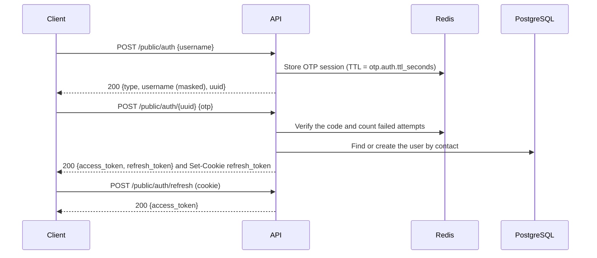

# API reference

This document describes the HTTP and WebSocket API as currently implemented on `main`. The API is not versioned yet. Moving it under `/api/v1` with a stable error contract is tracked in [#53](https://github.com/mdastpak/Crypto-Exchange/issues/53). The generated Swagger UI at `/swagger/index.html` currently covers only the currency endpoints ([#54](https://github.com/mdastpak/Crypto-Exchange/issues/54)).

## Conventions

### Response envelope

Every endpoint except `/system/*` responds with:

```json
{
  "status": 200,
  "message": "Human-readable message",
  "info": {}
}
```

`status` repeats the HTTP status code. `info` holds the payload and is omitted when there is none. Error responses use the same envelope and contain only a message.

### Authentication

Protected routes expect the JWT access token in the `Authorization` header.

> [!NOTE]
> The `/admin/*` and `/user/*` middleware currently expects the **raw token without a `Bearer` prefix**. Only the logout handlers strip the prefix. Consistent `Bearer` support is tracked in [#17](https://github.com/mdastpak/Crypto-Exchange/issues/17).

Tokens are RS256-signed JWTs with these claims:

| Claim | Description |
| --- | --- |
| `uuid` | The user's public identifier (`users.hk`) |
| `role` | `user` or `admin` |
| `iss` | `jwt.issuer` from the configuration |
| `iat`, `exp` | Issue and expiry time |

### Rate limiting

Rate-limited responses return `429 Too Many Requests` with the `X-RateLimit-Limit`, `X-RateLimit-Remaining`, and `Retry-After` headers. [docs/configuration.md](configuration.md#rate_limits) lists the limits per route group.

## Sign-in flow



OTP codes are currently written to the server log rather than delivered by email or SMS ([#13](https://github.com/mdastpak/Crypto-Exchange/issues/13), [#14](https://github.com/mdastpak/Crypto-Exchange/issues/14)).

### `POST /public/auth`

Requests an OTP.

```json
{ "username": "user@example.com" }
```

`username` accepts one of the following:

| Contact type | Format |
| --- | --- |
| `email` | A standard email address |
| `mobile` | An Iranian mobile number: `09` followed by 9 digits |
| `username` | 6 to 20 characters of `A-Z`, `a-z`, `0-9`, and `_`. It must not start with a digit or `_` and must not contain `__`. |

Response `200`:

```json
{
  "status": 200,
  "message": "OTP sent to your contact",
  "info": { "type": "email", "username": "use*****@example.com", "uuid": "1b9d6bcd-bbfd-4b2d-9b5d-ab8dfbbd4bed" }
}
```

Errors: `400` for a missing or invalid contact, `429` when the rate limit is exceeded.

### `POST /public/auth/{uuid}`

Verifies the OTP for the session `uuid` returned by the previous call.

```json
{ "otp": "123456" }
```

Response `200`:

```json
{
  "status": 200,
  "message": "OTP verified successfully",
  "info": { "access_token": "<jwt>", "refresh_token": "<jwt>" }
}
```

The refresh token is also set as an `HttpOnly`, `Secure` cookie named `refresh_token` with `Path=/`.

Errors:

- `400`: invalid UUID or missing code
- `401`: wrong or expired code
- `429`: too many failed attempts (`otp.auth.retry_limit`)
- `500`: user creation failed ([#8](https://github.com/mdastpak/Crypto-Exchange/issues/8))

### `POST /public/auth/refresh`

Issues a new access token from the `refresh_token` cookie. No request body is needed.

Response `200`: `{"info": {"access_token": "<jwt>"}}`. Errors: `401` when the cookie is missing, invalid, or expired.

### `POST /public/auth/logout` and `POST /user/logout`

Revokes the access token sent in the `Authorization` header (with or without a `Bearer` prefix) until it expires. The refresh token is not revoked yet ([#10](https://github.com/mdastpak/Crypto-Exchange/issues/10)).

Response `200`. Errors: `401` for a missing or invalid token.

## Currencies

### Currency object

```json
{
  "id": 1,
  "hk": "0d4f2a7e-8c1b-4f0e-9a51-3c2f6f1b7d10",
  "status": "approved",
  "info": {
    "en_name": "Tether",
    "fa_name": "<name in Persian>",
    "symbol": "USDT",
    "if_fiat": false,
    "is_token": true,
    "contract": "TR7NHqjeKQxGTCi8q8ZY4pL8otSzgjLj6t"
  },
  "created_at": "",
  "updated_at": ""
}
```

`status` is one of `approved`, `pending`, `suspend`, or `deleted`. `symbol` and `contract` must be unique. The field name `if_fiat` is a known typo ([#35](https://github.com/mdastpak/Crypto-Exchange/issues/35)).

### `GET /public/currencies`

Lists the currencies held in the Redis cache. Response `200` with an array in `info`, which is empty when there are none.

### `GET /public/currencies/{hk}`

Returns one cached currency. Errors: `404` when it is not cached.

### `POST /admin/currencies` (admin)

Creates a currency. The body is a currency object without `id` and `hk`. Always send `status`. Omitting it currently returns `500` ([#23](https://github.com/mdastpak/Crypto-Exchange/issues/23)).

Response `201`. Errors: `400` for an invalid body, `500` for duplicates or other database errors ([#22](https://github.com/mdastpak/Crypto-Exchange/issues/22)).

### `PUT /admin/currencies/{hk}` (admin)

Partially updates a currency. Only non-empty fields are applied, so boolean flags cannot be reset to `false` yet ([#35](https://github.com/mdastpak/Crypto-Exchange/issues/35)).

Response `200`. Errors: `400` for an invalid UUID or body, `404` when the currency is not found.

### `DELETE /admin/currencies/{hk}` (admin)

Soft-deletes a currency (sets `deleted_at` and `status = deleted`) and removes it from the cache.

Response `200`. Errors: `400` for an invalid UUID, `404` when the currency is not found or already deleted.

Create, update, and delete publish an event to the `price_updates` exchange:

```json
{
  "entity": "currencies",
  "action": "create",
  "hk": "0d4f2a7e-8c1b-4f0e-9a51-3c2f6f1b7d10",
  "info": { "symbol": "USDT" },
  "server_time": "2026-11-02T10:00:00Z"
}
```

## User

| Route | Current behavior |
| --- | --- |
| `GET /user/profile` | Returns the currency list instead of the profile ([#27](https://github.com/mdastpak/Crypto-Exchange/issues/27)) |
| `POST /user/update` | Returns `501 Not Implemented` |

## System

These endpoints return plain JSON without the envelope.

### `GET /system/healthcheck`

```json
{
  "status": "ok",
  "details": {
    "postgres": { "status": "ok", "last_check": "2026-11-02T10:00:00Z", "latency_ms": 1 },
    "redis": { "status": "ok", "last_check": "2026-11-02T10:00:00Z", "latency_ms": 1 },
    "rabbitmq": { "status": "ok", "last_check": "2026-11-02T10:00:00Z" }
  }
}
```

`status` is `degraded` when any dependency fails. The HTTP status is currently always `200` ([#33](https://github.com/mdastpak/Crypto-Exchange/issues/33)).

### `GET /system/ping`

```json
{ "message": "pong", "timestamp": "2026-11-02T10:00:00Z" }
```

## WebSocket

Connect to `ws://<host>:<port>/ws/`. The trailing slash is required. Browser origins must match `websocket.allowed_origins`, or the request must be same-origin when the list is empty.

### Connection behavior

| Setting | Value |
| --- | --- |
| Maximum inbound message size | 512 bytes |
| Server ping interval | 30 seconds |
| Read deadline | 60 seconds, extended on every pong |
| Per-client outbound buffer | 256 messages. Messages are dropped when the buffer is full. |

### Client messages

Ping, optionally with an IANA time zone for the reply timestamp:

```json
{ "event": "ping", "timezone": "Europe/Berlin" }
```

The server replies:

```json
{ "event": "pong", "timestamp": "2026-11-02T11:00:00+01:00" }
```

`{"event": "subscribe", "channels": [...]}` is accepted but has no effect yet. The channel protocol is tracked in [#66](https://github.com/mdastpak/Crypto-Exchange/issues/66).

### Server messages

Currency events (see [Currencies](#currencies)) are meant to be broadcast to every client, with a `server_time` field added. The broadcast consumer is not started by the server yet ([#19](https://github.com/mdastpak/Crypto-Exchange/issues/19)). When several messages are queued, they can currently arrive concatenated in a single frame ([#20](https://github.com/mdastpak/Crypto-Exchange/issues/20)).
