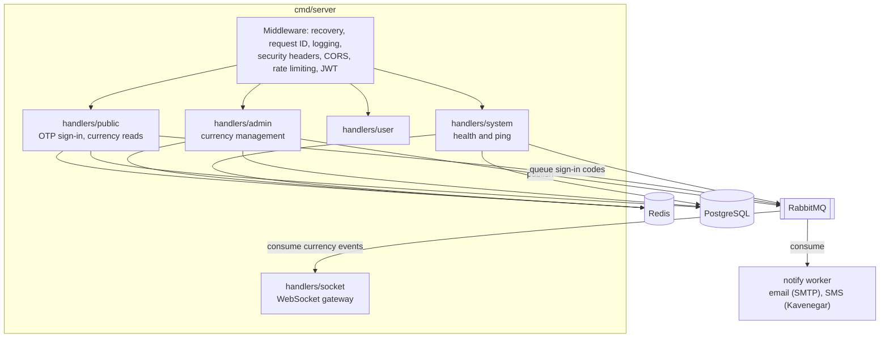
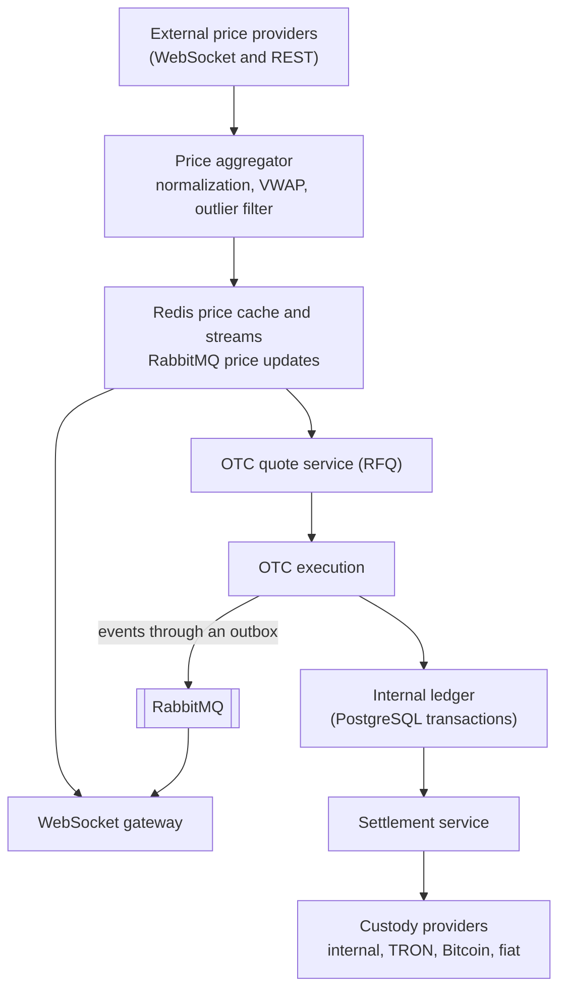

# Architecture

This document describes the current architecture on `main` and the target architecture from the roadmap.

## Current architecture

The service is a single Go binary (`cmd/server`) that serves REST and WebSocket traffic and depends on PostgreSQL, Redis, and RabbitMQ.



### Packages

| Package | Responsibility |
| --- | --- |
| `cmd/server` | Startup, route registration, graceful shutdown |
| `cmd/admin` | Command for operators: create administrators, replace their authenticator, disable them, and list, rotate, retire, and re-wrap the data-protection keys |
| `internal/adminauth` | Administrator accounts: creation, TOTP enrollment with encrypted secrets, authenticator checks with replay protection |
| `internal/totp` | Time-based one-time passwords (RFC 6238) |
| `internal/assetregistry` | Loads and checks `config/assets.yaml`: one entry per asset with its networks, contract addresses validated by format and checksum (EIP-55 for Ethereum, Base58Check for TRON), and markets of known assets. Not loaded at runtime yet ([#57](https://github.com/mdastpak/Crypto-Exchange/issues/57)). |
| `internal/keys` | Data-protection keys: a `Provider` interface for the key-encryption key, with Transit (Vault or OpenBao) and a local development provider, the wrapped keys in `data_keys`, and a keyring whose keys only offer the operation of their purpose (see [data-protection.md](data-protection.md)) |
| `internal/config` | YAML loading, defaults, environment overrides, validation (see [configuration.md](configuration.md)). The YAML files are in `config/`, whose only Go code embeds `config.example.yaml` as the fallback. |
| `internal/auth` | RS256 JWT issuing and verification with separate keys per role, `kid`-based key selection and retired keys for rotation, Redis-backed token blacklist, admin and user middleware |
| `internal/db` | PostgreSQL connection with startup retries and migrations under an advisory lock, Redis client |
| `internal/rabbitmq` | Connection and publishing with confirms. One supervisor goroutine owns the connection and the publishing channel: it reconnects after a broker restart and restores the channel after a channel-level error, while publishes wait up to five seconds for it. |
| `internal/notify` | Sign-in code delivery: the queue sender used by OTP sign-in, the worker that consumes the queue with retries and a dead-letter queue, and the SMTP and Kavenegar SMS channels |
| `internal/otp` | Sign-in codes: unbiased generation, Redis sessions with hashed codes and encrypted contacts, atomic attempt limits per code and per contact |
| `internal/handlers/*` | HTTP and WebSocket handlers. They currently contain the business logic and SQL directly ([#48](https://github.com/mdastpak/Crypto-Exchange/issues/48)). |
| `internal/middleware` | Security headers, CORS, Redis rate limiters, validation and recovery helpers |
| `internal/domain/*` | Exchange domain model (asset, market, order, trade, balance, account, kyc, custody, shared). It is not used by handlers yet. |
| `internal/models`, `internal/helpers` | API models and the response envelope |

### Request pipeline

Middleware is applied to every route, including `/` and `/swagger/*`, in this order: Gin logger; recovery, which answers a panic with `500 Internal server error` in the standard envelope and logs the details; request ID; security headers; CORS; the REST rate limiter; and the request body limit. `RouteHandler` registers it before any route, because Gin applies middleware only to the routes registered after it. Route groups add their own layers:

| Group | Additional middleware |
| --- | --- |
| `/ws` | WebSocket rate limit (applied to the upgrade request) |
| `/public` | Authentication rate limit |
| `/admin/auth` | Authentication rate limit. Admin sign-in, without a token. |
| `/admin` | `JWTAdminVerification` (Bearer access token signed with an admin key, blacklist check), `RequireActiveAdmin` (the token's administrator is still active in the database), trading rate limit |
| `/user` | `JWTUserVerification` (Bearer access token signed with a user key, blacklist check), trading rate limit, and on every route except `/user/logout` `RequireActiveSession` (the token's session is active and its user can still sign in, checked in the database) |
| `POST /public/auth/logout` | `JWTUserVerification`, like `/user/logout` |

### Startup and shutdown

1. Load the configuration and the RSA key pair.
2. Connect to PostgreSQL with retries, then apply the migrations under a PostgreSQL advisory lock.
3. Connect to Redis, then to RabbitMQ, and declare the fan-out exchanges.
4. Load the data-protection keys when `keys.provider` is set: unwrap them through the key management service, creating the first version of each on the first start. The server refuses to start when a key cannot be unwrapped.
5. Declare the sign-in code queues and start the delivery worker, when a delivery channel is configured. Subscribe the WebSocket gateway to currency events.
6. Start the HTTP server (with TLS when enabled). Startup does not touch the shared currency cache: the list of public currencies is loaded from PostgreSQL on the first read that misses it ([#52](https://github.com/mdastpak/Crypto-Exchange/issues/52)).
7. On `SIGINT` or `SIGTERM`, or when the HTTP server fails, stop within `server.shutdown_timeout_seconds` (30 by default), in this order ([#49](https://github.com/mdastpak/Crypto-Exchange/issues/49)):
   1. `/system/ready` answers `503` with `"status": "draining"`, so that load balancers stop routing new requests to the instance, and responses ask clients to close their connections.
   2. The instance keeps serving for `server.drain_seconds` (0 by default), the time the load balancers take to notice. A server that failed skips this step.
   3. The HTTP server stops accepting connections and waits for the requests in flight. If the deadline passes first, it closes their connections.
   4. The outbox relay and the delivery worker stop. Messages the relay has not sent stay in the outbox, for the relay of another instance.
   5. The WebSocket clients get a close frame with code `1001` and have one second to answer it, and the event consumer stops.
   6. RabbitMQ, Redis, and PostgreSQL close, in that order.

   Each step runs even when an earlier one fails, and every `Close` and `Shutdown` may be called more than once. A failure at any point of the startup also closes what was opened before it.

   Production runs several instances, and stopping one does not stop the service. Shutdown concerns only the stopping instance. Its readiness state is in its memory, and it closes only its own connection pools to PostgreSQL, Redis, and RabbitMQ. Nothing shared is deleted: the currency cache, sessions, and rate-limit counters in Redis stay, and so do the exchanges and the durable queues. Sign-in code jobs that the instance has not delivered go back to the shared queue, where another instance delivers them; the broker also returns the jobs it had sent to this instance but that were not acknowledged. Only the instance's own WebSocket event queue, which no other instance reads, is removed by the broker once its channel closes. WebSocket clients reconnect through the load balancer to another instance. Set `server.drain_seconds` to a little more than the readiness interval of the load balancer, so that it stops routing to the instance before the instance refuses connections; release mode warns at startup when it is 0.

## Data stores

### PostgreSQL

Migrations live in `internal/db/migrations` and are applied with golang-migrate.

| Migration | Contents | Used by code |
| --- | --- | --- |
| 1 | `currencies` (JSONB `info`, status enum) | Yes |
| 2 | `users` (JSONB `info`, status enum) | Yes |
| 3 | `assets` | Not yet |
| 4 | `markets`, `market_stats_24h` | Not yet |
| 5 | `orders`, `order_events` | Not yet |
| 6 | `trades`, `trade_events` | Not yet |
| 7 | `balances`, `balance_snapshots`, `balance_changes` | Not yet |
| 8 | Extra `users` columns, `sub_accounts`, `api_keys`, `sessions` | `sessions` only (sign-in sessions and refresh token rotation) |
| 9 | `kyc_profiles`, `kyc_documents`, `kyc_applications`, `sanctions_screenings`, `aml_rules`, `aml_alerts` | Not yet |
| 10 | `deposit_addresses`, `deposits`, `withdrawals`, `settlements`, `custody_configs` | Not yet |
| 11 | Aligns the `users.info` constraint with OTP sign-in, and adds unique indexes on contact values | Yes |
| 12 | Adds `users.role` (`user` or `admin`) and `users.totp_last_step` | Yes (admin sign-in) |
| 13 | Makes only non-empty currency contracts unique | Yes |
| 14 | Unifies the user model: contacts move from `users.info` into `user_contacts`, `users.status` becomes `account_status_type`, and `users.info` and the unused contact columns of migration 8 are dropped | Yes |
| 15 | `data_keys`: the data-protection keys, wrapped by the key-encryption key | Yes, when `keys.provider` is set |
| 16 | Replaces the plaintext `api_keys.secret_hash` with `secret_sealed` (HMAC secrets, sealed with a `field-enc` key) and `ed25519_public_key`, with a constraint that each key type keeps only what verifying it needs | Not yet (API keys are #63) |
| 17 | Balance invariants: no negative amounts, `total` computed as `available + locked`, `on_chain` dropped, one balance per user, asset, and sub-account also without a sub-account | Not yet (the ledger is #60) |
| 18 | `outbox_events`: the transactional outbox, with a partial index on the pending messages and one on the publish time for the cleanup | Yes |

Users have one model since migration 14 ([#38](https://github.com/mdastpak/Crypto-Exchange/issues/38)):

- `users` holds the account: `hk` is the ID that every other table references, `status` is `account_status_type` (`ACTIVE`, `PENDING_VERIFICATION`, `INACTIVE`, `SUSPENDED`, `BANNED`), and `deleted_at` alone marks a deleted account.
- `user_contacts` holds the contacts: the type (`email`, `mobile`, or the legacy `username`), the value, `verified_at`, and `is_primary`. The database makes each contact value belong to one user, with emails and usernames compared case-insensitively, and allows one primary contact of each type per user.
- The Go type is `account.User`.

A balance (`internal/domain/balance`) is a state machine of one asset in one account ([#43](https://github.com/mdastpak/Crypto-Exchange/issues/43)). Available funds can be traded and withdrawn, locked funds are reserved by open orders and pending withdrawals, and pending deposits are detected but not credited yet. The total, what the user owns, is available plus locked. Every change is one transition of a positive amount, which fails without changing anything when a component would become negative:

| Transition | Available | Locked | Pending | Total | When |
| --- | --- | --- | --- | --- | --- |
| `PENDING_DEPOSIT` | | | +a | | A deposit is detected |
| `DEPOSIT` | +a | | -a | +a | The deposit is credited |
| `DEPOSIT_FAILED` | | | -a | | The deposit will not be credited |
| `LOCK` | -a | +a | | | An order is placed, or a withdrawal requested |
| `UNLOCK` | +a | -a | | | The order is cancelled, or the withdrawal fails |
| `TRADE_CREDIT` | +a | | | +a | An asset is received in a trade |
| `TRADE_DEBIT` | | -a | | -a | An asset is given in a trade |
| `FEE` | | -a | | -a | A fee is charged, from the funds locked with the order |
| `WITHDRAWAL` | | -a | | -a | A withdrawal is completed |

Funds enter the total only through a credited deposit or a trade credit, and leave it only from locked funds. A property test applies random sequences of transitions and checks that the total changes by exactly the funds that entered or left. Each transition returns a change event with the components before and after and the version, which a repository uses for optimistic locking (`UPDATE ... WHERE version = $n`). The database enforces the same invariants (migration 17). Where funds are held on chain is tracked per wallet by custody, not in the user's balance.

Currencies still use the legacy JSONB table next to the typed `assets` table. Unifying them is tracked in [#57](https://github.com/mdastpak/Crypto-Exchange/issues/57).

#### The shared currency list

The public currency routes of every instance read one list in Redis ([#52](https://github.com/mdastpak/Crypto-Exchange/issues/52)), with one `MGET` that also returns the generation. The instances must not all load and write the list at the same time:

- **A miss**, after a change dropped the list or Redis lost it, is loaded by one instance only: the one that takes the `loading` lock. The others wait for the list and read it once it is written. If it does not come within two seconds, because the loading instance stopped or PostgreSQL is slow, they read PostgreSQL themselves, without writing the list. Within an instance, concurrent misses share one wait or load.
- **An old list**, past `redis.currency_cache_ttl_seconds`, is refreshed by the one request that takes the lock, while every other request, on every instance, is served the old list at once. So the list never disappears at the end of its time, and no burst of misses follows.
- **Changes** drop the list with one transaction that also counts the generation. Instances may drop it at the same time; each drop is the same. A load that began before a drop does not write what it read.
- **Redis unavailable**: each Redis call of a read gives up after 250 ms, and the read goes to PostgreSQL.

### Redis

| Key pattern | Purpose | Lifetime |
| --- | --- | --- |
| `{currencies}:public:v1` | The list of public (approved, not deleted) currencies and when it was loaded, as JSON, shared by all instances. Every admin change to a currency that was or becomes public drops it. | Fresh for `redis.currency_cache_ttl_seconds` (300). After that, one instance refreshes it while all of them keep serving it. The key expires after twice the time, if nothing reads it |
| `{currencies}:public:v1:loading` | Held by the one instance that loads and writes the list (`SET NX` with a random token, released only by its holder) | 10 seconds, if its holder stops |
| `{currencies}:public:v1:generation` | Counts the drops of the list. A load writes the list only if no drop happened since it began, so that a slow load cannot write what a change replaced. The hash tag keeps the three keys in one slot of a Redis cluster. | No expiry |
| `base_definitions:currency:<hk>` | The cache before [#52](https://github.com/mdastpak/Crypto-Exchange/issues/52), one key per currency. Nothing reads it any more; instances of the previous version still do during a rolling deploy, so it is left to expire. | 24 hours |
| `otp:session:<session-uuid>` | Sign-in session: HMAC of the code, encrypted contact, contact ID, and attempt count. The code and the contact are erased when its attempts are used up. | `otp.auth.ttl_seconds` |
| `otp:contact:<contact-id>:requests` | Codes issued to a contact in the current hour. The contact ID is an HMAC of the normalized contact. | 1 hour from the first code |
| `otp:contact:<contact-id>:attempts` | Verification attempts for a contact in the current hour, across all of its codes | 1 hour from the first attempt, removed by a successful sign-in |
| `blacklist:token:<sha256>` | Revoked access tokens | Until the token expires |
| `ratelimit:<scope>:<key>` | Rate-limit buckets and counters | Window-dependent |

### RabbitMQ

| Exchange or queue | Type | Purpose |
| --- | --- | --- |
| `price_updates` | Durable fan-out exchange | Currency change events, published by the outbox relay, and price ticks in the future |
| `trade_events` | Durable fan-out exchange | Declared at startup for upcoming features |
| `notifications` | Durable fan-out exchange | Sign-in code jobs |
| `notifications.otp` | Durable queue bound to `notifications` | Consumed by the delivery worker. Jobs expire with the code. |
| `notifications.dead-letter`, `notifications.otp.dead-letter` | Durable fan-out exchange and queue | Records of codes that could not be delivered, without the code or the raw contact, kept for seven days |
| Server-named queue per instance | Exclusive, auto-delete queue bound to `price_updates` | WebSocket broadcast consumer. Each instance has its own queue, so every instance receives every event. The queue disappears when the instance disconnects. |

#### The outbox

A change and the messages it causes are written in one transaction ([#89](https://github.com/mdastpak/Crypto-Exchange/issues/89)). The admin currency routes write the event of a change to the public view to `outbox_events`, so the event exists if and only if the change commits, also while RabbitMQ or Redis is unavailable. The relay of `internal/outbox` delivers the messages:

- **One instance at a time.** Every instance runs a relay, but each batch takes a transaction-scoped advisory lock, and an instance that does not get it skips the round. So two instances never publish the same message, and an instance that stops leaves its messages to the others.
- **In order.** Messages are relayed in id order. A message that fails holds back the later messages of its topic, so a currency's events never overtake each other; other topics go on.
- **Retries.** A failed message is tried again after 1 s, doubling up to 5 minutes, until it succeeds. Its attempts and last error are kept in its row.
- **Before publishing**, the relay drops the cached currency list, so that a drop that failed in the request is retried too. The admin routes also drop it and nudge the relay right after the commit, so changes show and events go out within milliseconds.
- **At least once.** A message whose publish succeeded is published again if the relay cannot record that. Events carry an `id`, so that clients can drop a repeated one.
- **Retention.** Published messages are deleted after seven days, a thousand at a time. The pending messages have a partial index, so the relay's query does not grow with the table. Partitioning, once trade events go through the outbox, is part of [#169](https://github.com/mdastpak/Crypto-Exchange/issues/169).

## Target architecture

The [roadmap](https://github.com/mdastpak/Crypto-Exchange/issues/85) evolves the service in phases: an automated OTC MVP, then spot trading, then derivatives. The OTC data flow is:



### Planned layering

Handlers will become thin transport adapters on top of services and repositories, wired by a composition root ([#48](https://github.com/mdastpak/Crypto-Exchange/issues/48)):

```text
transport (HTTP, WebSocket)  ->  services (business logic)  ->  repositories and publishers (PostgreSQL, Redis, RabbitMQ)
```

### Key technical decisions

| Topic | Decision |
| --- | --- |
| Monetary values | `shared.Decimal` (arbitrary precision). Never use floating point. |
| Identifiers | UUIDs, with timestamp-ordered UUIDv7 planned for orders and trades |
| Balance safety | Database transactions with row locks or optimistic versioning, plus an immutable change log ([#60](https://github.com/mdastpak/Crypto-Exchange/issues/60)) |
| Event delivery | Publisher confirms now. A transactional outbox is planned for trade events. |
| WebSocket scaling | Per-instance consumers and channel-based subscriptions ([#66](https://github.com/mdastpak/Crypto-Exchange/issues/66)) |
| Authentication | JWT for interactive users. HMAC and Ed25519 API keys for programmatic access ([#64](https://github.com/mdastpak/Crypto-Exchange/issues/64)). |
| Configuration | YAML plus environment variables, with fail-closed validation planned ([#41](https://github.com/mdastpak/Crypto-Exchange/issues/41)) |
