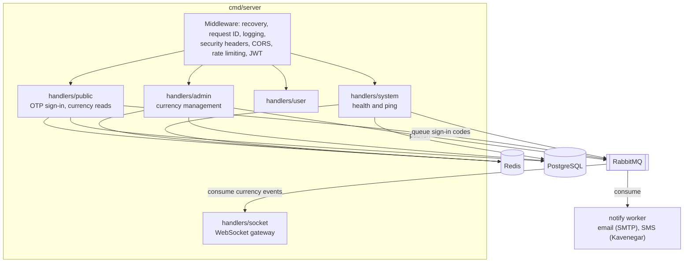
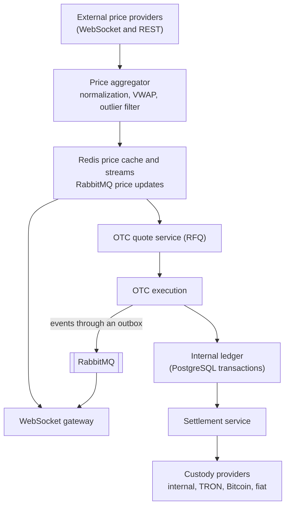

# Architecture

This document describes the current architecture on `main` and the target architecture from the roadmap.

## Current architecture

The service is a single Go binary (`cmd/server`) that serves REST and WebSocket traffic and depends on PostgreSQL, Redis, and RabbitMQ.



### Packages

| Package | Responsibility |
| --- | --- |
| `cmd/server` | Startup, route registration, graceful shutdown |
| `cmd/market-worker` | The worker of the global market data catalog ([#262](https://github.com/mdastpak/Crypto-Exchange/issues/262)): runs apart from the server, on the nodes that reach the sources, and answers its own health probes. See [market-data.md](market-data.md). |
| `cmd/admin` | Command for operators: create administrators, replace their authenticator, disable them; list, rotate, retire, and re-wrap the data-protection keys; handle outbox dead letters; manage platform controls; and check backups and restored databases |
| `internal/adminauth` | Administrator accounts: creation, TOTP enrollment with encrypted secrets, authenticator checks with replay protection |
| `internal/marketdata` | The global market data catalog: unverified assets with their identities at each source and their contracts, venues (global and Iranian exchanges), their pairs and latest tickers, and the runs of the jobs. Every write is idempotent and safe when several workers race. `internal/marketdata/jobs` runs each job once across the workers, with leases and fencing tokens; `internal/marketdata/source` defines the sources and their client, with the limits of each plan counted across the workers and the route of each node. See [market-data.md](market-data.md). |
| `internal/totp` | Time-based one-time passwords (RFC 6238) |
| `internal/assetregistry` | Loads and checks `config/assets.yaml`: one entry per asset with its networks, contract addresses validated by format and checksum (EIP-55 for Ethereum, Base58Check for TRON), and markets of known assets. Not loaded at runtime yet ([#57](https://github.com/mdastpak/Crypto-Exchange/issues/57)). |
| `internal/keys` | Data-protection keys: a `Provider` interface for the key-encryption key, with Transit (Vault or OpenBao) and a local development provider, the wrapped keys in `data_keys`, and a keyring whose keys only offer the operation of their purpose (see [data-protection.md](data-protection.md)) |
| `internal/config` | YAML loading, defaults, environment overrides, validation (see [configuration.md](configuration.md)). The YAML files are in `config/`, whose only Go code embeds `config.example.yaml` as the fallback. |
| `internal/auth` | RS256 JWT issuing and verification with separate keys per role, `kid`-based key selection and retired keys for rotation, Redis-backed token blacklist, admin and user middleware |
| `internal/db` | PostgreSQL connection with startup retries, several hosts with `target_session_attrs`, server-side timeouts, and `application_name`; migrations under an advisory lock with a bounded wait; Redis client of the standalone, sentinel, or cluster mode |
| `internal/redisutil` | Durable Redis writes (`WAIT` on the primary of the key), hash slots, and a cluster client that follows failovers |
| `internal/dberr` | Notes on each request when PostgreSQL refused one of its queries for a moment (a lock or statement timeout, a deadlock, a failover), so that the response helpers answer `503 database_busy` instead of `500` ([#230](https://github.com/mdastpak/Crypto-Exchange/issues/230)), and when Redis could not be reached, `503 service_unavailable` ([#130](https://github.com/mdastpak/Crypto-Exchange/issues/130)) |
| `internal/rabbitmq` | Connection and publishing with confirms. One supervisor goroutine owns the connection and the publishing channel: it reconnects after a broker restart, to another node of a cluster when its node is gone, and restores the channel after a channel-level error, while publishes wait up to five seconds for it. The service starts without the broker and connects in the background. |
| `internal/notify` | Sign-in code delivery: the queue sender used by OTP sign-in, the worker that consumes the queue with retries and a dead-letter queue, and the SMTP and Kavenegar SMS channels |
| `internal/otp` | Sign-in codes: unbiased generation, Redis sessions with hashed codes and encrypted contacts, atomic attempt limits per code and per contact |
| `internal/handlers/*` | HTTP and WebSocket handlers. They currently contain the business logic and SQL directly ([#48](https://github.com/mdastpak/Crypto-Exchange/issues/48)). |
| `internal/middleware` | Security headers, CORS, Redis rate limiters, validation and recovery helpers |
| `internal/domain/*` | Exchange domain model (asset, market, order, trade, balance, account, kyc, custody, shared). It is not used by handlers yet. |
| `internal/recovery` | Backup and restore checks ([#236](https://github.com/mdastpak/Crypto-Exchange/issues/236)): the age of the newest archived WAL against the RPO, and the verification of a restored database. See [disaster-recovery.md](disaster-recovery.md). |
| `internal/platform` | Maintenance and feature lockdowns ([#235](https://github.com/mdastpak/Crypto-Exchange/issues/235)): the controls in PostgreSQL, the check that money operations make in their transaction, the watcher that keeps each instance's copy, and the gate of the routes. See [Platform controls](#platform-controls). |
| `internal/geoip` | The country of a client ([#284](https://github.com/mdastpak/Crypto-Exchange/issues/284)): the country header of a trusted proxy, or a MaxMind-format database that each instance reloads when its file changes. See [geoip.md](geoip.md). |
| `internal/sites` | The sites per country ([#285](https://github.com/mdastpak/Crypto-Exchange/issues/285)): domains, countries, and locales; where a visitor belongs from their country, choices, and browser; safe redirect URLs and `hreflang` alternates. See [i18n.md](i18n.md#sites-and-redirects). |
| `internal/i18n` | The supported locales with their names and direction, the negotiation of the locale of each request, and the embedded catalogs that the response envelope translates its messages with ([#283](https://github.com/mdastpak/Crypto-Exchange/issues/283)). It depends on no other package of the module. See [i18n.md](i18n.md). |
| `internal/models`, `internal/helpers` | API models and the response envelope |

### Request pipeline

Middleware is applied to every route, including `/` and `/swagger/*`, in this order: Gin logger; recovery, which answers a panic with `500 Internal server error` in the standard envelope and logs the details; request ID; the locale of the request ([i18n.md](i18n.md)); security headers; CORS; the REST rate limiter; the answer to CORS preflights, which comes after the rate limiter so that preflights are counted; and the request body limit. `RouteHandler` registers it before any route, because Gin applies middleware only to the routes registered after it.

The API routes are registered once, under `/api/v1`, by `registerAPI`. The health probes `/system/live` and `/system/ready`, and `/swagger/*` outside release mode, are not part of the API; no other path answers, and `TestAPI_EveryRouteIsVersioned` keeps it so. Route groups, below relative to `/api/v1`, add their own layers:

| Group | Additional middleware |
| --- | --- |
| `/ws` | WebSocket rate limit (applied to the upgrade request) |
| `/public` | Authentication rate limit |
| `/admin/auth` | Authentication rate limit. Admin sign-in, without a token. |
| `/admin` | `JWTAdminVerification` (Bearer access token signed with an admin key, blacklist check), `RequireActiveAdmin` (the token's administrator is still active in the database), trading rate limit |
| `/user` | `JWTUserVerification` (Bearer access token signed with a user key, blacklist check), trading rate limit, and on every route except `/user/logout` `RequireActiveSession` (the token's session is active and its user can still sign in, checked in the database) |
| `POST /public/auth/logout` | `JWTUserVerification`, like `/user/logout` |

### Startup and shutdown

1. Load the configuration and the RSA key pair.
2. Connect to PostgreSQL with retries, then apply the migrations under a PostgreSQL advisory lock.
3. Connect to Redis, then to RabbitMQ, and declare the fan-out exchanges. When no RabbitMQ node can be reached, the server starts without it, logs a warning, and connects in the background ([#232](https://github.com/mdastpak/Crypto-Exchange/issues/232)).
4. Load the data-protection keys when `keys.provider` is set: unwrap them through the key management service, creating the first version of each on the first start. The server refuses to start when a key cannot be unwrapped.
5. Declare the sign-in code queues and start the delivery worker, when a delivery channel is configured. Subscribe the WebSocket gateway to currency events. Without the broker, both start and do this once it is back.
6. Start the HTTP server (with TLS when enabled). Startup does not touch the shared currency cache: the list of public currencies is loaded from PostgreSQL on the first read that misses it ([#52](https://github.com/mdastpak/Crypto-Exchange/issues/52)).
7. On `SIGINT` or `SIGTERM`, or when the HTTP server fails, stop within `server.shutdown_timeout_seconds` (30 by default), in this order ([#49](https://github.com/mdastpak/Crypto-Exchange/issues/49)):
   1. `/system/ready` answers `503` with `"status": "draining"`, so that load balancers stop routing new requests to the instance, and responses ask clients to close their connections.
   2. The instance keeps serving for `server.drain_seconds` (0 by default), the time the load balancers take to notice. A server that failed skips this step.
   3. The HTTP server stops accepting connections and waits for the requests in flight. If the deadline passes first, it closes their connections.
   4. The outbox relay and the delivery worker stop. Messages the relay has not sent stay in the outbox, for the relay of another instance.
   5. The WebSocket clients get a close frame with code `1001` and have one second to answer it, and the event consumer stops.
   6. RabbitMQ, Redis, and PostgreSQL close, in that order.

   Each step runs even when an earlier one fails, and every `Close` and `Shutdown` may be called more than once. A failure at any point of the startup also closes what was opened before it.

   Production runs several instances, and stopping one does not stop the service. Shutdown concerns only the stopping instance. Its readiness state is in its memory, and it closes only its own connection pools to PostgreSQL, Redis, and RabbitMQ. Nothing shared is deleted: the currency cache, sessions, and rate-limit counters in Redis stay, and so do the exchanges and the durable queues. Sign-in code jobs that the instance has not delivered go back to the shared queue, where another instance delivers them; the broker also returns the jobs it had sent to this instance but that were not acknowledged. Only the instance's own WebSocket event queue, which no other instance reads, is removed by the broker once its channel closes. WebSocket clients reconnect through the load balancer to another instance. Set `server.drain_seconds` to a little more than the readiness interval of the load balancer, so that it stops routing to the instance before the instance refuses connections; release mode warns at startup when it is 0.

## Data stores

### PostgreSQL

Migrations live in `internal/db/migrations` and are applied with golang-migrate.

The schema starts from one baseline, `1_baseline`, which creates every table, type, and function of the first working version ([#312](https://github.com/mdastpak/Crypto-Exchange/issues/312)). Later changes are migrations 2 and up, one per change. The tables of the exchange domain (assets, markets, orders, trades, deposits, withdrawals, KYC, and AML) are in the schema, and no service uses them yet.

Users have one model ([#38](https://github.com/mdastpak/Crypto-Exchange/issues/38)):

- `users` holds the account: `hk` is the ID that every other table references, `status` is `account_status_type` (`ACTIVE`, `PENDING_VERIFICATION`, `INACTIVE`, `SUSPENDED`, `BANNED`), and `deleted_at` alone marks a deleted account.
- `user_contacts` holds the contacts: the type (`email`, `mobile`, or the legacy `username`), the value, `verified_at`, and `is_primary`. The database makes each contact value belong to one user, with emails and usernames compared case-insensitively, and allows one primary contact of each type per user.
- The Go type is `account.User`.

A balance (`internal/domain/balance`) is a state machine of one asset in one account ([#43](https://github.com/mdastpak/Crypto-Exchange/issues/43)). Available funds can be traded and withdrawn, locked funds are reserved by open orders and pending withdrawals, and pending deposits are detected but not credited yet. The total, what the user owns, is available plus locked. Every change is one transition of a positive amount, which fails without changing anything when a component would become negative:

| Transition | Available | Locked | Pending | Total | When |
| --- | --- | --- | --- | --- | --- |
| `PENDING_DEPOSIT` | | | +a | | A deposit is detected |
| `DEPOSIT` | +a | | -a | +a | The deposit is credited |
| `DEPOSIT_FAILED` | | | -a | | The deposit will not be credited |
| `LOCK` | -a | +a | | | An order is placed, or a withdrawal requested |
| `UNLOCK` | +a | -a | | | The order is cancelled, or the withdrawal fails |
| `TRADE_CREDIT` | +a | | | +a | An asset is received in a trade |
| `TRADE_DEBIT` | | -a | | -a | An asset is given in a trade |
| `FEE` | | -a | | -a | A fee is charged, from the funds locked with the order |
| `WITHDRAWAL` | | -a | | -a | A withdrawal is completed |

Funds enter the total only through a credited deposit or a trade credit, and leave it only from locked funds. A property test applies random sequences of transitions and checks that the total changes by exactly the funds that entered or left. Each transition returns a change event with the components before and after and the version, which a repository uses for optimistic locking (`UPDATE ... WHERE version = $n`). The database enforces the same invariants (migration 17). Where funds are held on chain is tracked per wallet by custody, not in the user's balance.

Currencies still use the legacy JSONB table next to the typed `assets` table. Unifying them is tracked in [#57](https://github.com/mdastpak/Crypto-Exchange/issues/57).

#### The shared currency list

The public currency routes of every instance read one list in Redis ([#52](https://github.com/mdastpak/Crypto-Exchange/issues/52)), with one `MGET` that also returns the generation. The instances must not all load and write the list at the same time:

- **A miss**, after a change dropped the list or Redis lost it, is loaded by one instance only: the one that takes the `loading` lock. The others wait for the list and read it once it is written. If it does not come within two seconds, because the loading instance stopped or PostgreSQL is slow, they read PostgreSQL themselves, without writing the list. Within an instance, concurrent misses share one wait or load.
- **An old list**, past `redis.currency_cache_ttl_seconds`, is refreshed by the one request that takes the lock, while every other request, on every instance, is served the old list at once. So the list never disappears at the end of its time, and no burst of misses follows.
- **Changes** drop the list with one transaction that also counts the generation. Instances may drop it at the same time; each drop is the same. A load that began before a drop does not write what it read.
- **Redis unavailable**: each Redis call of a read gives up after 250 ms, and the read goes to PostgreSQL.

#### The audit log

`audit_events` records who did what, when, from where, and with which outcome ([#51](https://github.com/mdastpak/Crypto-Exchange/issues/51)). `internal/audit` writes it.

- **One event per action.** An event of a change is written in the transaction of the change, so it commits or rolls back with it: a currency cannot change without its event. If the event cannot be written, the change is refused with `500`. An attempt that changes nothing, such as a wrong code, writes its event on its own.
- **Append-only.** Triggers refuse `UPDATE`, `DELETE`, and `TRUNCATE` on the table, to every role, the owner included. Removing them takes a schema change. A superuser could still turn the triggers off; running the server with a database role that cannot change the schema is [#180](https://github.com/mdastpak/Crypto-Exchange/issues/180).
- **Fields.**
  - The actor: a type (`user`, `admin`, `anonymous`, `system`) and the actor's hk, never a contact.
  - The action, the target (type and id), and the outcome: `success`; `failure`, a wrong code; or `denied`, refused before it was tried, such as a rate limit. A failure or a denial adds a reason code.
  - The request ID, the client address (honoring `server.trusted_proxies`), the user agent (at most 512 characters), and, for a change, the fields that changed, before and after.
  - The event's hk, a UUID v7, which sorts the events by time.
- **Commands.** The changes of `cmd/admin` have the `system` actor, and their user agent names the command, the person given with `-operator`, the operating-system user, and the host, for example `cmd/admin create; operator=alice; os_user=deploy; host=ops-1` ([#195](https://github.com/mdastpak/Crypto-Exchange/issues/195)). A command whose event cannot be written changes nothing.
- **Personal data.** The client address and the user agent are to be encrypted with [#140](https://github.com/mdastpak/Crypto-Exchange/issues/140). The table only grows; its retention and partitioning are part of [#169](https://github.com/mdastpak/Crypto-Exchange/issues/169).

| Action | When | Outcomes |
| --- | --- | --- |
| `currency.create`, `currency.update`, `currency.delete`, `currency.restore` | An administrator changes a currency; the event holds the fields that changed | `success`. Refused changes write no event. |
| `currency.delisting_schedule`, `currency.delisting_cancel`, `currency.capability_override` | An administrator schedules or cancels a delisting, or overrides a capability, in the transaction of the change; the event names the delisting and its steps, or the capability before and after | `success` |
| `currency.symbol_release` | An administrator releases a previous symbol of a currency, for another to take | `success` |
| `currency.migration_schedule`, `currency.migration_cancel` | An administrator schedules or cancels a migration of currencies; the target is the currency migrated into, and the event names the migration, its sources and ratios, and its phases | `success` |
| `currency.migration_phase` | The scheduler applies a phase of a migration; the actor is the system | `success` |
| `currency.lifecycle_change` | The scheduler applies a step of a delisting; the actor is the system, and the event holds the state before and after | `success` |
| `admin.sign_in_code` | An administrator's sign-in code is requested | `success`; `failure` with `unknown_account`, without an actor; `denied` with `rate_limited` |
| `admin.sign_in` | An administrator signs in | `success`, without which no token is issued; `failure` with `email_code_invalid`, `authenticator_code_invalid`, or `account_unavailable`; `denied` with `rate_limited`. The answer does not say which factor was wrong; the event does. |
| `admin.logout` | An administrator signs out | `success` |
| `user.sign_in_code` | A user's sign-in code is requested. The actor is the account that owns the contact, or `anonymous` for a contact without one; the target is the sign-in (`sign_in` and the `uuid` of the answer). | `success`; `failure` with `delivery_failed`; `denied` with `rate_limited` |
| `user.create` | A first sign-in creates a user, in the transaction that creates it | `success` |
| `user.sign_in` | A user signs in. A success targets the new session, and is in the transaction that creates it; a failure targets the sign-in, which links it to its code request. | `success`, without which no token is issued; `failure` with `code_invalid` (anonymous), `account_unavailable`, or `use_admin_sign_in`; `denied` with `rate_limited` (anonymous), `account_frozen`, or `session_limit_reached` |
| `user.token_refresh` | A user's tokens are refreshed; the target is the session | `success`, in the transaction of the rotation, without which no token is issued, with `concurrent_refresh` for the replaced token within the grace period; `failure` with `refresh_token_reused`, in the transaction that revokes the session, `session_inactive`, `account_unavailable`, or `account_frozen` |
| `user.logout` | A user signs out, in the transaction that revokes the session | `success` |
| `user.profile_update` | A user changes their names, in the transaction of the change; the event holds the names that changed. An update that changes nothing records nothing. | `success` |
| `user.restriction_add`, `user.restriction_lift` | An administrator restricts a user or lifts a restriction, in the transaction of the change; the target is the user, the reason is the restriction's, and the event names the restriction, its scope, operations, currency, case, and end, never the note. A freeze also records a `user.session_revoke` with the reason `account_frozen` for each session it ends. | `success` |
| `user.contact_add`, `user.contact_replace`, `user.contact_remove` | A user changes a contact after proving the account and the new contact with codes, in the transaction of the change; the event holds the contacts masked | `success`; `failure` with `code_invalid` for a confirmation with a wrong code |
| `admin.create`, `admin.totp_reset`, `admin.disable` | `cmd/admin` creates an administrator, replaces its authenticator secret, or disables it, in the transaction of the change; the target is the administrator. `admin.create` holds the address and the role, `admin.disable` the status before and after, and none holds a secret. | `success` |
| `data_key.create`, `data_key.rotate`, `data_key.retire`, `data_key.rewrap` | The server creates the first data keys, or `cmd/admin keys` rotates, retires, or re-wraps one, in the transaction of the change; the target is `purpose/vN`, and the event holds the KEK, never the key | `success` |
| `platform.control_create`, `platform.control_update`, `platform.control_lift_request`, `platform.control_lift` | An administrator, or `cmd/admin platform`, opens, changes, or lifts a maintenance or a lockdown, in the transaction of the change; the target is the control, and the event holds its kind, feature, times, and reason. A lift that waits for a second administrator records `platform.control_lift_request`. | `success` |
| `integrity.seal_mismatch` | A read or the verifier finds a row that does not match its [row seal](data-protection.md#row-seals), the first time for each finding ([#139](https://github.com/mdastpak/Crypto-Exchange/issues/139)); the target is the table and the row's key, the reason what failed, and the changes the finding, the detector, and the mode | `failure` |
| `integrity.reseal` | An administrator, or `cmd/admin row-seals reseal`, seals a row of a finding again, in its transaction; the target is the row, and the changes hold the resolution, the reason, and the sealed values, secret columns shown as `[secret]` | `success` |
| `market_data.source_pause`, `market_data.source_resume`, `market_data.venue_enable`, `market_data.venue_disable`, `market_data.asset_hide`, `market_data.asset_unhide`, `market_data.asset_link`, `market_data.asset_unlink`, `market_data.tier_override`, `market_data.pair_map`, `market_data.conflict_resolve`, `market_data.job_run` | An administrator, or `cmd/admin market-data`, administers the market data catalog ([#270](https://github.com/mdastpak/Crypto-Exchange/issues/270)), in the transaction of the change; the target is a `market_source`, `market_venue`, `market_asset`, `market_pair`, `market_conflict`, or `market_job`, and the event holds the values before and after, with the reason | `success` |
| `outbox.retry`, `outbox.discard` | `cmd/admin outbox` retries or discards a dead letter; the target is the message, and the event holds its topic | `success` |
| `user.session_revoke` | A user ends a session from the session list, one event per ended session, in the transaction that revokes it; the target is the session | `success` |

Failed and refused attempts, and admin logouts, are recorded on a best-effort basis: if the event cannot be written, it is logged, so that an unavailable audit log cannot be used to lock anyone out. A refresh token that does not parse records nothing, since it names no user.

A user's session changes with its event, in one transaction of the session store. A change that grants access, a new session or new tokens, never commits without its event. A revocation, a logout, a revocation for reuse, or one from the session list, writes its event under a savepoint: if the event cannot be written, the session is revoked without it and the failure is logged, so that an unavailable audit log never keeps a session alive.

Administrators read the log with `GET /api/v1/admin/audit`: newest first, filtered by actor, action, target, outcome, and time, a page at a time, by the event's hk. The query names only the filters that are set, so that it uses the index of each.

#### Platform controls

`platform_controls` holds the maintenances and the feature lockdowns ([#235](https://github.com/mdastpak/Crypto-Exchange/issues/235)), and `platform_state` one row with a version that every change counts.

- **Active.** A control is active once its start has passed, until its end or its lift. A scheduled control starts and ends by time alone, with no job, so every instance sees it at the same moment.
- **Each instance's copy.** The watcher of each instance reads the version every `platform.poll_interval_ms`, and reloads the controls when it changed. The routes, the WebSocket gateway, the outbox relay, and the scheduler ask that copy, so a change reaches every instance within one interval, without a broker. When an instance cannot read the controls for `platform.stale_after_seconds`, it refuses the features of `platform.fail_closed` (deposits, withdrawals, and trading by default) with `state_unknown`, since it cannot know whether they are closed.
- **Money operations.** An operation that moves money checks the controls again inside its own transaction, under `FOR SHARE` on `platform_state`, while a change takes `FOR UPDATE`. So an operation either commits before a lockdown, or is refused after it; none commits after the lockdown was reported.
- **Two administrators.** Lifting an active lockdown of a feature in `platform.lift_approval` (withdrawals and trading by default) takes a request and the approval of another administrator. The lockdown applies until the approval.

##### Platform commands

`cmd/admin platform` works on the database directly, for when the API is unhealthy: `status` lists the controls, `maintenance` and `lockdown` open one (`-reason`, and `-feature` for a lockdown, `-starts-at`, `-ends-at`, the messages, and the allow lists), and `lift -id ... -note ...` lifts one at once. Its changes are audited with the `system` actor, and reach the instances within one poll interval.

### Redis

| Key pattern | Purpose | Lifetime |
| --- | --- | --- |
| `{currencies}:public:v1` | The list of public (approved, not deleted) currencies and when it was loaded, as JSON, shared by all instances. Every admin change to a currency that was or becomes public drops it. | Fresh for `redis.currency_cache_ttl_seconds` (300). After that, one instance refreshes it while all of them keep serving it. The key expires after twice the time, if nothing reads it |
| `{currencies}:public:v1:loading` | Held by the one instance that loads and writes the list (`SET NX` with a random token, released only by its holder) | 10 seconds, if its holder stops |
| `{currencies}:public:v1:generation` | Counts the drops of the list. A load writes the list only if no drop happened since it began, so that a slow load cannot write what a change replaced. The hash tag keeps the three keys in one slot of a Redis cluster. | No expiry |
| `base_definitions:currency:<hk>` | The cache before [#52](https://github.com/mdastpak/Crypto-Exchange/issues/52), one key per currency. Nothing reads it any more; instances of the previous version still do during a rolling deploy, so it is left to expire. | 24 hours |
| `otp:session:<session-uuid>` | Sign-in session: HMAC of the code, encrypted contact, contact ID, client ID, and attempt count. The code and the contact are erased when its attempts are used up. | `otp.auth.ttl_seconds` |
| `otp:contact:{<contact-id>}:requests` | Codes issued to a contact in the current hour, from every client. The contact ID is an HMAC of the normalized contact; as the hash tag, it keeps every key of the contact in one slot of a Redis cluster. | 1 hour from the first code |
| `otp:contact:{<contact-id>}:client:<client-id>:requests`, `...:attempts` | Codes requested and verification attempts for a contact from one client in the current hour, across all of its codes | 1 hour from the first; the attempts are removed by a successful sign-in |
| `otp:contact:{<contact-id>}:client:<client-id>:known` | The client signed in with the contact, and is exempt from its total code limit | 30 days |
| `blacklist:token:<sha256>` | Revoked access tokens | Until the token expires |
| `ratelimit:<scope>:<key>` | Rate-limit buckets and counters | Window-dependent |
| `ws:connections:ip:<address>`, `ws:connections:user:<user-uuid>` | The open WebSocket connections of a client address and of a user, over all instances: a sorted set of `<instance>:<connection>` members scored by when they expire, in Redis's clock ([#234](https://github.com/mdastpak/Crypto-Exchange/issues/234)) | A minute after the last refresh of each connection |

Redis runs as one node, behind Sentinel, or as a cluster (`redis.mode`). Every script and transaction stays in one hash slot, and the security counters, the OTP attempts and code requests and the blacklist, can be written durably, with `WAIT`, so that a failover cannot give attempts back. [Redis high availability](redis-high-availability.md) describes the deployment and decides, for each kind of key, what a failover may lose ([#231](https://github.com/mdastpak/Crypto-Exchange/issues/231)).

### RabbitMQ

| Exchange or queue | Type | Purpose |
| --- | --- | --- |
| `price_updates` | Durable fan-out exchange | Currency change events, published by the outbox relay, and price ticks in the future |
| `trade_events` | Durable fan-out exchange | Declared at startup for upcoming features |
| `notifications` | Durable fan-out exchange | Sign-in code jobs |
| `notifications.otp.quorum` | Quorum queue bound to `notifications` | Consumed by the delivery worker. Jobs expire with the code. Replicated to a majority of the nodes, so a lost node loses no job. |
| `notifications.dead-letter`, `notifications.otp.dead-letter.quorum` | Durable fan-out exchange and quorum queue | Records of codes that could not be delivered, without the code or the raw contact, kept for seven days |
| Server-named queue per instance | Exclusive, auto-delete queue bound to `price_updates` | WebSocket broadcast consumer. Each instance has its own queue, so every instance receives every event. The queue disappears when the instance disconnects. After it subscribes again, the instance tells its clients to reload the currencies (`currencies.resync`). |

RabbitMQ runs as a cluster of three nodes (`rabbitmq.hosts`). The server stays ready without the broker, with the status `degraded`, and a sign-in code request then answers `503 delivery_unavailable`. [RabbitMQ high availability](rabbitmq-high-availability.md) describes the deployment, the upgrade from the classic queues, and the failover drill ([#232](https://github.com/mdastpak/Crypto-Exchange/issues/232)).

#### The outbox

A change and the messages it causes are written in one transaction ([#89](https://github.com/mdastpak/Crypto-Exchange/issues/89)). The admin currency routes write the event of a change to the public view to `outbox_events`, so the event exists if and only if the change commits, also while RabbitMQ or Redis is unavailable. The relay of `internal/outbox` delivers the messages:

- **One instance at a time.** Every instance runs a relay, but each batch takes a transaction-scoped advisory lock, and an instance that does not get it skips the round. So two instances never publish the same message, and an instance that stops leaves its messages to the others.
- **In order.** Messages are relayed in id order. A message that fails holds back the later messages of its topic, so a currency's events never overtake each other; other topics go on. Each topic is read on its own, up to a batch of its oldest pending messages, so a topic with many waiting messages cannot fill the batch and hide the others ([#192](https://github.com/mdastpak/Crypto-Exchange/issues/192)).
- **Retries.** A failed message is tried again after 1 s, doubling up to 5 minutes. Its attempts and last error are kept in its row.
- **Dead letters.** After 20 attempts, about an hour, a message is set aside with `failed_at`, logged as an error, and the later messages of its topic go on without it: for the currency events, which carry the whole public view of a currency, a later event makes up for a lost one. A route can set its own number of attempts, or never give up, when its order matters more than its availability. Every five minutes, the instance that relays logs a warning while a dead letter exists or a message has waited more than five minutes. `admin outbox list` shows the pending messages and lists the dead letters, `admin outbox retry -id <n>` makes one pending again, which is then published after the later messages of its topic, and `admin outbox discard -id <n>` deletes one. Metrics of the outbox wait for [#50](https://github.com/mdastpak/Crypto-Exchange/issues/50).
- **Before publishing**, the relay drops the cached currency list, so that a drop that failed in the request is retried too. The admin routes also drop it and nudge the relay right after the commit, so changes show and events go out within milliseconds.
- **At least once.** A message whose publish succeeded is published again if the relay cannot record that. Events carry an `id`, so that clients can drop a repeated one.
- **Retention.** Published messages are deleted after seven days, a thousand at a time. The pending messages have a partial index, so the relay's query does not grow with the table. Partitioning, once trade events go through the outbox, is part of [#169](https://github.com/mdastpak/Crypto-Exchange/issues/169).

## Target architecture

The [roadmap](https://github.com/mdastpak/Crypto-Exchange/issues/85) evolves the service in phases: an automated OTC MVP, then spot trading, then derivatives. The OTC data flow is:



### Planned layering

Handlers will become thin transport adapters on top of services and repositories, wired by a composition root ([#48](https://github.com/mdastpak/Crypto-Exchange/issues/48)):

```text
transport (HTTP, WebSocket)  ->  services (business logic)  ->  repositories and publishers (PostgreSQL, Redis, RabbitMQ)
```

### Key technical decisions

| Topic | Decision |
| --- | --- |
| Monetary values | Exact decimals, never floating point: every amount, price, rate, and ratio of the exchange is an `exact_decimal` column, and `shared.Decimal` in Go. See [Amounts, prices, and ratios](#amounts-prices-and-ratios) ([#314](https://github.com/mdastpak/Crypto-Exchange/issues/314)). |
| Identifiers | UUIDs, with timestamp-ordered UUIDv7 planned for orders and trades |
| Balance safety | Database transactions with row locks or optimistic versioning, plus an immutable change log ([#60](https://github.com/mdastpak/Crypto-Exchange/issues/60)) |
| Event delivery | A transactional outbox for every event: written in the transaction of its change and relayed with publisher confirms, retries, and dead letters ([#89](https://github.com/mdastpak/Crypto-Exchange/issues/89), [#171](https://github.com/mdastpak/Crypto-Exchange/issues/171), [#192](https://github.com/mdastpak/Crypto-Exchange/issues/192)) |
| WebSocket scaling | Per-instance consumers and channel-based subscriptions ([#66](https://github.com/mdastpak/Crypto-Exchange/issues/66)) |
| Authentication | JWT for interactive users. HMAC and Ed25519 API keys for programmatic access ([#64](https://github.com/mdastpak/Crypto-Exchange/issues/64)). |
| Configuration | YAML plus environment variables, validated fail-closed at startup: release mode is the default and refuses unsafe settings (`internal/config/validate.go`, [#41](https://github.com/mdastpak/Crypto-Exchange/issues/41), [#306](https://github.com/mdastpak/Crypto-Exchange/issues/306)) |

### Amounts, prices, and ratios

Decision record for [#314](https://github.com/mdastpak/Crypto-Exchange/issues/314), accepted 2026-11-10.

**Context.** The first migrations stored every amount as `NUMERIC(36, 18)`. PostgreSQL rounds a value to a column's scale without an error, so an asset with more than 18 decimals, such as NEAR (24), would have been credited short, and its on-chain balance and the books would never reconcile. Nothing tied the column scale to an asset's `decimals`, and ratios and fees had scales of their own.

**Decision.**

- Every amount (balances and their changes, order and trade quantities, fees, deposits, withdrawals, limits), price, rate, and ratio of the exchange's tables is an `exact_decimal`: a PostgreSQL domain over `NUMERIC` without a fixed scale, so a value is stored exactly as written. It refuses, with a check violation instead of rounding, a value with more than 36 decimals or 42 integer digits.
- An asset has at most 36 decimals: `assets.decimals` and `custody_configs.decimals` are checked to be from 0 to 36, and the asset registry refuses more. Every unit of every listed asset therefore fits, including the smallest.
- Amounts are kept in whole units of the asset (1.5 BTC is `1.5`), not in base units. Code that writes an amount checks that its scale is at most the asset's `decimals`, and rounds explicitly, in the direction that favors the books (down for what a user receives, up for what a user pays), where a computation such as a price times a quantity or a conversion ratio gives more decimals. The rounding of a conversion is recorded as dust, as [currency migrations](api.md#currency-migrations) will.
- In Go, amounts are `shared.Decimal` (`internal/domain/shared`), which wraps `shopspring/decimal` and adds the database and JSON encodings; JSON carries amounts as strings. Code outside the domain, such as market data, uses `shopspring/decimal` directly.
- Third-party figures of market data (`market_*` tables, [market-data.md](market-data.md)) stay unconstrained `NUMERIC`: no balance is computed from them. `risk_score` is a score, not money.

**Alternatives.** Integers in base units (`NUMERIC(78, 0)`, which holds any `uint256`) avoid fractions in the books, but need a conversion at every edge and an asset for every column, including limits and notional values that have none; whole units with an exact type and an explicit scale check give the same exactness. Keeping `NUMERIC(36, 18)` with a limit of 18 decimals would have refused assets such as NEAR.

**Consequences.** `TestSchema_EveryAmountIsExact` fails on a money column of another type, and `TestExactDecimal_HoldsTheSmallestUnitOfEveryAsset` stores 1 yoctoNEAR without loss. A new money column is an `exact_decimal`.
