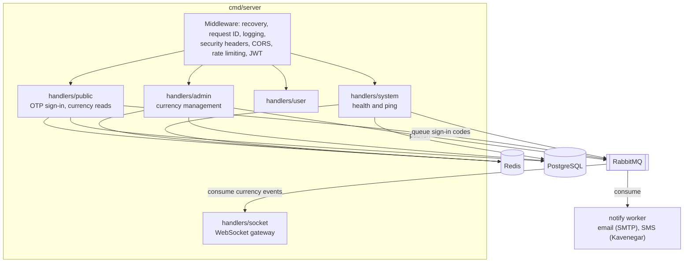
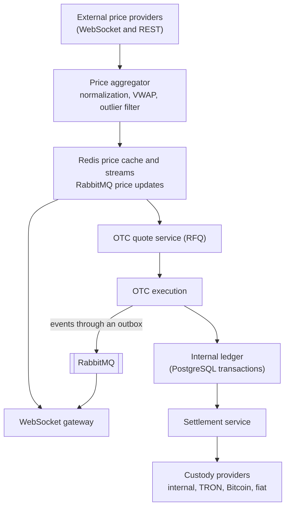

# Architecture

This document describes the current architecture on `main` and the target architecture from the roadmap.

## Current architecture

The service is a single Go binary (`cmd/server`) that serves REST and WebSocket traffic and depends on PostgreSQL, Redis, and RabbitMQ.



### Packages

| Package | Responsibility |
| --- | --- |
| `cmd/server` | Startup, route registration, graceful shutdown |
| `cmd/admin` | Command for operators: create administrators, replace their authenticator, disable them |
| `internal/adminauth` | Administrator accounts: creation, TOTP enrollment with encrypted secrets, authenticator checks with replay protection |
| `internal/totp` | Time-based one-time passwords (RFC 6238) |
| `config` | YAML loading, defaults, environment overrides (see [configuration.md](configuration.md)) |
| `internal/auth` | RS256 JWT issuing and verification with separate keys per role, `kid`-based key selection and retired keys for rotation, Redis-backed token blacklist, admin and user middleware |
| `internal/db` | PostgreSQL connection with startup retries and migrations under an advisory lock, Redis client |
| `internal/rabbitmq` | Connection and publishing with confirms. One supervisor goroutine owns the connection and the publishing channel: it reconnects after a broker restart and restores the channel after a channel-level error, while publishes wait up to five seconds for it. |
| `internal/notify` | Sign-in code delivery: the queue sender used by OTP sign-in, the worker that consumes the queue with retries and a dead-letter queue, and the SMTP and Kavenegar SMS channels |
| `internal/otp` | Sign-in codes: unbiased generation, Redis sessions with hashed codes and encrypted contacts, atomic attempt limits per code and per contact |
| `internal/handlers/*` | HTTP and WebSocket handlers. They currently contain the business logic and SQL directly ([#48](https://github.com/mdastpak/Crypto-Exchange/issues/48)). |
| `internal/middleware` | Security headers, CORS, Redis rate limiters, validation and recovery helpers |
| `internal/domain/*` | Exchange domain model (asset, market, order, trade, balance, account, kyc, custody, shared). It is not used by handlers yet. |
| `internal/models`, `internal/helpers` | API models and the response envelope |

### Request pipeline

Middleware is applied to every route, including `/` and `/swagger/*`, in this order: Gin logger; recovery, which answers a panic with `500 Internal server error` in the standard envelope and logs the details; request ID; security headers; CORS; the REST rate limiter; and the request body limit. `RouteHandler` registers it before any route, because Gin applies middleware only to the routes registered after it. Route groups add their own layers:

| Group | Additional middleware |
| --- | --- |
| `/ws` | WebSocket rate limit (applied to the upgrade request) |
| `/public` | Authentication rate limit |
| `/admin/auth` | Authentication rate limit. Admin sign-in, without a token. |
| `/admin` | `JWTAdminVerification` (Bearer access token signed with an admin key, blacklist check), `RequireActiveAdmin` (the token's administrator is still active in the database), trading rate limit |
| `/user` | `JWTUserVerification` (Bearer access token signed with a user key, blacklist check), trading rate limit |
| `POST /public/auth/logout` | `JWTUserVerification`, like `/user/logout` |

### Startup and shutdown

1. Load the configuration and the RSA key pair.
2. Connect to PostgreSQL with retries, then apply the migrations under a PostgreSQL advisory lock.
3. Connect to Redis, then to RabbitMQ, and declare the fan-out exchanges.
4. Declare the sign-in code queues and start the delivery worker, when a delivery channel is configured. Subscribe the WebSocket gateway to currency events.
5. Bring the shared currency cache in line with PostgreSQL: cache the approved currencies and remove the entries of currencies that are not approved. The cache is never cleared as a whole, because other instances serve from it.
6. Start the HTTP server (with TLS when enabled).
7. On `SIGINT` or `SIGTERM`: close WebSocket clients, shut down the HTTP server, stop the delivery worker, then close RabbitMQ, Redis, and PostgreSQL. Shared state in Redis, such as the currency cache, is left for the other instances. The intended order is tracked in [#49](https://github.com/mdastpak/Crypto-Exchange/issues/49).

## Data stores

### PostgreSQL

Migrations live in `internal/db/migrations` and are applied with golang-migrate.

| Migration | Contents | Used by code |
| --- | --- | --- |
| 1 | `currencies` (JSONB `info`, status enum) | Yes |
| 2 | `users` (JSONB `info`, status enum) | Yes |
| 3 | `assets` | Not yet |
| 4 | `markets`, `market_stats_24h` | Not yet |
| 5 | `orders`, `order_events` | Not yet |
| 6 | `trades`, `trade_events` | Not yet |
| 7 | `balances`, `balance_snapshots`, `balance_changes` | Not yet |
| 8 | Extra `users` columns, `sub_accounts`, `api_keys`, `sessions` | `sessions` only (sign-in sessions and refresh token rotation) |
| 9 | `kyc_profiles`, `kyc_documents`, `kyc_applications`, `sanctions_screenings`, `aml_rules`, `aml_alerts` | Not yet |
| 10 | `deposit_addresses`, `deposits`, `withdrawals`, `settlements`, `custody_configs` | Not yet |
| 11 | Aligns the `users.info` constraint with OTP sign-in, and adds unique indexes on contact values | Yes |
| 12 | Adds `users.role` (`user` or `admin`) and `users.totp_last_step` | Yes (admin sign-in) |
| 13 | Makes only non-empty currency contracts unique | Yes |
| 14 | Unifies the user model: contacts move from `users.info` into `user_contacts`, `users.status` becomes `account_status_type`, and `users.info` and the unused contact columns of migration 8 are dropped | Yes |

Users have one model since migration 14 ([#38](https://github.com/mdastpak/Crypto-Exchange/issues/38)):

- `users` holds the account: `hk` is the ID that every other table references, `status` is `account_status_type` (`ACTIVE`, `PENDING_VERIFICATION`, `INACTIVE`, `SUSPENDED`, `BANNED`), and `deleted_at` alone marks a deleted account.
- `user_contacts` holds the contacts: the type (`email`, `mobile`, or the legacy `username`), the value, `verified_at`, and `is_primary`. The database makes each contact value belong to one user, with emails and usernames compared case-insensitively, and allows one primary contact of each type per user.
- The Go type is `account.User`.

Currencies still use the legacy JSONB table next to the typed `assets` table. Unifying them is tracked in [#57](https://github.com/mdastpak/Crypto-Exchange/issues/57).

### Redis

| Key pattern | Purpose | Lifetime |
| --- | --- | --- |
| `base_definitions:currency:<hk>` | Cached public (approved) currency, shared by all instances | 24 hours, refreshed when an instance starts or the currency changes |
| `otp:session:<session-uuid>` | Sign-in session: HMAC of the code, encrypted contact, contact ID, and attempt count. The code and the contact are erased when its attempts are used up. | `otp.auth.ttl_seconds` |
| `otp:contact:<contact-id>:requests` | Codes issued to a contact in the current hour. The contact ID is an HMAC of the normalized contact. | 1 hour from the first code |
| `otp:contact:<contact-id>:attempts` | Verification attempts for a contact in the current hour, across all of its codes | 1 hour from the first attempt, removed by a successful sign-in |
| `blacklist:token:<sha256>` | Revoked access tokens | Until the token expires |
| `ratelimit:<scope>:<key>` | Rate-limit buckets and counters | Window-dependent |

### RabbitMQ

| Exchange or queue | Type | Purpose |
| --- | --- | --- |
| `price_updates` | Durable fan-out exchange | Currency change events today, price ticks in the future |
| `trade_events` | Durable fan-out exchange | Declared at startup for upcoming features |
| `notifications` | Durable fan-out exchange | Sign-in code jobs |
| `notifications.otp` | Durable queue bound to `notifications` | Consumed by the delivery worker. Jobs expire with the code. |
| `notifications.dead-letter`, `notifications.otp.dead-letter` | Durable fan-out exchange and queue | Records of codes that could not be delivered, without the code or the raw contact, kept for seven days |
| Server-named queue per instance | Exclusive, auto-delete queue bound to `price_updates` | WebSocket broadcast consumer. Each instance has its own queue, so every instance receives every event. The queue disappears when the instance disconnects. |

## Target architecture

The [roadmap](https://github.com/mdastpak/Crypto-Exchange/issues/85) evolves the service in phases: an automated OTC MVP, then spot trading, then derivatives. The OTC data flow is:



### Planned layering

Handlers will become thin transport adapters on top of services and repositories, wired by a composition root ([#48](https://github.com/mdastpak/Crypto-Exchange/issues/48)):

```text
transport (HTTP, WebSocket)  ->  services (business logic)  ->  repositories and publishers (PostgreSQL, Redis, RabbitMQ)
```

### Key technical decisions

| Topic | Decision |
| --- | --- |
| Monetary values | `shared.Decimal` (arbitrary precision). Never use floating point. |
| Identifiers | UUIDs, with timestamp-ordered UUIDv7 planned for orders and trades |
| Balance safety | Database transactions with row locks or optimistic versioning, plus an immutable change log ([#60](https://github.com/mdastpak/Crypto-Exchange/issues/60)) |
| Event delivery | Publisher confirms now. A transactional outbox is planned for trade events. |
| WebSocket scaling | Per-instance consumers and channel-based subscriptions ([#66](https://github.com/mdastpak/Crypto-Exchange/issues/66)) |
| Authentication | JWT for interactive users. HMAC and Ed25519 API keys for programmatic access ([#64](https://github.com/mdastpak/Crypto-Exchange/issues/64)). |
| Configuration | YAML plus environment variables, with fail-closed validation planned ([#41](https://github.com/mdastpak/Crypto-Exchange/issues/41)) |
