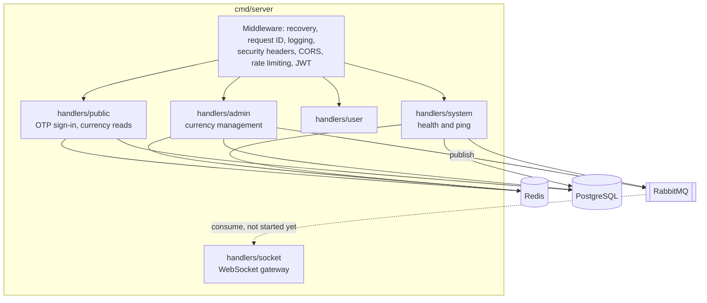
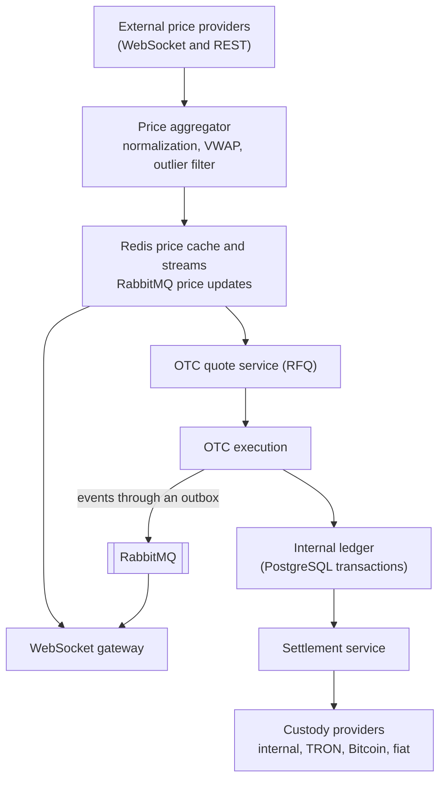

# Architecture

This document describes the current architecture on `main` and the target architecture from the roadmap.

## Current architecture

The service is a single Go binary (`cmd/server`) that serves REST and WebSocket traffic and depends on PostgreSQL, Redis, and RabbitMQ.



### Packages

| Package | Responsibility |
| --- | --- |
| `cmd/server` | Startup, route registration, graceful shutdown |
| `config` | YAML loading, defaults, environment overrides (see [configuration.md](configuration.md)) |
| `internal/auth` | RS256 JWT issuing and verification, key registry for rotation, Redis-backed token blacklist, admin and user middleware |
| `internal/db` | PostgreSQL connection with startup retries and migrations under an advisory lock, Redis client |
| `internal/rabbitmq` | Connection, publisher confirms, automatic reconnect |
| `internal/handlers/*` | HTTP and WebSocket handlers. They currently contain the business logic and SQL directly ([#48](https://github.com/mdastpak/Crypto-Exchange/issues/48)). |
| `internal/middleware` | Security headers, CORS, Redis rate limiters, validation and recovery helpers |
| `internal/domain/*` | Exchange domain model (asset, market, order, trade, balance, account, kyc, custody, shared). It is not used by handlers yet. |
| `internal/models`, `internal/helpers` | API models and the response envelope |

### Request pipeline

Middleware is applied in this order: Gin recovery, request ID, Gin logger, security headers, CORS, then the REST rate limiter. Route groups add their own layers:

| Group | Additional middleware |
| --- | --- |
| `/ws` | WebSocket rate limit (applied to the upgrade request) |
| `/public` | Authentication rate limit |
| `/admin` | `JWTAdminVerification` (role `admin`, blacklist check), trading rate limit |
| `/user` | `JWTUserVerification` (role `user` or `admin`, blacklist check), trading rate limit |

### Startup and shutdown

1. Load the configuration and the RSA key pair.
2. Connect to PostgreSQL with retries, then apply the migrations under a PostgreSQL advisory lock.
3. Connect to Redis, then to RabbitMQ, and declare the fan-out exchanges.
4. Load approved currencies from PostgreSQL into the Redis cache.
5. Start the HTTP server (with TLS when enabled).
6. On `SIGINT` or `SIGTERM`: close WebSocket clients, delete the shared currency cache ([#25](https://github.com/mdastpak/Crypto-Exchange/issues/25)), shut down the HTTP server, then close RabbitMQ, Redis, and PostgreSQL. The intended order is tracked in [#49](https://github.com/mdastpak/Crypto-Exchange/issues/49).

## Data stores

### PostgreSQL

Migrations live in `internal/db/migrations` and are applied with golang-migrate.

| Migration | Contents | Used by code |
| --- | --- | --- |
| 1 | `currencies` (JSONB `info`, status enum) | Yes |
| 2 | `users` (JSONB `info`, status enum) | Yes |
| 3 | `assets` | Not yet |
| 4 | `markets`, `market_stats_24h` | Not yet |
| 5 | `orders`, `order_events` | Not yet |
| 6 | `trades`, `trade_events` | Not yet |
| 7 | `balances`, `balance_snapshots`, `balance_changes` | Not yet |
| 8 | Extra `users` columns, `sub_accounts`, `api_keys`, `sessions` | Not yet |
| 9 | `kyc_profiles`, `kyc_documents`, `kyc_applications`, `sanctions_screenings`, `aml_rules`, `aml_alerts` | Not yet |
| 10 | `deposit_addresses`, `deposits`, `withdrawals`, `settlements`, `custody_configs` | Not yet |

Two models currently coexist: the legacy JSONB `currencies` and `users` tables used by the API, and the typed exchange schema. Unifying them is tracked in [#38](https://github.com/mdastpak/Crypto-Exchange/issues/38) (users) and [#57](https://github.com/mdastpak/Crypto-Exchange/issues/57) (currencies and assets).

### Redis

| Key pattern | Purpose | Lifetime |
| --- | --- | --- |
| `base_definitions:currency:<hk>` | Cached currency | 24 hours |
| `otp:auth:<session-uuid>:<code>` | OTP session ([#15](https://github.com/mdastpak/Crypto-Exchange/issues/15) removes the code from the key) | `otp.auth.ttl_seconds` |
| `uuid_blacklist:<session-uuid>` | Failed OTP attempts | Up to 24 hours |
| `blacklist:token:<sha256>` | Revoked access tokens | Until the token expires |
| `ratelimit:<scope>:<key>` | Rate-limit buckets and counters | Window-dependent |

### RabbitMQ

| Exchange or queue | Type | Purpose |
| --- | --- | --- |
| `price_updates` | Durable fan-out exchange | Currency change events today, price ticks in the future |
| `trade_events`, `notifications` | Durable fan-out exchanges | Declared at startup for upcoming features |
| `ws_price_updates` | Durable queue bound to `price_updates` | WebSocket broadcast consumer ([#19](https://github.com/mdastpak/Crypto-Exchange/issues/19)) |

## Target architecture

The [roadmap](https://github.com/mdastpak/Crypto-Exchange/issues/85) evolves the service in phases: an automated OTC MVP, then spot trading, then derivatives. The OTC data flow is:



### Planned layering

Handlers will become thin transport adapters on top of services and repositories, wired by a composition root ([#48](https://github.com/mdastpak/Crypto-Exchange/issues/48)):

```text
transport (HTTP, WebSocket)  ->  services (business logic)  ->  repositories and publishers (PostgreSQL, Redis, RabbitMQ)
```

### Key technical decisions

| Topic | Decision |
| --- | --- |
| Monetary values | `shared.Decimal` (arbitrary precision). Never use floating point. |
| Identifiers | UUIDs, with timestamp-ordered UUIDv7 planned for orders and trades |
| Balance safety | Database transactions with row locks or optimistic versioning, plus an immutable change log ([#60](https://github.com/mdastpak/Crypto-Exchange/issues/60)) |
| Event delivery | Publisher confirms now. A transactional outbox is planned for trade events. |
| WebSocket scaling | Per-instance consumers and channel-based subscriptions ([#66](https://github.com/mdastpak/Crypto-Exchange/issues/66)) |
| Authentication | JWT for interactive users. HMAC and Ed25519 API keys for programmatic access ([#64](https://github.com/mdastpak/Crypto-Exchange/issues/64)). |
| Configuration | YAML plus environment variables, with fail-closed validation planned ([#41](https://github.com/mdastpak/Crypto-Exchange/issues/41)) |
