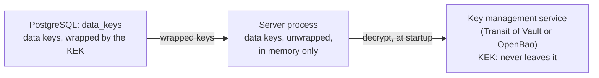

# Data protection

A crypto exchange holds identity documents and money, so access to its database must not be enough to read personal data or to change protected rows unnoticed. That covers a database administrator, a leaked backup, a replica, and an SQL injection. Three pieces work toward this:

| Piece | Status |
| --- | --- |
| Key management: data-protection keys wrapped by a key-encryption key (KEK) in a key management service | Implemented ([#138](https://github.com/mdastpak/Crypto-Exchange/issues/138)), described here |
| Row seals: a keyed MAC over each protected row, so that a change made outside the backend is detected | Planned ([#139](https://github.com/mdastpak/Crypto-Exchange/issues/139)) |
| Field encryption: personal, identity, and financial fields stored as ciphertext, with blind indexes for lookups | Planned ([#140](https://github.com/mdastpak/Crypto-Exchange/issues/140)) |

The first use is the secret of HMAC API keys, which is stored sealed with a `field-enc` key ([#45](https://github.com/mdastpak/Crypto-Exchange/issues/45)). The API does not issue API keys yet ([#63](https://github.com/mdastpak/Crypto-Exchange/issues/63)). Until it does, and until row seals and field encryption land, the server loads the keys when a provider is configured, and only logs a warning when none is.

## Key hierarchy



- **The KEK** stays in the key management service. The server can ask the service to encrypt and decrypt with it, but can never read it.
- **Data keys** are 32 random bytes each, generated by the server. They are stored in the `data_keys` table, wrapped (encrypted) by the KEK, so the table alone holds no usable key. The server unwraps them once at startup and keeps them in memory. It never logs them, writes them anywhere, or prints them: a key prints as `row-mac/v2`.

| Purpose | Algorithm | Used by |
| --- | --- | --- |
| `row-mac` | HMAC-SHA-256 | Row seals ([#139](https://github.com/mdastpak/Crypto-Exchange/issues/139)) |
| `field-enc` | AES-256-GCM | Field encryption ([#140](https://github.com/mdastpak/Crypto-Exchange/issues/140)), and the secrets of HMAC API keys (`api_keys.secret_sealed`) |
| `blind-index` | HMAC-SHA-256 | Equality lookups of encrypted values ([#140](https://github.com/mdastpak/Crypto-Exchange/issues/140)) |

Every key has one purpose and only offers the operation of that purpose. A MAC key cannot encrypt, and an encryption key cannot seal.

### The `data_keys` table

| Column | Description |
| --- | --- |
| `purpose`, `version` | The primary key. Versions start at 1. |
| `kek_id` | The KEK that wrapped the key, such as `transit:transit/crypto-exchange-data-keys` or `local:<fingerprint>` |
| `wrapped_key` | The key, wrapped by the KEK. With Transit, a `vault:v<n>:` ciphertext. |
| `created_at`, `retired_at` | A retired key is no longer loaded. |

The wrapped plaintext contains the purpose and the version besides the key. After unwrapping, the server checks that both match the row, so a wrapped key copied to another row is refused. For example, copying a MAC key into the row of the current encryption key does not work.

### Sealed values

`Keyring.SealField` encrypts a value with the current `field-enc` key. It stores the key version in decimal, a colon, a random 96-bit nonce, and the AES-256-GCM ciphertext with its tag. The associated data names the value's place, so a sealed value copied to another row or column does not decrypt. For API key secrets, that place is `api_keys.secret_sealed:<key ID>`. `Keyring.OpenField` finds the key by the stored version, so values sealed before a rotation stay readable until that version is retired.

### Versions

New seals and ciphertexts use the current version of their purpose: the newest one that is not retired. Each seal and ciphertext stores the version it used, so older versions stay readable after a rotation until they are retired.

### At startup

The server:

1. builds the provider from the [`keys`](configuration.md#keys) settings. Release mode refuses the `local` provider and a Transit address without `https`.
2. creates version 1 of every purpose that has no key yet. This happens on the first start of a deployment, and instances that start at the same time create one key between them.
3. unwraps every key that is not retired.

It refuses to start when any of the following holds:

- a key was wrapped by another KEK than the configured one;
- a key does not unwrap;
- a key belongs to another row;
- the newest version of a purpose is retired, which the key commands never do.

The key management service is only needed at startup and by the `admin keys` commands. A running server keeps working while the service is unavailable.

## Setup

### Production: Transit of HashiCorp Vault or OpenBao

The `vault` commands below work the same with `bao`, the OpenBao CLI.

1. Enable the Transit engine and create a key for the data keys. `deletion_allowed` is `false` by default; keep it so.

   ```bash
   vault secrets enable transit
   vault write -f transit/keys/crypto-exchange-data-keys type=aes256-gcm96
   ```

2. Create a policy that may only encrypt and decrypt with that key, never read, export, rotate, or delete it:

   ```hcl
   path "transit/encrypt/crypto-exchange-data-keys" {
     capabilities = ["update"]
   }
   path "transit/decrypt/crypto-exchange-data-keys" {
     capabilities = ["update"]
   }
   ```

3. Give the server a token with that policy. Prefer Vault Agent (or OpenBao Agent) with an auth method such as AppRole or Kubernetes. It writes a token file and renews the token in place, so set `KEYS_TRANSIT_TOKEN_FILE`, which is read on every request. A plain token in `VAULT_TOKEN` works too.

4. Configure the server and the `admin` command:

   ```bash
   KEYS_PROVIDER=transit
   VAULT_ADDR=https://vault.internal:8200
   KEYS_TRANSIT_KEY=crypto-exchange-data-keys
   KEYS_TRANSIT_TOKEN_FILE=/run/vault/token   # or VAULT_TOKEN
   VAULT_CACERT=/run/vault/ca.pem             # if the server's CA is not a system CA
   ```

   On its next start, the server creates the data keys, and `admin keys list` shows them.

Every encrypt and decrypt request appears in the audit log of Vault or OpenBao. Enable an audit device there, so that every unwrap of the data keys is recorded outside the exchange's database.

### Development: the local provider

```bash
KEYS_PROVIDER=local
KEYS_LOCAL_KEK=$(openssl rand -base64 32)
```

The KEK is in the environment, so whoever reads it can unwrap every data key. Release mode refuses `local`. Keep the same KEK for a database, or the server refuses to start with a message that names both KEKs.

## Operations

The `admin` command in the image runs the key commands. They read the same configuration as the server and never print a key. In the Compose stack:

```bash
docker compose run --rm --no-deps --entrypoint /app/admin app -config config/config.compose.yaml keys list
```

| Command | What it does |
| --- | --- |
| `keys list` | Purpose, version, state (`current`, `readable`, or `retired`), KEK, creation time, and retirement time of every key |
| `keys rotate -purpose <purpose>` | Creates the next version of one purpose |
| `keys retire -purpose <purpose> -version <n>` | Stops loading one version. The newest version cannot be retired. |
| `keys rewrap` | Unwraps every key, including retired ones, and wraps it again with the newest version of the KEK. The keys themselves do not change. |

Every change, and the creation of the first keys by the server, records a `data_key.*` event in the audit log, in its transaction, with the key's purpose, version, and KEK, never the key. Pass `-operator <name>` before the command to name yourself in the event ([#195](https://github.com/mdastpak/Crypto-Exchange/issues/195)).

### Rotating a data key

Rotate a data key on a schedule, such as once a year, and whenever it may have leaked.

1. Run `admin keys rotate -purpose field-enc`.
2. Restart the server instances one by one. Each instance uses the new version after its restart. Until then, it writes with the older version, which stays valid.
3. Once the background jobs of [#139](https://github.com/mdastpak/Crypto-Exchange/issues/139) and [#140](https://github.com/mdastpak/Crypto-Exchange/issues/140) have re-sealed or re-encrypted every row, run `admin keys retire -purpose field-enc -version 1`, and restart the instances again. Never retire a version that data still uses: that data can then no longer be checked or read.

Rotating a `blind-index` key also needs a second index during the change ([#140](https://github.com/mdastpak/Crypto-Exchange/issues/140)).

### Rotating the KEK

Rotating the KEK needs no restart, because the data keys do not change.

1. Rotate the Transit key: `vault write -f transit/keys/crypto-exchange-data-keys/rotate`.
2. Run `admin keys rewrap`. Every wrapped key now starts with the new KEK version, such as `vault:v2:`.
3. Stop the old KEK version from decrypting: `vault write transit/keys/crypto-exchange-data-keys/config min_decryption_version=2`.

The token of `admin keys rewrap` needs both `encrypt` and `decrypt`.

### Losing the KEK

If the Transit key is deleted, or the storage of Vault or OpenBao is lost without a backup, the wrapped data keys can never be unwrapped again. The server then refuses to start. Sealed rows can no longer be checked, and encrypted fields can no longer be read: that data is lost. There is deliberately no command that exports the unwrapped keys. To prevent this:

- keep `deletion_allowed` off for the key;
- back up the storage of Vault or OpenBao, encrypted, apart from the database backups;
- limit who may change the key's configuration.

### Suspected leaks

| What leaked | What to do |
| --- | --- |
| The server's Transit token | Revoke it (`vault token revoke`), issue a new one, and restart the servers with it. Check the audit log of Vault or OpenBao for decrypt requests that the servers did not make. If whoever had the token also had the `data_keys` table, they could unwrap the data keys: handle it as a leak of the data keys. |
| A data key, for example through a memory dump | Rotate its purpose, let the background jobs re-seal or re-encrypt the rows, and then retire the leaked version. |
| The KEK, or the key management service itself | Rotate the KEK and re-wrap, as above. Then rotate every data key, since whoever had the KEK could unwrap them. |
| `KEYS_LOCAL_KEK` (development) | Development data only: create a new database with a new KEK. |

## Limits

- **Write access to the database.** Someone who can only write to the database cannot read the data keys or forge them. They can still delete or change rows of `data_keys`. Most such changes make the server refuse to start; the others cause failures, not forgeries:
  - deleting the newest version silently makes an older version current;
  - deleting every version of a purpose makes the server create a new key, and data protected with the old key fails its checks.

  Allow only the application's database role to write to `data_keys`, and watch `admin keys list`. The audit log ([#51](https://github.com/mdastpak/Crypto-Exchange/issues/51)) will record key changes.
- **Process memory.** The unwrapped keys live in process memory. Disable core dumps in production (`ulimit -c 0`; containers have none by default), and do not attach debuggers to production processes.
- **Other secrets.** `otp.auth.secret` and `admin.totp_key` are still secrets of their own, configured directly. Moving them onto these keys is [#146](https://github.com/mdastpak/Crypto-Exchange/issues/146).
- **Other key services.** Only Transit is implemented. AWS KMS, Google Cloud KMS, and Azure Key Vault fit the same `keys.Provider` interface.
- **Reloading.** Instances pick up a rotation only when they restart.
