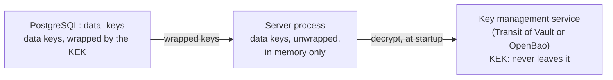

# Data protection

A crypto exchange holds identity documents and money, so access to its database must not be enough to read personal data or to change protected rows unnoticed. That covers a database administrator, a leaked backup, a replica, and an SQL injection. Three pieces work toward this:

| Piece | Status |
| --- | --- |
| Key management: data-protection keys wrapped by a key-encryption key (KEK) in a key management service | Implemented ([#138](https://github.com/mdastpak/Crypto-Exchange/issues/138)), described here |
| Row seals: a keyed MAC over each protected row, so that a change made outside the backend is detected | First step implemented ([#139](https://github.com/mdastpak/Crypto-Exchange/issues/139)): accounts, contacts, and sessions; see [row seals](#row-seals) |
| Field encryption: personal, identity, and financial fields stored as ciphertext, with blind indexes for lookups | Planned ([#140](https://github.com/mdastpak/Crypto-Exchange/issues/140)) |

The data keys also protect the authenticator secrets of administrators (`users.totp_secret`, sealed with `field-enc`) and the sign-in codes in Redis (`otp-mac`), and nothing else does: no secret in the configuration can read or write either. Release mode therefore refuses to start without `keys.provider`. In development without it, sign-in codes are protected by a random secret of the process, so only that process verifies them, and admin sign-in is disabled. The first use was the secret of HMAC API keys, which is stored sealed with a `field-enc` key ([#45](https://github.com/mdastpak/Crypto-Exchange/issues/45)). The API does not issue API keys yet ([#63](https://github.com/mdastpak/Crypto-Exchange/issues/63)). Until it does, and until field encryption lands, the server loads the keys when a provider is configured; without keys, which only development allows, rows are not sealed.

## Key hierarchy



- **The KEK** stays in the key management service. The server can ask the service to encrypt and decrypt with it, but can never read it.
- **Data keys** are 32 random bytes each, generated by the server. They are stored in the `data_keys` table, wrapped (encrypted) by the KEK, so the table alone holds no usable key. The server unwraps them once at startup and keeps them in memory. It never logs them, writes them anywhere, or prints them: a key prints as `row-mac/v2`.

| Purpose | Algorithm | Used by |
| --- | --- | --- |
| `row-mac` | HMAC-SHA-256 | Row seals ([#139](https://github.com/mdastpak/Crypto-Exchange/issues/139)) |
| `field-enc` | AES-256-GCM | Field encryption ([#140](https://github.com/mdastpak/Crypto-Exchange/issues/140)), the secrets of HMAC API keys (`api_keys.secret_sealed`), and verified national IDs (`user_national_ids.national_id_sealed`, [#253](https://github.com/mdastpak/Crypto-Exchange/issues/253)) |
| `blind-index` | HMAC-SHA-256 | Equality lookups of encrypted values ([#140](https://github.com/mdastpak/Crypto-Exchange/issues/140)) |
| `otp-mac` | HMAC-SHA-256 | Sign-in codes in Redis ([#146](https://github.com/mdastpak/Crypto-Exchange/issues/146)): the root from which the HMAC key of codes, contacts, and clients and the AES-256-GCM key of contacts are derived, each with a label of its own. Each session stores the version that protects it. |
| `audit-mac` | HMAC-SHA-256 | The seals of [audit events](#audit-events) ([#337](https://github.com/mdastpak/Crypto-Exchange/issues/337)). A purpose of its own, since events are never sealed again: a version that seals an event stays readable for good, while `row-mac` keeps its rotate, re-seal, and retire cycle. |

Every key has one purpose and only offers the operation of that purpose. A MAC key cannot encrypt, and an encryption key cannot seal.

### The `data_keys` table

| Column | Description |
| --- | --- |
| `purpose`, `version` | The primary key. Versions start at 1. |
| `kek_id` | The KEK that wrapped the key, such as `transit:transit/crypto-exchange-data-keys` or `local:<fingerprint>` |
| `wrapped_key` | The key, wrapped by the KEK. With Transit, a `vault:v<n>:` ciphertext. |
| `created_at`, `retired_at` | A retired key is no longer loaded. |
| `active_from` | When the version starts writing ([#233](https://github.com/mdastpak/Crypto-Exchange/issues/233)). Until then, instances only read with it. The first version of a purpose is active at once. |

The wrapped plaintext contains the purpose and the version besides the key. After unwrapping, the server checks that both match the row, so a wrapped key copied to another row is refused. For example, copying a MAC key into the row of the current encryption key does not work.

### Sealed values

`Keyring.SealField` encrypts a value with the current `field-enc` key. It stores the key version in decimal, a colon, a random 96-bit nonce, and the AES-256-GCM ciphertext with its tag. The associated data names the value's place, so a sealed value copied to another row or column does not decrypt. For API key secrets, that place is `api_keys.secret_sealed:<key ID>`, for national IDs `user_national_ids.national_id_sealed:<user hk>`, for the authenticator secrets of administrators `users.totp_secret:<admin hk>`, and for those of users `user_totp.secret_sealed:<user hk>`. An authenticator secret is stored as `v1:`, which marks the format, and the sealed value in base64. `Keyring.OpenField` finds the key by the stored version, so values sealed before a rotation stay readable until that version is retired.

### Versions

New seals and ciphertexts use the current version of their purpose: the newest one that is not retired and whose `active_from` has passed. A newer version that is not active yet is already loaded, so data that another instance writes with it once it is active can be read. Each seal and ciphertext stores the version it used, so older versions stay readable after a rotation until they are retired.

### At startup

The server:

1. builds the provider from the [`keys`](configuration.md#keys) settings. Release mode refuses a missing provider, the `local` provider, and a Transit address without `https`.
2. creates version 1 of every purpose that has no key yet. This happens on the first start of a deployment, and instances that start at the same time create one key between them.
3. unwraps every key that is not retired.

It refuses to start when any of the following holds:

- a key was wrapped by another KEK than the configured one;
- a key does not unwrap;
- a key belongs to another row;
- the newest version of a purpose is retired, which the key commands never do.

Afterwards it checks `data_keys` every `keys.reload_interval_seconds` (60 by default), and loads the keys again when a row changed: a rotation, a retirement, or a re-wrap. A value sealed with a version it has not loaded makes it reload at once, at most every 5 seconds. A reload that fails keeps the keys loaded before and is logged, so a running server keeps working while the key management service is unavailable; it needs the service only at startup, after a change of `data_keys`, and for the `admin keys` commands.

## Row seals

A row seal is an HMAC-SHA-256, with the current `row-mac` key, over the protected columns of a row ([#139](https://github.com/mdastpak/Crypto-Exchange/issues/139)). The backend seals each row it writes, in the transaction of the write, and checks the seal where it reads the row to decide something. A change made outside the backend, such as an `UPDATE` by someone with database access or an SQL injection, does not carry a valid seal, because only the backend has the key. The first step covers the tables that decide who signs in to which account and with what rights:

| Table | Columns sealed | Checked when |
| --- | --- | --- |
| `users` | `status`, `role`, `deleted_at`, `totp_secret`, `totp_enabled`, `security_hold_until`, `kyc_status`, `kyc_tier`, the names, and `password_set_at` ([the record of the password](#records-of-rows)) | every signed-in request (the session check), user sign-in, admin sign-in and its TOTP check, and every read of whether the account has a password |
| `user_contacts` | `user_hk`, `type`, `value`, `is_primary`, `verified_at`, `removed_at`, `ownership_checked_at` | user sign-in, which finds the account by the contact |
| `sessions` | `user_id`, `status`, the times, the three token hashes | every signed-in request and every refresh |
| `user_passwords` | `password_hash`, `changed_at` | the second step of a sign-in, and a change of the password |
| `user_passkeys` | `user_hk`, `credential_id`, `credential`, `removed_at` | every proof of a passkey, and its list; a row that does not match is left out |

Columns that the backend writes on its own often, such as `sessions.last_used_at`, are not sealed. Each of the tables has three columns for it: `row_version`, which every sealing write increments, `row_seal`, and `seal_key_version`, the version of the `row-mac` key. The MAC covers the table, the key, the version, and each column in a canonical, length-prefixed text, with times in UTC, so a seal does not depend on the session settings of the database, and a seal cannot be copied to another row or column.

A column added to a sealed table later, such as `users.password_set_at`, is *optional*: while it is NULL it is left out of the MAC, so the seals made before it existed still match, and no migration has to write a value that the database could not seal. Once it has a value, the seal covers it, and setting it back to NULL no longer matches.

### Records of rows

A seal shows a row that was changed, never one that was deleted. Where deleting a row would weaken an account, a sealed row records that it exists ([#337](https://github.com/mdastpak/Crypto-Exchange/issues/337)):

- **The account password.** `users.password_set_at` is set, in the transaction that gives an account its password, and covered by the seal of `users`. The password is the second step of the sign-in, and the factor that the [operations it protects](api.md#second-factor-and-step-up) ask for. Before the record, deleting the `user_passwords` row in SQL let a code alone sign in, and let a stolen session set a password without the current one.
- **The check.** Every read of whether an account has a password (the sign-in, the guard, and the routes that set a password, an authenticator, or a passkey) checks the seal of `users`, and compares the record with the row. A record without its row is a `row_missing` [finding](#integrity-findings) on `user_passwords`. In `enforce` mode the account is then refused, as for a row that does not match: the sign-in answers `403 account_unavailable`, and so do the protected routes. In `report` mode the account is served as one without a password, as `report` mode serves every row that fails its check.
- **The verifier** looks for records without their row on every pass, and records them as findings in both modes. `report` mode cannot seal a row that is not there. The finding stays until the row is restored from a backup; a re-seal of it resolves it as `row_gone`, and the next read finds the record without its row again.
- **The rows written before migration 12** have no record, and their seals still match. The record is written the next time the password is proved, at a sign-in or a step-up, or changed. A migration cannot write it: a value written outside the backend would not match the seal.

The authenticator and the passkeys are alternatives to the password, which stays required, so deleting their rows takes nothing away from the second step.

### Audit events

`audit_events` is sealed too ([#337](https://github.com/mdastpak/Crypto-Exchange/issues/337), migration 11), over every column of an event, with the same encoding and the `audit-mac` key. Its rows never change: triggers refuse `UPDATE` and `DELETE`, and nothing re-seals them. So `audit.Record` seals each event in its `INSERT`, at `row_version` 0. One query before the insert returns the canonical text of the columns, in the form that a read returns, and the time of the event, which the insert then writes.

The admin query of the log (`GET /api/v1/admin/audit`) checks each event it returns, and reports its `integrity`:

| Integrity | Meaning |
| --- | --- |
| `verified` | The event matches its seal. |
| `mismatch` | The event does not match its seal, or its seal names a key version that does not exist. Only a change made outside the backend causes either, for example with the triggers turned off; the server also logs a `SECURITY` line. |
| `unsealed` | The event has no seal: it was written before migration 11, or without data keys. |
| `unchecked` | The event is sealed, but this instance cannot check it: it has no data keys, or the key service did not answer. |

An event that fails is not recorded as an integrity finding: a finding is resolved by a re-seal, which an event cannot have. The verifier does not walk the events yet.

An `audit-mac` version that seals audit events must stay readable, since the events are never sealed again: `admin keys retire` refuses it. Rotate `audit-mac` like any key; new events take the new version, and the older ones keep theirs. The server creates the first `audit-mac` key at its first start after migration 11; until then, and in `cmd/admin` before that start, events are written without a seal.

### Modes

`keys.row_seals.mode` (`KEYS_ROW_SEALS_MODE`) decides what a row without a valid seal does:

- `report` (the default) records an [integrity finding](#integrity-findings) and serves the row. Use it while rolling out, since rows written before the release, or by an instance of the previous release, have no seal yet.
- `enforce` records the finding and refuses the row until an administrator re-seals the row: a session that fails answers `401`, like a revoked one, and a sign-in or request of an account or contact that fails answers `403`, like a disabled account. Enforce needs `keys.provider`.

Rows are sealed only when the server has data keys (`keys.provider` set). To roll out:

1. Deploy the release with `report`. Every instance seals what it writes from then on.
2. The verifier (below) seals every row that has no valid seal yet, and resolves its finding as `report_mode`. Wait until every instance runs the release and one verifier pass has finished after that: `admin row-seals findings` shows no open finding.
3. Set `enforce` and roll it out.

Before a rollback to a release without row seals, set `report`: an older release writes rows without sealing them, and its writes would be reported once the newer release returns.

### The verifier

Every `keys.row_seals.verify_interval_minutes` (60), one instance checks every row of the protected tables, in batches of 500, under a PostgreSQL advisory lock, so that several instances do not repeat the pass; an instance that does not get the lock skips the pass. It records a finding for each row without a valid seal, and audits the first detection. In `report` mode it seals such a row and resolves the finding as `report_mode`, unless the row changed meanwhile. It also seals again every row sealed with an older `row-mac` version, so that the version can be retired after a rotation. `admin row-seals verify` runs one pass at once and prints what it checked, found, re-sealed, and rotated.

### Integrity findings

A finding names the table, the row's key, and what failed: `missing` (no seal), `mismatch`, `unknown_key` (a key version the server does not have), or `row_missing` (a row that a sealed [record](#records-of-rows) says exists, and that is gone). A row has at most one open finding; each new detection, on a read or by the verifier, increments its `seen_count`. The first detection is audited as `integrity.seal_mismatch`.

An administrator checks the row, for example against the audit log and backups, and then either fixes it or confirms it:

- `admin row-seals findings [-all] [-limit n]`, or `GET /api/v1/admin/integrity/findings`, lists the findings, newest first.
- `POST /api/v1/admin/integrity/findings/{id}/reseal` with `{"reason": "…"}` seals the row as it now is and resolves the finding as `resealed`, or as `row_gone` if the row no longer exists. It takes two administrators ([#308](https://github.com/mdastpak/Crypto-Exchange/issues/308)): one asks, with the reason, and another approves with the same request within 24 hours. The one who asked cannot approve, and the administrator whose account the row belongs to can do neither, so nobody accepts a change of their own alone. It records `integrity.reseal_request`, and `integrity.reseal` with both reasons, who asked, and the sealed values, secret columns shown as `[secret]`.
- `admin row-seals reseal -id N -reason TEXT` does it in one step, for the operator, who holds the data keys and the database anyway, and for an installation with one administrator.

Re-sealing makes a row valid as it is, so re-seal only a row that is right. A row that someone changed must be fixed first, through the backend or in SQL followed by a re-seal.

### Limits of row seals

- **Replay.** Someone with write access to the database can put back an older version of a row with its seal, such as a session from before its revocation, and the seal matches. A later step of #139 detects that, with a hash-chained log of the seals.
- **Deleting rows.** Deleting a row leaves no seal to check. The verifier does not see it, except for the rows that a [record](#records-of-rows) names: the account password. Removing the seal of an audit event makes it look `unsealed`, and deleting the event leaves nothing to check.
- **Other tables.** KYC records, balances, and the ledger are not sealed yet; they follow in later steps of #139. Neither are the tables of the second factors, recoveries, step-ups, and admin sessions ([#337](https://github.com/mdastpak/Crypto-Exchange/issues/337)).
- **The operator.** A re-seal through the API needs two administrators, but `cmd/admin` needs one operator: whoever holds the data keys and a database role that writes can seal any row.

## Setup

### Production: Transit of HashiCorp Vault or OpenBao

The `vault` commands below work the same with `bao`, the OpenBao CLI.

1. Enable the Transit engine and create a key for the data keys. `deletion_allowed` is `false` by default; keep it so.

   ```bash
   vault secrets enable transit
   vault write -f transit/keys/crypto-exchange-data-keys type=aes256-gcm96
   ```

2. Create a policy that may only encrypt and decrypt with that key, never read, export, rotate, or delete it:

   ```hcl
   path "transit/encrypt/crypto-exchange-data-keys" {
     capabilities = ["update"]
   }
   path "transit/decrypt/crypto-exchange-data-keys" {
     capabilities = ["update"]
   }
   ```

3. Give the server a token with that policy. Prefer Vault Agent (or OpenBao Agent) with an auth method such as AppRole or Kubernetes. It writes a token file and renews the token in place, so set `KEYS_TRANSIT_TOKEN_FILE`, which is read on every request. A plain token in `VAULT_TOKEN` works too.

4. Configure the server and the `admin` command:

   ```bash
   KEYS_PROVIDER=transit
   VAULT_ADDR=https://vault.internal:8200
   KEYS_TRANSIT_KEY=crypto-exchange-data-keys
   KEYS_TRANSIT_TOKEN_FILE=/run/vault/token   # or VAULT_TOKEN
   VAULT_CACERT=/run/vault/ca.pem             # if the server's CA is not a system CA
   ```

   On its next start, the server creates the data keys, and `admin keys list` shows them.

Every encrypt and decrypt request appears in the audit log of Vault or OpenBao. Enable an audit device there, so that every unwrap of the data keys is recorded outside the exchange's database.

### Development: the local provider

```bash
KEYS_PROVIDER=local
KEYS_LOCAL_KEK=$(openssl rand -base64 32)
```

The KEK is in the environment, so whoever reads it can unwrap every data key. Release mode refuses `local`. Keep the same KEK for a database, or the server refuses to start with a message that names both KEKs.

## Operations

The `admin` command in the image runs the key commands. They read the same configuration as the server and never print a key. In the Compose stack:

```bash
docker compose run --rm --no-deps --entrypoint /app/admin app -config config/config.compose.yaml keys list
```

| Command | What it does |
| --- | --- |
| `keys list` | Purpose, version, state (`current`, `readable`, or `retired`), KEK, creation time, and retirement time of every key |
| `keys rotate -purpose <purpose>` | Creates the next version of one purpose |
| `keys retire -purpose <purpose> -version <n>` | Stops loading one version. The newest version cannot be retired, nor a version that still seals rows: a `row-mac` version until the verifier has moved the rows of the sealed tables, and an `audit-mac` version that seals an event, for good. |
| `keys rewrap` | Unwraps every key, including retired ones, and wraps it again with the newest version of the KEK. The keys themselves do not change. |

Every change, and the creation of the first keys by the server, records a `data_key.*` event in the audit log, in its transaction, with the key's purpose, version, and KEK, never the key. Pass `-operator <name>` before the command to name yourself in the event ([#195](https://github.com/mdastpak/Crypto-Exchange/issues/195)).

### Rotating a data key

Rotate a data key on a schedule, such as once a year, and whenever it may have leaked. A rotation needs no restart. It has two phases, so that no instance writes with a version that another instance cannot read yet ([#233](https://github.com/mdastpak/Crypto-Exchange/issues/233)):

1. Run `admin keys rotate -purpose field-enc`, with the same `keys` settings as the servers. It writes the new version with `active_from` set `keys.activation_delay_seconds` (300 by default) ahead, and prints that time.
2. **Phase 1: every instance learns the version.** Within `keys.reload_interval_seconds`, every instance loads it and can read values sealed with it. An instance started meanwhile loads it at startup. `admin keys list` shows the version as `pending`.
3. **Phase 2: every instance writes with it.** From `active_from`, every instance seals with the new version, which the others already read. `admin keys list` shows it as `current`. The activation delay must be at least twice the reload interval, which the server checks at startup, so an instance whose reload failed once still loads the version in time.
4. Once the background jobs have re-sealed or re-encrypted every row, run `admin keys retire -purpose field-enc -version 1`. The instances drop it at their next reload. Never retire a version that data still uses: that data can then no longer be checked or read. `retire` refuses the version that writes, until the newer version is active.

If an instance cannot load the new version, because it cannot reach the key management service, it keeps writing with the older version, which every instance still reads, and logs the failure.

For `row-mac`, the [verifier](#the-verifier) re-seals the rows: run `admin row-seals verify` after the activation, check that it reports no finding, and then retire the older version; `retire` refuses it while a row still uses it. An `audit-mac` version that sealed [audit events](#audit-events) stays readable: `retire` refuses it. Field encryption ([#140](https://github.com/mdastpak/Crypto-Exchange/issues/140)) will re-encrypt its rows in the same way.

Rotating a `blind-index` key also needs a second index during the change ([#140](https://github.com/mdastpak/Crypto-Exchange/issues/140)).

Rotating `otp-mac` needs no re-encryption: the sessions it protects live for `otp.auth.ttl_seconds`, and each names its version, so the codes pending at the activation still verify. The per-contact limits of sign-in are counted under an ID that the key computes, so they start again at the activation, once per rotation. Retire the older version after `otp.auth.ttl_seconds`.

### Rotating the KEK

Rotating the KEK needs no restart, because the data keys do not change. The instances load the re-wrapped keys at their next reload.

1. Rotate the Transit key: `vault write -f transit/keys/crypto-exchange-data-keys/rotate`.
2. Run `admin keys rewrap`. Every wrapped key now starts with the new KEK version, such as `vault:v2:`.
3. Stop the old KEK version from decrypting: `vault write transit/keys/crypto-exchange-data-keys/config min_decryption_version=2`.

The token of `admin keys rewrap` needs both `encrypt` and `decrypt`.

### Losing the KEK

If the Transit key is deleted, or the storage of Vault or OpenBao is lost without a backup, the wrapped data keys can never be unwrapped again. The server then refuses to start. Sealed rows can no longer be checked, and encrypted fields can no longer be read: that data is lost. There is deliberately no command that exports the unwrapped keys. To prevent this:

- keep `deletion_allowed` off for the key;
- back up the storage of Vault or OpenBao, encrypted, apart from the database backups, and check that each database backup unwraps with its KEK backup with `admin restore verify -keys` ([disaster-recovery.md](disaster-recovery.md));
- limit who may change the key's configuration.

### Suspected leaks

| What leaked | What to do |
| --- | --- |
| The server's Transit token | Revoke it (`vault token revoke`), issue a new one, and restart the servers with it. Check the audit log of Vault or OpenBao for decrypt requests that the servers did not make. If whoever had the token also had the `data_keys` table, they could unwrap the data keys: handle it as a leak of the data keys. |
| A data key, for example through a memory dump | Rotate its purpose, let the background jobs re-seal or re-encrypt the rows, and then retire the leaked version. A leaked `audit-mac` version stays readable to check the events that it sealed, but whoever has it can forge their seals: trust those events only as far as a copy kept outside the database confirms them. |
| The KEK, or the key management service itself | Rotate the KEK and re-wrap, as above. Then rotate every data key, since whoever had the KEK could unwrap them. |
| `KEYS_LOCAL_KEK` (development) | Development data only: create a new database with a new KEK. |

## Limits

- **Write access to the database.** Someone who can only write to the database cannot read the data keys or forge them. They can still delete or change rows of `data_keys`. Most such changes make the server refuse to start; the others cause failures, not forgeries:
  - deleting the newest version silently makes an older version current;
  - deleting every version of a purpose makes the server create a new key, and data protected with the old key fails its checks.

  Allow only the application's database role to write to `data_keys`, and watch `admin keys list`. The audit log ([#51](https://github.com/mdastpak/Crypto-Exchange/issues/51)) will record key changes.
- **Process memory.** The unwrapped keys live in process memory. Disable core dumps in production (`ulimit -c 0`; containers have none by default), and do not attach debuggers to production processes.
- **Other key services.** Only Transit is implemented. AWS KMS, Google Cloud KMS, and Azure Key Vault fit the same `keys.Provider` interface.
- **Reloading.** Instances pick up a change of `data_keys` within `keys.reload_interval_seconds`. A change of the `keys` settings themselves, such as a new KEK provider, still needs a restart.
